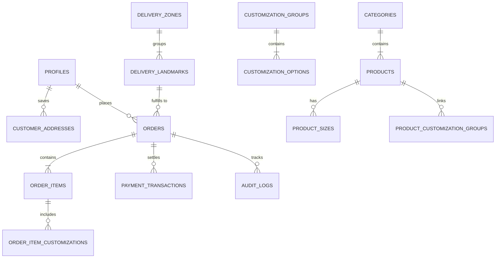

# PostgreSQL Database Specification & Schema: AY Pizza

**Project:** AY Pizza Production-Ready Mobile Ordering System  
**Phase:** Phase 2: Product Catalog Browsing, Customizer Engine & Local Cart  
**Target:** PostgreSQL 15+ / Supabase  
**Date:** October 2026  
**Status:** Hardened, Migrated & Tested  

---

## 1. Schema Overview

The AY Pizza database architecture enforces data integrity, strict referential constraints, database-driven pricing, and Row-Level Security (RLS) across every table. All order totals, item customizations, and landmark fees are verified authoritatively on the server.

---

## 2. Table Catalog & RLS Security Rules

### 2.1 Identity & Access
| Table Name | Primary Key | Description | Hardened RLS Policy |
| :--- | :--- | :--- | :--- |
| `public.profiles` | `id` (UUID references `auth.users`) | Extended user profile data and assigned role (`customer`, `staff`, `admin`, `rider`). | Users can view/update own. **Anti-escalation trigger `prevent_role_self_escalation()` blocks modifying `role` column without admin privileges.** |

### 2.2 Product Catalog & Customization (Provisional Seed Data)
*Note: All seeded prices and options are provisional reverse-engineered estimates pending restaurant owner sign-off. They can be updated at any time by administrators via SQL or management UI.*

| Table Name | Primary Key | Description | Hardened RLS Policy |
| :--- | :--- | :--- | :--- |
| `public.categories` | `id` (UUID) | Root menu categories (`pizza`, `icecream`, `fastfood`, `drinks`). | Public read active; Staff/Admin manage. |
| `public.products` | `id` (UUID) | Products with `base_price` (provisional) and `is_available` stock toggle. | Public read; Staff/Admin manage. |
| `public.product_sizes` | `id` (UUID) | Tiered size adders (Regular, Standard, Large, Queen, King). | Public read; Staff/Admin manage. |
| `public.customization_groups` | `id` (UUID) | Topping groups with selection bounds (`min_selections`, `max_selections`, `category_slug`). | Public read; Staff/Admin manage. |
| `public.customization_options` | `id` (UUID) | Specific add-on options with additional price. | Public read; Staff/Admin manage. |
| `public.product_customization_groups` | `(product_id, group_id)` | Product-to-customization group mapping. | Public read; Staff/Admin manage. |

### 2.3 Logistics & Delivery (Provisional Landmarks)
*Note: Landmark rates (e.g. UNILAG ₦500, Akoka ₦1,000, Surulere ₦3,500) are provisional estimates pending owner confirmation.*

| Table Name | Primary Key | Description | Hardened RLS Policy |
| :--- | :--- | :--- | :--- |
| `public.delivery_zones` | `id` (UUID) | Geographic delivery sectors (UNILAG Campus, Mainland Near, Mid, Far). | Public read active; Admin manage. |
| `public.delivery_landmarks` | `id` (UUID) | 19 provisional delivery landmarks with delivery fees. | Public read active; Admin manage. |
| `public.customer_addresses` | `id` (UUID) | Saved hostel rooms or off-campus delivery addresses. | Users manage own (`auth.uid() = customer_id`). |

### 2.4 Orders & Financial Records
| Table Name | Primary Key | Description | Hardened RLS Policy |
| :--- | :--- | :--- | :--- |
| `public.orders` | `id` (UUID) | Authoritative order header with financial snapshots. | **Locked:** Direct INSERT strictly requires `status = 'PENDING_PAYMENT'`. Customer ID bound to `auth.uid()` or NULL for guests. |
| `public.order_items` | `id` (UUID) | Snapshot of items ordered with base and size prices. | **Locked:** Can only be inserted if attached to a valid, pending parent order owned by caller. |
| `public.order_item_customizations` | `id` (UUID) | Snapshot of selected toppings/flavors with price adders. | **Locked:** Traversal check enforces parent order ownership. Public cannot view or insert orphaned customizations. |
| `public.payment_transactions` | `id` (UUID) | Paystack transaction logs and verification responses. | Users view own transactions; Insert restricted to trusted server/webhooks. |
| `public.audit_logs` | `id` (UUID) | Tamper-evident log of status updates and administrative changes. | **Strictly Immutable:** `reject_audit_tampering()` trigger aborts any UPDATE or DELETE. |

---

## 3. Database Migration Sequence

1. `20261021000001_initial_schema.sql`: 15 core tables, enums, sequences, triggers, and baseline RLS policies (including `product_customization_groups`).
2. `20261021000002_seed_ay_pizza.sql`: Provisional seed data (13 unique pizza varieties deduplicated from 14 legacy records, sizes, toppings, desserts, 19 landmarks).
3. `20261021000003_security_and_integrity_fixes.sql`: Anti-escalation trigger `prevent_role_self_escalation()`, audit tampering trigger `reject_audit_tampering()`, strict RLS child traversal, and authoritative order procedure `create_order_authoritative()`.
4. `20261021000004_catalog_customization_links.sql`: Links all pizzas to extra toppings and half-and-half groups; links desserts to flavor and dessert topping groups. Explicitly granted `SELECT` on `product_customization_groups` to `authenticated` and `anon` roles with RLS enabled.
5. `20261021000005_phase3_checkout_and_paystack.sql`: Adds cryptographic `receipt_token` to `orders`, establishes strict zero-direct-client-insert RLS policy on `orders`, `order_items`, and `order_item_customizations`, hardens `create_order_authoritative()` with `search_path = public, pg_temp` and concurrency-safe unique constraint violation recovery, and adds `get_order_by_receipt()` and `settle_order_payment()`.
6. `20261021000006_phase3_1_security_verification.sql`: Security and integrity hardening:
   - Revokes `EXECUTE` on `settle_order_payment` from `PUBLIC, anon, authenticated`; grants strictly to `service_role`.
   - Replaces plaintext `receipt_token` with SHA-256 `receipt_token_hash` at rest.
   - Enforces relational validation in `create_order_authoritative()`: size must belong to product or category (`ps.product_id = v_prod.id OR ps.category_slug = v_prod.category_slug`), customization options must belong to groups assigned to the product via `product_customization_groups`, and options must be active.
   - Restricts Half & Half customization strictly to `pizza` category.
   - Detects and flags duplicate successful charges on settled orders (`DUPLICATE_PAYMENT_DETECTED`).
   - Prevents reviving cancelled orders upon delayed payment arrival (`PAYMENT_RECEIVED_ON_CANCELLED_ORDER`).
7. `20261022000001_phase3_1_1_security_hardening.sql`: Replaces deterministic KDF with server CSPRNG `gen_random_bytes(32)` for receipt token generation; adds `is_available` column to `product_sizes` with default `true`.
8. `20261022000002_phase3_1_2_payment_concurrency.sql`: Payment initialization concurrency guarantees:
   - Extends `payment_status` enum with `expired`, `paid_after_cancellation`, `duplicate_success_needs_refund`.
   - Creates partial unique index `idx_single_active_initialized_payment_per_order` on `payment_transactions(order_id) WHERE status = 'initialized'`.
   - Adds `begin_or_reuse_payment_attempt(p_order_id, p_receipt_token)` with row locking (`FOR UPDATE`), 15-minute session check, and automated stale attempt cleanup.
   - Adds `record_payment_attempt(p_order_id, p_reference, p_amount_in_kobo, p_authorization_url, p_access_code, p_gateway, p_customer_email, p_metadata)` handling insertion race conditions and falling back to winning active attempt.
9. `20261022000003_phase3_1_3_payment_reservation.sql`: External payment provider race prevention & reservation lifecycle:
   - Extends `payment_status` enum with `initiating`.
   - Replaces old index with comprehensive partial unique index `idx_single_active_payment_attempt_per_order` on `payment_transactions(order_id) WHERE status IN ('initiating', 'initialized')`.
   - Re-engineers `begin_or_reuse_payment_attempt()` into a two-phase reservation lock: atomically creates an `initiating` reservation row before the Edge Function reaches Paystack, returns `RESERVATION_IN_PROGRESS` to concurrent callers, and expires stale reservations (>45s).
   - Adds `commit_payment_attempt()` transitioning `initiating` -> `initialized` upon external provider success.
   - Adds `fail_payment_reservation()` to immediately release constraint upon provider failure or timeout.
10. `20261022000004_phase3_1_4_ambiguous_outcome_recovery.sql`: Ambiguous-outcome recovery & Paystack reconciliation:
   - Extends `payment_status` enum with `requires_reconciliation`.
   - Updates partial unique index `idx_single_active_payment_attempt_per_order` to cover `WHERE status IN ('initiating', 'requires_reconciliation', 'initialized')`, preventing competing attempts while an ambiguous transaction is unverified.
   - Adds `mark_payment_ambiguous()` transitioning `initiating` -> `requires_reconciliation` upon network timeout or dropped HTTP response.
   - Adds `reconcile_payment_attempt()` resolving ambiguous transactions via external Paystack REST verification (recovered as `initialized`, confirmed not found as `failed`, or settled as `success`).
   - Hardens `begin_or_reuse_payment_attempt()`: stale reservations (>45s) transition to `requires_reconciliation` instead of being blindly discarded, and ambiguous transactions return `action = 'RECONCILIATION_REQUIRED'`.

---

## 4. Stored Procedures & Server Functions

### `create_order_authoritative(p_fulfillment_type, p_landmark_id, p_delivery_address, p_delivery_notes, p_guest_email, p_guest_phone, p_guest_name, p_idempotency_key, p_items)`
- **Execution Environment:** PostgreSQL Server (`SECURITY DEFINER`, `SET search_path = public, pg_temp`).
- **Functionality:**
  - Idempotency check: Reuses existing pending order if idempotency key matches (handles concurrent `unique_violation`).
  - Generates unguessable 256-bit `receipt_token` derived deterministically from idempotency key and server salt via HMAC-SHA256.
  - Stores only the SHA-256 `receipt_token_hash` at rest; returns plaintext token in memory to caller.
  - Re-fetches product base prices from `public.products` (validates active stock).
  - Validates size belongs to product or product category.
  - Validates customization options belong to groups linked to product via `product_customization_groups`.
  - Re-fetches customization prices from `public.customization_options` (`is_available = TRUE`).
  - Dynamically calculates Half & Half surcharges (₦1,000 for Regular/Standard; ₦1,500 for Large/Queen/King) exclusively for pizzas.
  - Resolves delivery fee from `public.delivery_landmarks` (strictly ₦0 for pickup).
  - Atomically writes `orders`, `order_items`, and `order_item_customizations`.
  - Returns `order_id`, `order_number`, `receipt_token`, `subtotal`, `delivery_fee`, `total`, and integer `total_in_kobo`.
  - Emits immutable audit log entry.

### `get_order_by_receipt(p_order_id UUID, p_receipt_token TEXT)`
- **Execution Environment:** PostgreSQL Server (`SECURITY DEFINER`, `SET search_path = public, pg_temp`).
- **Functionality:**
  - Authenticates receipt access by hashing incoming `p_receipt_token` with SHA-256 and matching against `orders.receipt_token_hash` (or authenticated owner/staff).
  - Aggregates itemized snapshot of purchased products, sizes, toppings, and line totals.
  - Returns clean receipt data without leaking tokens or hashes.
  - Prevents sequential order enumeration attacks.

### `settle_order_payment(p_order_id UUID, p_reference TEXT, p_gateway TEXT, p_amount_in_kobo BIGINT, p_channel TEXT, p_metadata JSONB)`
- **Execution Environment:** PostgreSQL Server (`SECURITY DEFINER`, `SET search_path = public, pg_temp`).
- **Authorization:** `service_role` ONLY. (`REVOKE EXECUTE ... FROM PUBLIC, anon, authenticated`).
- **Functionality:**
  - Validates payment amount in kobo matches `ROUND(orders.total * 100)`.
  - Cancelled order defense: If order is `CANCELLED`, records transaction as `paid_after_cancellation` and logs `PAYMENT_RECEIVED_ON_CANCELLED_ORDER` for immediate manual merchant refund. Does not revive order.
  - Duplicate payment defense: If order is already `CONFIRMED` and same reference is received, returns `already_settled: true` idempotently. If a *different* reference arrives with successful payment, records transaction as `duplicate_success_needs_refund` and logs `DUPLICATE_PAYMENT_DETECTED`.
  - Transitions order status to `CONFIRMED` and logs payment transaction.
  - Emits immutable audit log entry.

### `begin_or_reuse_payment_attempt(p_order_id UUID, p_receipt_token TEXT)`
- **Execution Environment:** PostgreSQL Server (`SECURITY DEFINER`, `SET search_path = public, pg_temp`).
- **Authorization:** `service_role` ONLY.
- **Functionality:**
  - Locks the target order row via `SELECT ... FOR UPDATE` to serialize concurrent checkout flows.
  - Validates guest receipt token against `orders.receipt_token_hash`.
  - Rejects attempts if order is already `CONFIRMED`, `PAID`, etc. (raises `P0002`) or `CANCELLED` (raises `P0003`).
  - Checks existing `initialized` transaction:
    - If created <15 minutes ago, returns existing Paystack reference and authorization URL (`action = 'REUSE_ACTIVE'`).
    - If created >=15 minutes ago, marks stale transaction as `status = 'expired'`, freeing the partial unique index, and returns `action = 'CREATE_NEW'`.

### `record_payment_attempt(p_order_id UUID, p_reference TEXT, p_amount_in_kobo BIGINT, ...)`
- **Execution Environment:** PostgreSQL Server (`SECURITY DEFINER`, `SET search_path = public, pg_temp`).
- **Authorization:** `service_role` ONLY.
- **Functionality:**
  - Atomically inserts the new Paystack payment transaction.
  - If a concurrent race condition triggers `unique_violation` against `idx_single_active_initialized_payment_per_order`, catches the error and selects the winning active transaction, ensuring no orphaned records and guaranteed caller synchronization.

---

## 4. Phase 4.1 KDS Database Extensions

### 4.1 Schema Additions (`20261022000005_phase4_1_kds_and_staff_operations.sql`)
1. **Enums:**
   - `order_status`: Extended with `'ACCEPTED'`.
   - `user_role`: Extended with `'kitchen'`, `'counter'`, and `'manager'`.
2. **Operational Columns on `public.orders`:**
   - `rejection_reason TEXT`
   - `accepted_at TIMESTAMPTZ`
   - `prepared_at TIMESTAMPTZ`
   - `ready_at TIMESTAMPTZ`
   - `completed_at TIMESTAMPTZ`
   - `staff_notes TEXT`
   - `assigned_staff_id UUID REFERENCES public.profiles(id)`
3. **Index:**
   - `idx_orders_kds_status` on `(status, created_at DESC)` for active KDS statuses.

### 4.2 RPC: `transition_order_status(p_order_id, p_target_status, p_reason, p_notes, p_expected_current_status)`
- **Execution Environment:** PostgreSQL Server (`SECURITY DEFINER`).
- **Authorization:** `kitchen`, `counter`, `staff`, `manager`, `admin`, or `service_role`.
- **Concurrency Control:** Serializes state transitions using `SELECT ... FOR UPDATE`.
- **Validation:** Enforces state machine rules, blocks unpaid order processing, requires non-empty rejection reasons for cancellations, and catches race conditions via `p_expected_current_status`.
- **Audit Logging:** Inserts an immutable entry into `public.audit_logs` recording previous status, target status, user ID, staff role, and timestamps.

### 4.3 RPC: `get_kds_orders(p_statuses)`
- **Execution Environment:** PostgreSQL Server (`SECURITY DEFINER`).
- **Authorization:** Staff and Admin roles only.
- **Functionality:** Aggregates active orders with nested items, customizations, half-and-half selections, and delivery landmarks, ordered by `created_at ASC` to prioritize older tickets.

### 4.4 Phase 4.1.1 Adversarial Hardening (`20261022000006_phase4_1_1_adversarial_hardening.sql`)
1. **Schema Enhancements on `public.orders`:**
   - `version INT NOT NULL DEFAULT 1`: Monotonic counter incremented on each status mutation for distributed Realtime event ordering and stale event rejection.
   - `refund_status TEXT CHECK (refund_status IN ('NOT_APPLICABLE', 'REFUND_REQUIRED', 'REFUND_PENDING', 'REFUNDED')) DEFAULT 'NOT_APPLICABLE'`: Explicit tracking of cancellation refund liability.
2. **Hardened RPC Authorization:**
   - `transition_order_status` & `get_kds_orders`:
     - Revoked `EXECUTE` from `PUBLIC` and `anon`.
     - Granted strictly to `authenticated` and `service_role`.
     - Rejects unauthenticated callers with `UNAUTHENTICATED`.
     - Rejects `customer` and `rider` callers with `FORBIDDEN`.
3. **Workflow & State Machine Enforcement in DB:**
   - Prohibits `kitchen` from cancelling/rejecting or confirming delivery.
   - Prohibits `counter` from initiating oven preparation (`PREPARING`).
   - Pickup orders cannot transition to `IN_TRANSIT`.
   - Delivery orders cannot transition directly from `READY_FOR_PICKUP` to `DELIVERED` without passing through `IN_TRANSIT`.
   - Paid orders that are cancelled/rejected automatically transition to `refund_status = 'REFUND_REQUIRED'` and log `KDS_ORDER_CANCELLED_REFUND_REQUIRED`.

