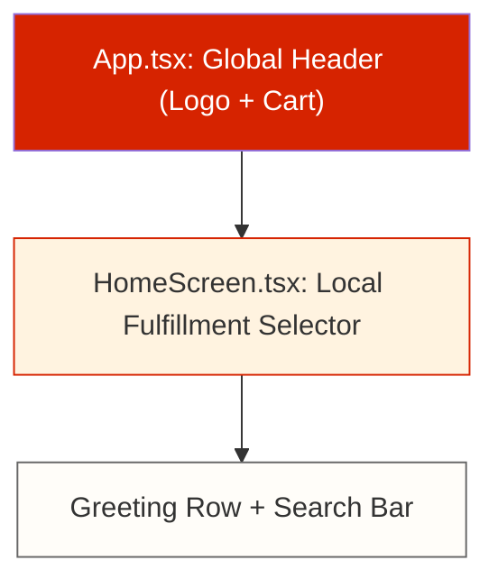
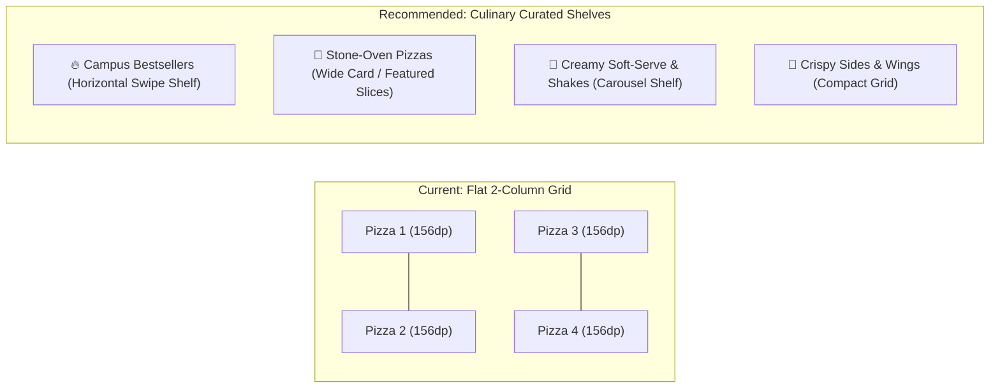

# AY PIZZA & ICE CREAM — HOMEPAGE DESIGN-GAP REPORT

**Date:** 2026-11-05  
**Audit Target:** `src/components/HomeScreen.tsx`, `src/components/CategoryBar.tsx`, `App.tsx`  
**Milestone Reference:** Phase 5.5-4 Specification vs Current Implementation  
**Quality Baseline:** 42 Test Suites Passing | 651 Tests Passing | TypeScript 0 Errors | Expo Doctor 20/20  

---

## 1. Executive Summary & Audit Context

Following physical device and user feedback during Phase 5.5 customer testing, a thorough audit was conducted on the mobile application's homepage and product discovery architecture. While automated unit and snapshot tests passed, real customer interaction revealed visual and structural gaps between the existing implementation in `HomeScreen.tsx` and the premium, appetite-stimulating, campus-first food ordering experience envisioned in Phase 5.5-4.

This report documents the architectural, visual, and UX discrepancies currently present on the homepage, examines screen real-estate constraints on standard 360dp Android displays, and outlines concrete recommendations for a distinctive pizza-brand redesign.

---

## 2. Above-the-Fold Vertical Budget on 360dp Displays

On standard Android devices (360dp viewport width, 640–800dp usable vertical viewport height minus system bars and bottom navigation bar), the vertical budget above the fold is **~600–660dp**. 

### Current Vertical Stack Before First Food Product:

| Element | Height (dp) | Accumulated Height (dp) | Issues Observed |
| :--- | :--- | :--- | :--- |
| **Global App Header** (`App.tsx`) | ~68dp | 68dp | AY Pizza logo, status badges, cart button |
| **Local Fulfillment Container** (`HomeScreen.tsx`) | ~110dp | 178dp | Duplicate delivery/pickup toggle & landmark selector |
| **Greeting & Kitchen Status Header** | ~60dp | 238dp | "Hello, Tunde 👋" + "Kitchen Open" |
| **Search Input Bar** | ~56dp | 294dp | Search pizzas, shakes, toppings... |
| **Active Order Live Strip** (when order active) | ~72dp | 366dp | Real-time baking/tracking card |
| **Hero Promotional Banner Carousel** | ~218dp | 584dp | Hero card (200dp) + margin (18dp) |
| **Category Header & Scroller** | ~92dp | 676dp | "Explore Categories" header (46dp) + chip scroll (46dp) |
| **Catalog Title Row** | ~40dp | 716dp | "Popular Right Now 🔥" |

> [!WARNING]
> **Above-the-Fold Deficit:**  
> On a 360dp device, the accumulated vertical height reaches **716dp** before the customer sees a single pizza or ice cream card. The customer is forced to swipe 1.5 to 2 full viewport screens simply to discover food items.

---

## 3. Section-by-Section Design-Gap Audit

### 3.1 Header & Delivery Location Area

#### Identified Gaps:
1. **Double Header Redundancy:**
   - `App.tsx` renders a sticky top navigation bar with the Concept 3 logo, kitchen status, and cart button.
   - `HomeScreen.tsx` immediately renders a large fulfillment box with its own Delivery/Pickup switch and landmark dropdown.
   - This duplication divides the customer's attention and creates visual clutter.
2. **Sprawling Landmark Card:**
   - The delivery address block currently uses 3 separate text rows, taking up excessive vertical space.
   - Needs a sleek, two-line address summary (e.g. `📍 Delivery to King Jaja Hall` / `₦700 delivery fee • 25–35 mins`) with an inline "Change" pill.

---

### 3.2 Promotional Banner Carousel

#### Current Implementation:
- Implements `DEFAULT_PROMO_SLIDES` with stone-oven, campus delivery, and shakes cards.
- Background image set to `opacity: 0.65` with a dark tint overlay: `backgroundColor: 'rgba(39, 33, 31, 0.48)'`.
- Small pill badges and subtitle text overlay.

#### Identified Gaps:
1. **Muted Food Photography:**
   - Applying `opacity: 0.65` combined with an opacity scrim makes the artisan pizza and creamy milkshake images look dark, flat, and unappealing.
   - Food photography requires bright, high-saturation, high-contrast presentation to stimulate appetite.
2. **Overloaded Text Overlay:**
   - The banner attempts to cram 5 text elements (primary badge, secondary badge, title, two-line subtitle, and action button) into a 200dp box.
   - On 360dp devices, text overlaps or crowds the edges, reducing legibility.
3. **Card Dimension & Bleed:**
   - The banner is boxed with margin instead of offering a modern edge-to-edge or peek-carousel experience (where 10–15% of the next card is visible to afford swiping).

---

### 3.3 Menu Category Navigation

#### Current Implementation:
- Horizontal chip scroller featuring canonical slugs and normalized aliases (`'all'`, `'pizza'`, `'icecream'`, `'fastfood'` / `'sides'`, `'drinks'`).
- Integrated touch target: `minHeight: 40` + `hitSlop` (48dp total touch area).

#### Identified Gaps:
1. **Visual Separation:**
   - In `HomeScreen.tsx`, categories are preceded by an "Explore Categories" header text row, adding unnecessary vertical height.
   - When scrolling down, the category bar scrolls off-screen. Customers wanting to switch from Pizza to Drinks must scroll all the way back to the top.
2. **Category Chip Aesthetics:**
   - Currently uses flat pill buttons with small emojis (`🍕`, `🍨`, `🍔`, `🥤`).
   - Lacks distinctive culinary branding—such as custom food iconography or subtle warm glowing active rings.

---

### 3.4 Product Discovery & Grid Layout

#### Identified Gaps:
1. **Flat 2-Column Grid Bottleneck:**
   - Currently, all products are dumped into a single 2-column grid (`numColumns={2}`).
   - On 360dp viewports, each card has only **~156dp width**.
   - In 156dp width, a product card must fit:
     - 130dp square image
     - Culinary badges ("Spicy 🌶️", "Vegetarian 🌱")
     - Product title ("Sweet Chili Chicken Pizza" = 3 lines)
     - Description snippet
     - Size price chips
     - "Customize / Add" button
   - This leads to severe vertical height variance between cards in the same row, awkward button misalignment, and visual noise.
2. **Lack of Curated Food Shelves:**
   - Top food-delivery applications organize items into appetizing shelves:
     - **🔥 Campus Favorites** (wide cards with prominent photography and quick-add)
     - **🍕 Fresh From The Stone-Oven** (customizable pizza showcase with half-and-half prompt)
     - **🍨 Shakes & Soft-Serve Swirls** (vibrant dessert cards)
     - **🍗 Sides & Quick Bites** (fast campus fuel)
   - The current flat catalog lacks this culinary storytelling.

---

### 3.5 Brand Warmth & Sensory Appetite Appeal

#### Identified Gaps:
1. **Generic eCommerce vs Artisan Pizzeria:**
   - The current color palette leans heavily on stark white backgrounds (`Colors.cardWhite`) and standard gray borders (`Colors.borderLight`).
   - AY Pizza's brand identity is built on stone ovens, proofed dough rolled daily, melted mozzarella, and campus energy.
   - The UI lacks warm crust undertones (`#FFF8F0`, warm parchment, terracotta accents) and culinary micro-details (e.g. "Oven-fresh in 15 mins", "100% Real Dairy").
2. **Call-to-Action Clarity:**
   - "Add to Cart" vs "Customize": Pizzas require crust and topping selection, whereas drinks and water can be added directly with one tap.
   - Currently, cards do not clearly differentiate items requiring multi-step customisation from instant quick-add items.

---

## 4. Prioritised Recommendations for Homepage Redesign

| Priority | Feature / Area | Recommended Change | Impact |
| :--- | :--- | :--- | :--- |
| **P0** | **Header Consolidation** | Merge `App.tsx` global header and `HomeScreen` fulfillment selector into a compact unified header. Display 2-line address (`📍 King Jaja Hall • ₦700`) with quick switch. Saves ~90dp above the fold. | Eliminates header duplication and brings food into immediate view. |
| **P0** | **Appetizing Hero Banner** | Remove 0.65 opacity and dark scrim. Use full-vibrancy food photography with a bottom gradient fade. Reduce text clutter to single punchy headline and action button. | High visual impact, instant appetite appeal. |
| **P1** | **Curated Food Shelves** | Introduce horizontal scroll shelves for "🔥 Campus Bestsellers" (card width 240dp) with large photo and one-tap customizer. | Solves 156dp cramped grid issue and boosts discovery. |
| **P1** | **Sticky / Compact Category Bar** | Keep CategoryBar easily accessible, sticky below the header when scrolling, allowing instant category hopping without scrolling to the top. | Seamless navigation across Pizza, Ice Cream, Sides, and Drinks. |
| **P2** | **Culinary Color Harmonisation** | Integrate subtle warm cream dough tones (`#FFF9F2`), warm terracotta borders, and crisp cheese-golden badges (`#F5A623`). | Distinctive AY Pizza identity that feels like a real pizzeria. |
| **P2** | **Direct Quick-Add vs Customize** | Show "+ Add" button for simple items (Drinks, Waters) and "Customize ⚙️" for configurable items (Pizzas, Shakes). | Reduces friction for quick beverage orders. |

---

## 5. Architectural Implementation Plan

### Phase A: Header & Above-The-Fold Compression
- Consolidate location indicator into top 48dp header bar.
- Streamline greeting: single line "Fresh Oven-Baked • Welcome to AY Pizza 🍕".
- Search bar reduced to 44dp height with integrated filter icon.

### Phase B: Hero Carousel Overhaul
- Update `DEFAULT_PROMO_SLIDES` styling:
  - Full-color image with subtle linear gradient overlay (`transparent` to `rgba(20, 10, 5, 0.75)` at bottom only).
  - Bold white typography on the bottom gradient.
  - Floating pill badge at top right (`⚡ Campus Hot`).

### Phase C: Hybrid Shelf + Grid Layout
- **Shelf 1:** `Campus Bestsellers` — Horizontal `ScrollView` of 240dp cards featuring high-res studio photography (`FoodImages.bbqChicken`, `FoodImages.pepperoni`, `FoodImages.milkshake`).
- **Shelf 2:** `Category Filtered Catalog` — Responsive cards formatted cleanly with uniform card heights and explicit "Customize" / "Quick Add" actions.

---

## 6. Verification & Quality Safeguards

All upcoming homepage redesign steps must adhere to the strict quality baseline:
1. `npx tsc --noEmit` must report 0 errors.
2. `npx expo lint` must report 0 errors.
3. All 42 Jest test suites (651 tests) must remain green.
4. Concept 3 logo and all 23 food photography assets must remain intact.
5. Authoritative pricing, delivery landmark tariffs, and checkout engines must remain untouched.

