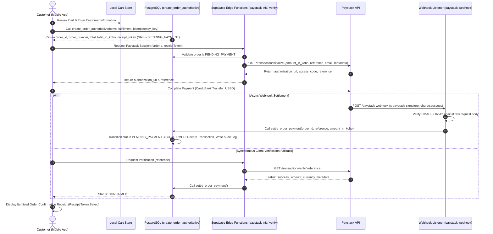

# Paystack Payment Gateway & Transaction Specification: AY Pizza

**Project:** AY Pizza Production-Ready Mobile Ordering System  
**Phase:** Phase 3: Checkout, Order Creation & Paystack Payment Integration  
**Payment Gateway:** Paystack API v1  
**Currency:** Nigerian Naira (NGN), Integer Kobo (`NGN * 100`)  
**Date:** October 2026  
**Status:** Implemented, Hardened & Verified  

---

## 1. Executive Summary & Security Principles

The AY Pizza payment architecture implements server-authoritative financial processing. Under no circumstances does the customer mobile application dictate or submit payment amounts, unit prices, delivery charges, or transaction success statuses.

### Core Security Tenets
1. **Zero-Trust Pricing:** The mobile client calculates local estimates for user experience only. The final, authoritative transaction total is calculated exclusively by the PostgreSQL database function `create_order_authoritative()`.
2. **Strict Secret Isolation:** The Paystack Secret Key (`PAYSTACK_SECRET_KEY`) is stored strictly in server-side environment variables (Supabase Edge Functions / Vault) and is never compiled into or accessible from the Expo mobile client application.
3. **Integer Kobo Precision:** All monetary amounts sent to Paystack are converted to integer kobo (`Math.round(amount * 100)`). No floating-point division or fractional kobo are permitted in payment requests.
4. **Independent Server Verification:** A client-side WebView redirect, mobile callback, or screenshot is never accepted as proof of payment. Payment confirmation requires independent server-to-server verification via Paystack's REST API or authenticated HMAC-SHA512 webhooks.
5. **State Machine Separation:** Payment status (`payment_status`) and Order Fulfillment status (`order_status`) are separate state machines. Successful payment confirms the order into the kitchen pipeline, but does not mark it as completed or delivered.

---

## 2. Architecture Overview



---

## 3. Environment Configuration

### 3.1 Client Mobile App (.env)
| Variable | Visibility | Description | Example |
| :--- | :--- | :--- | :--- |
| `EXPO_PUBLIC_SUPABASE_URL` | Client Public | Supabase REST/RPC endpoint | `https://your-project.supabase.co` |
| `EXPO_PUBLIC_SUPABASE_ANON_KEY` | Client Public | Supabase publishable anonymous key | `eyJhbGciOi...` |
| `EXPO_PUBLIC_PAYSTACK_PUBLIC_KEY` | Client Public | Paystack public key for client checkout identification | `pk_live_...` or `pk_test_...` |
| `EXPO_PUBLIC_APP_ENV` | Client Public | Environment tier (`development`, `staging`, `production`) | `production` |

### 3.2 Server-Side Environment (Supabase Edge Functions / Secrets)
| Variable | Visibility | Description | Confidentiality |
| :--- | :--- | :--- | :--- |
| `SUPABASE_SERVICE_ROLE_KEY` | Server Secret | High-privilege key for database RPC & settlement execution | **STRICT SECRET** |
| `PAYSTACK_SECRET_KEY` | Server Secret | Paystack secret key for initialization & HMAC signature verification | **STRICT SECRET** |

---

## 4. Payment Provider Abstraction

To ensure modularity and avoid vendor lock-in, the application integrates through a strict TypeScript provider interface:

```typescript
export interface PaymentProvider {
  readonly gatewayName: string;
  initializePayment(params: PaymentInitializationParams): Promise<PaymentInitializationResult>;
  verifyPayment(reference: string): Promise<PaymentVerificationResult>;
}
```

The concrete implementation [PaystackProvider](file:///c:/Users/Ososanwo%20Idris/Documents/AY%20PIZZA%20MOBILE/src/domains/payment/paystack-provider.ts) handles NGN kobo normalization, reference formatting (`ay_ord_<order_number>_<timestamp>`), and connects to Supabase Edge Functions.

---

## 5. Transaction Lifecycle & State Machines

### 5.1 Payment Transaction Statuses (`payment_status`)
- `initialized`: Transaction session generated; payment pending customer action.
- `pending`: Transaction submitted to payment processor; awaiting settlement.
- `success`: Payment confirmed, authenticated, and settled.
- `failed`: Payment declined by issuer, expired, or insufficient funds.
- `reversed`: Payment refunded or reversed back to customer account.

### 5.2 Order Fulfillment Statuses (`order_status`)
- `DRAFT`: Local shopping cart.
- `PENDING_PAYMENT`: Authoritative order created in PostgreSQL; awaiting financial settlement.
- `CONFIRMED`: Payment verified by Paystack; order accepted into restaurant ledger.
- `ACCEPTED`: Kitchen staff has acknowledged order on Kitchen Display System (Phase 4).
- `PREPARING`: Pizza is actively in preparation or baking in oven.
- `READY_FOR_PICKUP`: Pizza boxed and waiting at King Jaja Hall pickup counter.
- `IN_TRANSIT`: Rider has departed with delivery order on campus.
- `DELIVERED`: Order received by customer at designated landmark / room.
- `CANCELLED`: Order cancelled before preparation; payment subject to refund.

### 5.3 Anti-Regression Rules
In `public.settle_order_payment()`:
- If an order has already transitioned to `CONFIRMED`, `PAID`, `PREPARING`, `READY_FOR_PICKUP`, `IN_TRANSIT`, or `DELIVERED`, an incoming duplicate or delayed webhook event cannot revert or change the order status.
- Idempotent calls return `{ success: true, already_settled: true }` without throwing errors or creating duplicate payment transactions.

---

## 6. Webhook Security & Dual-Verification Architecture

The webhook endpoint (`supabase/functions/paystack-webhook/index.ts`) adheres to Paystack's official cryptographic security requirements and adds server-authoritative dual-verification:

1. **Header Verification:** Inspects `x-paystack-signature`. Missing signatures return `401 Unauthorized`.
2. **Raw Body Integrity:** Reads raw request body as string before parsing JSON to prevent formatting or whitespace alterations.
3. **HMAC Computation:** Computes `HMAC-SHA512` of the raw request body using `PAYSTACK_SECRET_KEY`.
4. **Timing-Safe Comparison (`timingSafeEqual`):** Compares computed hex digest with `x-paystack-signature` using a constant-time XOR comparison to prevent timing side-channel attacks.
5. **Dual-Verification with Paystack REST API:** Before database settlement, the webhook independently invokes `GET https://api.paystack.co/transaction/verify/:reference` using `PAYSTACK_SECRET_KEY`. It confirms that the Paystack transaction status is `success`, the amount matches the order total in kobo, currency is `NGN`, and `order_id` in metadata matches.
6. **Privilege-Restricted Settlement:** Settles through `settle_order_payment()` executed strictly via `service_role` (execution revoked from `anon` and `authenticated`).

---

## 7. Guest Checkout Security & Hashed Receipt Tokens at Rest

To support UNILAG students ordering quickly without mandatory account registration:
- Orders placed as guest have `customer_id = NULL`, but capture `guest_name`, `guest_phone`, and optional `guest_email`.
- **CSPRNG Hashed Tokens at Rest:** Rather than storing plaintext bearer tokens in the database, the server generates a cryptographically random 256-bit token via `gen_random_bytes(32)` (`v_receipt_token := encode(gen_random_bytes(32), 'hex')`) and stores only its SHA-256 hash at rest (`orders.receipt_token_hash`).
- **Zero Token Leakage:** The RPC `get_order_by_receipt(p_order_id, p_receipt_token)` computes the SHA-256 digest of the client-supplied token and matches against `receipt_token_hash`. The database response returns only receipt presentation fields; no token or hash is reflected back.
- **Hardware-Backed Device Storage (Phase 3.1.2 & 3.1.3):** Guest receipt credentials are saved on-device using Expo SecureStore (`GuestReceiptStore`) under hardware-protected keys (`ay_pizza_guest_receipt_${orderId}`). Tokens are never written to unencrypted `AsyncStorage` and are never emitted in console logs, URLs, or analytics. Master-index operations are serialized with an async mutex queue (`withIndexLock`).
- **Credential Retention & Pruning:** Delivered and `CANCELLED` orders are strictly retained in SecureStore so customers maintain access to order records, cancellation reasons, and refund notices. Pruning only occurs upon explicit customer dismissal or FIFO max-20 storage capacity.
- **Lost Initial Response (Scenario A vs Scenario B):**
  - **Scenario A:** Customer received the token, but closed or restarted the app. Local `GuestReceiptStore.getReceipt(orderId)` restores access immediately.
  - **Scenario B:** Order created on server, but network dropped before token reached device. Local recovery is impossible because the device never received the token. Server-side phone-number OTP recovery protocol is evaluated and required in production.

---

## 8. Failure Recovery & Concurrency Defenses

| Failure Scenario | Defensive Architecture |
| :--- | :--- |
| **Simultaneous Checkout Clicks** | Client-generated `idempotency_key` with unique database constraint. Second request catches `unique_violation` and returns existing pending order. |
| **External Payment Provider Race Condition** | Two-phase database reservation: Worker atomically creates row with `status = 'initiating'` before contacting Paystack. Partial unique index `idx_single_active_payment_attempt_per_order` on `payment_transactions(order_id) WHERE status IN ('initiating', 'requires_reconciliation', 'initialized')` prevents concurrent workers from calling Paystack. |
| **Concurrent Workers During Initialization** | Subsequent workers receive `action = 'RESERVATION_IN_PROGRESS'` and poll for the winning worker to commit the session, receiving the same Paystack authorization URL without creating duplicate external transactions. |
| **Provider Timeout or Dropped HTTP Response** | Worker calls `mark_payment_ambiguous()`, transitioning transaction to `status = 'requires_reconciliation'`. The original reference is preserved and reconciled via `GET /transaction/verify/:reference` before any replacement reference can be generated. |
| **Worker Crash Before Commit** | Stale `initiating` reservation transitions to `status = 'requires_reconciliation'` after 45 seconds (`reconcile_reason: 'reservation_timeout'`). Subsequent requests verify and recover the session. |
| **Payment Initialization Sprawl** | `begin_or_reuse_payment_attempt` reuses active initialized payment attempt created within 15 minutes (`action = 'REUSE_ACTIVE'`), avoiding multiple pending references and duplicate charges. |
| **Expired Payment Session (>15 Mins)** | Stale initialized transaction is automatically transitioned to `status = 'expired'`, releasing the partial unique index and allowing a clean new attempt (`action = 'CREATE_NEW'`). |
| **Attempt to Pay Already Settled Order** | `begin_or_reuse_payment_attempt` rejects initialization (throws `P0002`) if order status is already `CONFIRMED`, `PAID`, `PREPARING`, `READY_FOR_PICKUP`, `IN_TRANSIT`, or `DELIVERED`. |
| **Attempt to Pay Cancelled Order** | `begin_or_reuse_payment_attempt` rejects initialization (throws `P0003`) if order status is `CANCELLED`. |
| **Network Timeout During Payment** | Payment status is queried independently via `GET /transaction/verify/:reference` upon app reconnect. |
| **App Closed During Paystack Modal** | Webhook independently verifies and confirms order. When customer reopens app, receipt loads via cached receipt token restored from SecureStore. |
| **Lost Initial Response (Scenario B)** | Honest customer notice displayed in UI; order requires confirmation email or server-side phone OTP recovery. |
| **Price Tampering Attack** | Client estimate is compared against `create_order_authoritative()` total. Discrepancy > ₦0.01 throws `AuthoritativePriceDiscrepancyError`. |
| **Customization Injection Attack** | Database validates that every option ID belongs to a group assigned to that specific product or category via `product_customization_groups`. |
| **Cross-Product Size Manipulation** | Database verifies that `size_id` belongs to the selected product or its category. |
| **Second Successful Charge (Multi-Charge)** | If a second successful payment arrives with a different reference for an already settled order, `settle_order_payment` records the transaction as `duplicate_success_needs_refund` and logs `DUPLICATE_PAYMENT_DETECTED` in `audit_logs` for manual merchant reconciliation. |
| **Payment on Cancelled Order** | Payment received for an order with status `CANCELLED` is recorded as `paid_after_cancellation` and logs `PAYMENT_RECEIVED_ON_CANCELLED_ORDER`. The order status remains `CANCELLED` (kitchen order is NOT revived) and staff are alerted to issue a refund on Paystack. |
| **Delayed Failure Webhook** | Anti-regression check in `settle_order_payment()` prevents late webhooks from overriding active kitchen orders. |

---

## 9. Sandbox Testing & Production Readiness Checklist

### Sandbox Testing (Development Mode)
- In development shells or automated test suites, `PaystackProvider` runs in sandbox simulation mode, generating test authorization URLs and references without charging real bank accounts.
- Test suites (`src/__tests__/phase3-checkout-and-payment.test.ts`) validate all 13 security and payment scenarios.

### Production Deployment Checklist
- [ ] Configure live Paystack Secret Key in Supabase Vault: `supabase secrets set PAYSTACK_SECRET_KEY=sk_live_...`
- [ ] Configure live Paystack Public Key in Expo release config: `EXPO_PUBLIC_PAYSTACK_PUBLIC_KEY=pk_live_...`
- [ ] Configure Webhook URL in Paystack Dashboard: `https://<project-ref>.supabase.co/functions/v1/paystack-webhook`
- [ ] Verify merchant business registration, bank settlement details, and activated payment channels (Card, USSD, Bank Transfer) with AY Pizza management.
