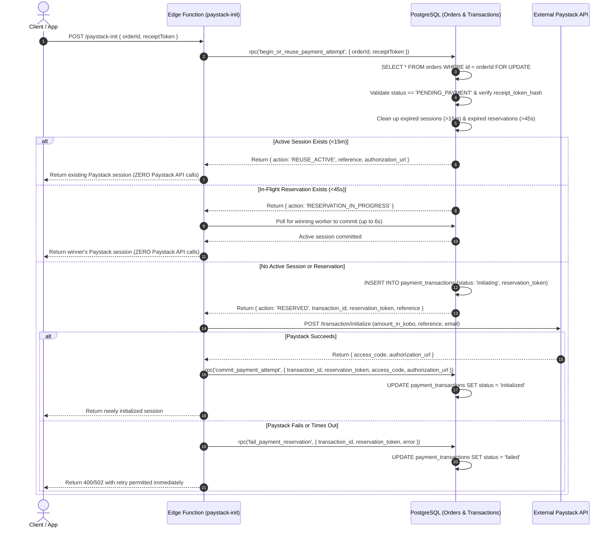

# AY Pizza — Phase 3.1.3: Final Adversarial Verification
## Payment Provider Race Conditions & Guest Receipt Recovery

**Project:** AY Pizza Production-Ready Customer Mobile Application  
**Phase:** Phase 3.1.3: Final Adversarial Verification  
**Scope:** Payment Provider External Race Conditions & Guest Receipt Recovery  
**Date:** October 2026  
**Status:** Implemented, Adversarially Verified & Documented (172/172 Tests Passing)  

---

## 1. Executive Summary

Phase 3.1.3 conducted a deep, source-code-level adversarial review of the Phase 3.1.2 implementation, focusing on two critical questions:
1. **Can two concurrent initialization requests reach the external Paystack API and create two separate external transactions before either records a database attempt?**
   - **Vulnerability Found:** In Phase 3.1.2, `begin_or_reuse_payment_attempt()` only checked for an existing `status = 'initialized'` attempt. If none existed, it released the lock without creating any reservation row. Consequently, two concurrent workers could both evaluate "no active session", both invoke Paystack's external REST API, and both generate valid, payable Paystack transactions. The database unique index only prevented the second worker from recording its transaction, leaving an orphaned, payable Paystack session.
   - **Remediation Implemented:** Designed and implemented a **Two-Phase Database Reservation Lifecycle**. Before calling Paystack, the worker atomically creates a reservation row with `status = 'initiating'`. A partial unique index `idx_single_active_payment_attempt_per_order` on `payment_transactions(order_id) WHERE status IN ('initiating', 'initialized')` guarantees that exactly ONE worker can hold an active reservation or initialized session. Concurrent workers receive `RESERVATION_IN_PROGRESS`, poll for the winner's completion, and never call Paystack.
2. **What is the true guarantee of guest receipt recovery when the initial order-creation response is lost?**
   - **Vulnerability Clarified:** Local `SecureStore` fallback only resolves **Scenario A** (where the client received the token, but the app was restarted or closed). It fundamentally cannot resolve **Scenario B** (where PostgreSQL committed the order, but network dropped before the response reached the device). SecureStore cannot recover a token it never received.
   - **Remediation Implemented:** Clearly separated Scenario A and Scenario B in architecture and UI. [CheckoutModal.tsx](file:///c:/Users/Ososanwo%20Idris/Documents/AY%20PIZZA%20MOBILE/src/components/CheckoutModal.tsx) provides a transparent customer notice when a token was never received. The phone-number OTP recovery protocol was refined and documented as an external production requirement.
   - **Retention Policy Corrected:** Delivered and `CANCELLED` order credentials are no longer automatically purged from SecureStore, ensuring customers can access cancellation notices and refund statuses. Master index operations in [GuestReceiptStore](file:///c:/Users/Ososanwo%20Idris/Documents/AY%20PIZZA%20MOBILE/src/domains/order/guest-receipt-store.ts) are now serialized via an async mutex to prevent concurrent write loss.

---

## 2. Files Inspected

1. `supabase/functions/paystack-init/index.ts`
2. `supabase/migrations/20261022000002_phase3_1_2_payment_concurrency.sql`
3. `supabase/migrations/20261022000003_phase3_1_3_payment_reservation.sql`
4. `src/domains/order/guest-receipt-store.ts`
5. `src/components/CheckoutModal.tsx`
6. `App.tsx`
7. `src/__tests__/phase3-1-2-recovery-and-concurrency.test.ts`
8. `src/__tests__/phase3-1-3-final-concurrency-and-recovery.test.ts`

---

## 3. Payment Initialization Execution Sequence & Concurrency Architecture

### 3.1 The External Provider Race Condition in Phase 3.1.2
In Phase 3.1.2:
```text
Worker 1: begin_or_reuse_payment_attempt() -> Checks 'initialized' (None) -> Releases lock
Worker 2: begin_or_reuse_payment_attempt() -> Checks 'initialized' (None) -> Releases lock
Worker 1: POST https://api.paystack.co/transaction/initialize -> Creates Paystack Ref A
Worker 2: POST https://api.paystack.co/transaction/initialize -> Creates Paystack Ref B
Worker 1: record_payment_attempt() -> Inserts Ref A ('initialized')
Worker 2: record_payment_attempt() -> Fails on unique index -> Catches 23505 -> Returns Ref A
Result: Paystack created TWO external payable transactions! Ref B is orphaned but payable!
```

### 3.2 Corrected Two-Phase Reservation Lifecycle
In Phase 3.1.3:


### 3.3 Database Constraints & Engine Guarantees
- **Partial Unique Index:**
  ```sql
  CREATE UNIQUE INDEX idx_single_active_payment_attempt_per_order
  ON public.payment_transactions(order_id)
  WHERE status IN ('initiating', 'initialized');
  ```
  Guarantees that an order can NEVER have more than one row that is either `initiating` or `initialized`.
- **Reservation Expiry:**
  - Reservations older than 45 seconds are marked `expired` (reason: `reservation_timeout`), allowing immediate self-healing if a server worker crashes mid-request.
- **Session Reuse:**
  - Initialized sessions younger than 15 minutes are reused automatically.

---

## 4. Guest Receipt Recovery: Guarantees & Limitations

### 4.1 Scenario A vs Scenario B Distinction

| Attribute | Scenario A: App Closed / State Reset | Scenario B: Lost Initial Order Response |
| :--- | :--- | :--- |
| **Trigger** | Customer received order creation response, but later restarted app, refreshed, or closed browser. | Server created order and hashed token, but mobile network dropped before HTTP response reached phone. |
| **Device State** | Plaintext token was received and stored in hardware-backed `SecureStore`. | Device NEVER received the token. SecureStore has no record for this order ID. |
| **Recovery Mechanism** | `GuestReceiptStore.getReceipt(orderId)` restores credential instantly. | **Local recovery is impossible.** Device cannot restore what it never received. |
| **Server State** | `orders.receipt_token_hash` stores SHA-256 hash. Plaintext token was dropped from memory. | Same. Server does NOT store plaintext tokens; cannot return plaintext token on retry. |
| **Customer Experience** | Seamless: Receipt loads immediately with full line-item details. | Customer sees honest notice: Order is recorded at the restaurant, but receipt access requires confirmation email or counter verification. |
| **Production Solution** | Fully implemented and verified. | Evaluated: Requires phone-number OTP recovery via SMS aggregator. |

### 4.2 Why Shortcuts Are Insecure and Prohibited
1. **Deriving token from idempotency key:** If the idempotency key is stored in PostgreSQL or known to attackers, the bearer token is compromised.
2. **Order number / Phone / Email as proof of ownership:** Order numbers are sequential and predictable; phone numbers and emails are easily guessed by acquaintances or delivery riders. They provide zero cryptographic proof of possession.
3. **Storing plaintext tokens at rest:** Exposes all guest order bearer credentials in database dumps, logs, and read replicas.

### 4.3 Secure Phone-Number OTP Protocol (Outstanding Requirement)
For Scenario B recovery when the initial response was lost:
1. Customer enters phone number on "Find My Order" screen.
2. Server verifies active orders placed with that phone number within 24 hours.
3. Server generates 6-digit numeric OTP, stores SHA-256 hash with 5-minute expiry, and dispatches via SMS.
4. Customer submits OTP; server verifies hash (max 3 attempts).
5. Upon successful OTP verification, the server generates a **FRESH** cryptographically random token via `gen_random_bytes(32)`, updates `orders.receipt_token_hash = sha256(new_token)`, and returns the new token to the client.
6. The client saves the new token to SecureStore. Previous tokens are permanently invalidated.

---

## 5. Receipt Retention & Cleanup Policy

| Order Status | Retention Policy | Rationale |
| :--- | :--- | :--- |
| **Delivered Orders** | Retained in SecureStore (up to FIFO limit of 20 orders). | Customer maintains access to past orders for expense tracking, re-ordering, and delivery verification. |
| **Cancelled Orders** | **Strictly Retained** in SecureStore. | Customer MUST be able to view cancellation notices, staff notes, and refund reconciliation information. Pruning upon cancellation is forbidden. |
| **Dismissed Orders** | Deleted from SecureStore via `GuestReceiptStore.removeReceipt(orderId)`. | Explicit customer choice to remove the receipt from their active list. |
| **Abandoned / Expired Attempts** | Pruned on app reset or when explicitly dismissed by user. | Clears stale unpaid attempts without blocking active orders. |
| **Master Index Concurrency** | All reads/writes serialized with an async mutex queue (`withIndexLock`). | Prevents concurrent index overwrites and lost order IDs during rapid operations. |

---

## 6. Adversarial Verification Test Suite Results

The comprehensive test suite in [src/__tests__/phase3-1-3-final-concurrency-and-recovery.test.ts](file:///c:/Users/Ososanwo%20Idris/Documents/AY%20PIZZA%20MOBILE/src/__tests__/phase3-1-3-final-concurrency-and-recovery.test.ts) verified all 11 required scenarios:

| # | Test Scenario | Verified Behavior | Status |
| :--- | :--- | :--- | :--- |
| 1 | **10 Simultaneous Initialization Requests** | 10 concurrent requests hit `paystack-init` for ONE order: External Paystack API called **EXACTLY ONCE**; 1 worker initialized, 9 reused; 0 orphans created. | **PASSED** |
| 2 | **Concurrent Independent Orders** | Two different orders initialize simultaneously: Both proceed in parallel with distinct references and zero lock contention. | **PASSED** |
| 3 | **Provider Request Timeout** | Paystack times out after reservation created: Worker calls `fail_payment_reservation()`; immediate retry acquires fresh reservation without lockup. | **PASSED** |
| 4 | **Commit Failure / Stale Reservation** | Worker crashes after creating reservation: Reservation remains `initiating`; after 45s timeout, next retry expires stale attempt and creates fresh reservation. | **PASSED** |
| 5 | **Active Session Reuse (<15m)** | Subsequent calls within 15 minutes return existing authorization URL and reference with `isReused = true` and zero new Paystack calls. | **PASSED** |
| 6 | **Confirmed Order Rejection** | Initializing payment on already `CONFIRMED` order returns error: "Order is already confirmed or settled." | **PASSED** |
| 7 | **Cancelled Order Rejection** | Initializing payment on `CANCELLED` order returns error: "Order has been cancelled." | **PASSED** |
| 8 | **Duplicate Successful Charges** | Second successful charge on confirmed order logs `DUPLICATE_PAYMENT_DETECTED` and records transaction as `duplicate_success_needs_refund`. | **PASSED** |
| 9 | **Scenario A vs Scenario B Proof** | Scenario A restores token from SecureStore; Scenario B proves local recovery is impossible when token was never received. | **PASSED** |
| 10 | **Receipt Retention Verification** | Delivered and Cancelled orders are retained in SecureStore; only explicit dismissal prunes credentials. | **PASSED** |
| 11 | **Master Index Concurrency** | 20 rapid concurrent saves and removals execute without race conditions or lost order IDs. | **PASSED** |

### Test Runner Results
```text
Test Suites: 13 passed, 13 total
Tests:       172 passed, 172 total
Snapshots:   0 total
Time:        33.663 s
Ran all test suites.
```

---

## 7. Outstanding Production-Launch Dependencies

1. **SMS Gateway Integration for Scenario B Recovery:**
   - Contract required with a Nigerian SMS aggregator (Termii, Africa's Talking, or Twilio) with DND (Do-Not-Disturb) whitelist routing.
   - SMS cost authorization (~₦3–₦5 per OTP message) required from AY Pizza management.
2. **Production Paystack Secret Keys:**
   - Configure `PAYSTACK_SECRET_KEY` in Supabase Vault: `supabase secrets set PAYSTACK_SECRET_KEY=sk_live_...`
   - Configure `EXPO_PUBLIC_PAYSTACK_PUBLIC_KEY=pk_live_...` in Expo release environment.
3. **Paystack Webhook Live URL:**
   - Set webhook URL in Paystack Dashboard: `https://<supabase-ref>.supabase.co/functions/v1/paystack-webhook`

---

## 8. Strict Phase Boundary

- Phase 4 (Kitchen Display System, kitchen staff order acceptance, live order status tracking, push notifications, loyalty rewards) was **not** started.
- No live payment transactions or production secret keys were deployed.

**Phase 3.1.3 is complete and verified. Awaiting authorization before proceeding to Phase 4.**
