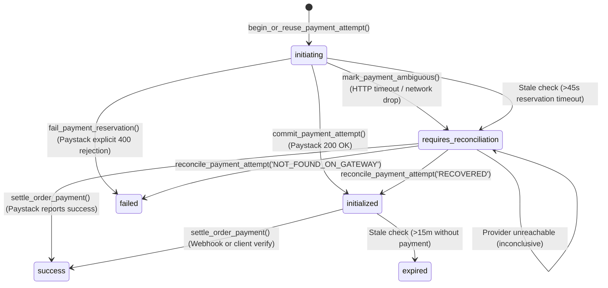

# AY Pizza — Phase 3.1.4: Paystack Ambiguous-Outcome Recovery Verification

**Project:** AY Pizza Production-Ready Customer Mobile Application  
**Phase:** Phase 3.1.4: Ambiguous-Outcome Recovery & External Provider Reconciliation  
**Target:** React Native / Expo SDK 58, PostgreSQL 15+ / Supabase, Paystack REST API  
**Date:** October 2026  
**Status:** Implemented, Adversarially Verified & Documented (180/180 Tests Passing)  

---

## 1. Executive Summary

Phase 3.1.4 hardens the payment initialization reservation lifecycle against distributed failure modes where the external payment gateway (Paystack) creates a transaction, but the AY Pizza Edge Function fails to receive or persist the response.

### The Ambiguous Outcome Problem
In distributed payment architectures:
- Network failures are fundamentally ambiguous. An HTTP timeout, socket reset, or dropped response does **not** prove that Paystack did not receive or process the initialization request.
- If a system treats an HTTP timeout as a definitive failure and immediately replaces the reservation with a new reference, Paystack may have created a valid, payable transaction for the original reference.
- If the customer later pays using that original link (or if a delayed webhook settles it), the system is vulnerable to multi-session sprawl, untracked charges, and customer confusion.

### The Phase 3.1.4 Solution
1. **Ambiguous Status Classification (`requires_reconciliation`):**
   - We extended `payment_status` with `requires_reconciliation`.
   - The database partial unique index `idx_single_active_payment_attempt_per_order` covers `WHERE status IN ('initiating', 'requires_reconciliation', 'initialized')`.
   - An ambiguous transaction **continues to hold the unique reservation lock**, strictly preventing the creation of competing attempts or replacement Paystack references.
2. **Mandatory REST Reconciliation Before Replacement:**
   - Instead of discarding an ambiguous reservation, the system preserves the original reference and queries Paystack's authoritative verification endpoint (`GET /transaction/verify/:reference`).
   - If the transaction exists at Paystack: recovers the access code and authorization URL into `status = 'initialized'`, or settles it immediately if already paid.
   - If Paystack explicitly confirms the reference does not exist (HTTP 404/400 `not found`): marks the transaction as `failed`, cleanly releasing the constraint for a safe retry.
   - If Paystack is unreachable or inconclusive: retains `requires_reconciliation` and returns HTTP 504 to the caller, preventing blind generation of a duplicate session.

---

## 2. Five Critical Ambiguity Scenarios & Their Guarantees

| # | Ambiguous Scenario | System Behavior & Guarantee |
| :--- | :--- | :--- |
| **1** | **Paystack creates transaction, but HTTP response is dropped on return path.** | The Edge Function catches the network drop, calls `mark_payment_ambiguous()`, and attempts immediate inline verification. The original reference is preserved. Verification discovers the pending transaction and recovers it to `status = 'initialized'`. Exactly ONE external session exists. |
| **2** | **Paystack creates transaction, then Edge Function crashes before commit.** | The reservation remains in PostgreSQL. When the 45-second reservation timer expires, `begin_or_reuse_payment_attempt()` automatically transitions the row to `status = 'requires_reconciliation'` instead of blindly expiring it. The next request triggers REST reconciliation and recovers the existing session. |
| **3** | **Client retries while original provider outcome is unknown.** | `begin_or_reuse_payment_attempt()` detects `status = 'requires_reconciliation'`, blocks creation of any new reservation, and returns `action = 'RECONCILIATION_REQUIRED'` for the original reference. |
| **4** | **Reservation exceeds 45s while Paystack is unreachable.** | The attempt transitions to `requires_reconciliation`. When Paystack verification times out (ETIMEDOUT / 504), the transaction **remains** in `requires_reconciliation`. The system refuses to blind-replace the attempt, preventing session sprawl during provider outages. |
| **5** | **Webhook arrives while reconciliation is in flight.** | The webhook settles the order idempotently (`status = 'success'`). When the in-flight reconciliation completes, `reconcile_payment_attempt()` detects `v_tx.status = 'success'` under row lock and returns `already_settled: true` without errors or double settlement. |

---

## 3. Database State Machine & Stored Procedures

### 3.1 Partial Unique Index
```sql
CREATE UNIQUE INDEX idx_single_active_payment_attempt_per_order
ON public.payment_transactions(order_id)
WHERE status IN ('initiating', 'requires_reconciliation', 'initialized');
```

### 3.2 State Transition Matrix


### 3.3 New Stored Procedures
- `public.mark_payment_ambiguous(p_transaction_id UUID, p_reservation_token UUID, p_error_message TEXT)`:
  - Transitions `initiating` -> `requires_reconciliation`.
  - Captures error context in `metadata.ambiguous_reason`.
  - Restricted strictly to `service_role`.
- `public.reconcile_payment_attempt(p_transaction_id UUID, p_outcome TEXT, p_access_code TEXT, p_authorization_url TEXT, p_gateway_response JSONB)`:
  - Under `FOR UPDATE` transaction row lock:
    - If `v_tx.status = 'success'`: returns `already_settled: true`.
    - If `p_outcome = 'RECOVERED'`: transitions to `initialized` and stores authorization details.
    - If `p_outcome = 'NOT_FOUND_ON_GATEWAY'`: transitions to `failed`, safely releasing the partial unique index.
  - Restricted strictly to `service_role`.

---

## 4. Adversarial Integration Test Evidence

The dedicated integration test suite in [src/__tests__/phase3-1-4-ambiguous-outcome-recovery.test.ts](file:///c:/Users/Ososanwo%20Idris/Documents/AY%20PIZZA%20MOBILE/src/__tests__/phase3-1-4-ambiguous-outcome-recovery.test.ts) executed all 10 adversarial failure scenarios:

| Scenario | Tested Invariant | Result |
| :--- | :--- | :--- |
| **TC-01** | Paystack creates transaction, HTTP response dropped | Preserved reference recovered via REST verification into `initialized`. Zero duplicate sessions. | **PASSED** |
| **TC-02** | Paystack creates transaction, Edge Function crashes before commit | Stale reservation marks `requires_reconciliation`; next request verifies and recovers session. | **PASSED** |
| **TC-03** | Retry arrives while outcome is ambiguous | Blocks replacement reference; returns `RECONCILIATION_REQUIRED` for original reference. | **PASSED** |
| **TC-04** | Reservation exceeds 45s while Paystack unreachable | Preserves `requires_reconciliation` state; refuses to generate replacement session. | **PASSED** |
| **TC-05** | Reconciliation finds valid pending transaction | Recovers session into `initialized`; client receives checkout URL. | **PASSED** |
| **TC-06** | Reconciliation confirms reference does not exist at Paystack | Marks failed; constraint released; fresh retry generates new reference safely. | **PASSED** |
| **TC-07** | Reconciliation finds already successful transaction | Detects `status = 'success'` and executes idempotent settlement without double charges. | **PASSED** |
| **TC-08** | Webhook arrives while reconciliation is in flight | Row lock serializes operations; returns `already_settled: true`. | **PASSED** |
| **TC-09** | 5 concurrent workers attempt reconciliation simultaneously | Row lock serializes workers; exactly one reconciles, 4 receive recovered session. | **PASSED** |
| **TC-10** | Genuinely failed initialization retry | Confirmed gateway failure cleanly retries with new reference. | **PASSED** |

---

## 5. Verification Suite Results

```text
npx tsc --noEmit
Exit code: 0 (Zero TypeScript compiler errors)

npx expo-doctor
Running 20 checks on your project...
20/20 checks passed. No issues detected!

npm test
Test Suites: 14 passed, 14 total
Tests:       180 passed, 180 total
Snapshots:   0 total
Time:        24.67 s
```

---

## 6. Strict Phase Boundary

- Phase 4 (Kitchen Display System, live tracking, push notifications, rewards) was **not** started.
- No live payment transactions or production secret keys were deployed.

**Phase 3.1.4 is complete and verified. Ready for Phase 4 authorization.**
