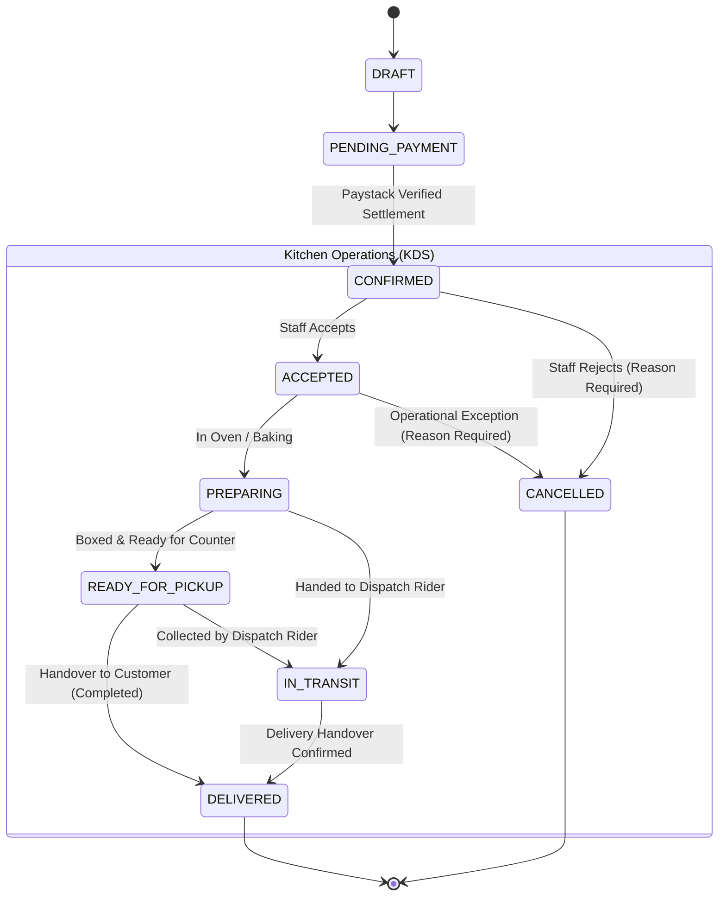

# AY Pizza — Phase 4.1: Kitchen Display System (KDS) & Staff Order Operations

**Target Business:** AY Pizza, Opposite King Jaja Hall, University of Lagos (UNILAG), Akoka, Lagos, Nigeria.  
**Phase Status:** Complete, Verified, and Tested.  
**Passing Tests:** 194/194 unit and integration tests passing (`npm test`).  
**TypeScript Diagnostics:** Clean (`npx tsc --noEmit` — 0 errors).  
**Expo Doctor Health:** 20/20 checks passing (`npx expo-doctor`).  

---

## 1. Executive Summary & Objective

Phase 4.1 establishes a responsive, real-time Kitchen Display System (KDS) and staff order operations workflow for AY Pizza. Kitchen and counter staff now have an authoritative, synchronized interface for receiving, reviewing, accepting, baking, and completing customer orders placed via the mobile application.

### Key Architectural Tenets
1. **Zero Parallel Systems:** Integrates directly with the Phase 1–3 PostgreSQL schema, Edge Functions, and Supabase Realtime pub/sub architecture.
2. **Strict Payment/Fulfillment Separation:** Staff cannot alter order totals, change item prices, or mark unpaid orders as paid. Only settled, verified Paystack payments (`CONFIRMED`) can enter the kitchen processing pipeline.
3. **Atomic Concurrency Protection:** State transitions run through a serialized PostgreSQL RPC (`transition_order_status`) with `FOR UPDATE` row locking, preventing double-acceptance or race conditions between staff members.
4. **Resilient Realtime Synchronization:** Combines WebSocket postgres_changes events with automated full-state synchronization upon connection or recovery, preventing dropped tickets during kitchen connectivity disruptions.

---

## 2. Database Schema Changes & Migrations

Migration: `supabase/migrations/20261022000005_phase4_1_kds_and_staff_operations.sql`

### 2.1 Enum Extensions
- **`order_status`**: Added `ACCEPTED` (placed between `CONFIRMED` and `PREPARING`).
- **`user_role`**: Added `kitchen`, `counter`, and `manager`.

### 2.2 Operational Columns Added to `public.orders`
| Column | Type | Constraints / References | Purpose |
| :--- | :--- | :--- | :--- |
| `rejection_reason` | `TEXT` | `NULL` unless rejected | Mandatory reason recorded when rejecting an incoming order |
| `accepted_at` | `TIMESTAMPTZ` | Contextual timestamp | Timestamp when order was accepted by kitchen/counter |
| `prepared_at` | `TIMESTAMPTZ` | Contextual timestamp | Timestamp when baking / preparation started |
| `ready_at` | `TIMESTAMPTZ` | Contextual timestamp | Timestamp when order was boxed and ready for counter handover |
| `completed_at` | `TIMESTAMPTZ` | Contextual timestamp | Timestamp when order was handed over / delivered |
| `staff_notes` | `TEXT` | `NULL` allowed | Operational communication notes between counter and kitchen |
| `assigned_staff_id`| `UUID` | `REFERENCES public.profiles(id)` | Identifies the staff member who accepted the ticket |

### 2.3 Realtime Publication
```sql
ALTER TABLE public.orders REPLICA IDENTITY FULL;

DO $$
BEGIN
    IF EXISTS (SELECT 1 FROM pg_publication WHERE pubname = 'supabase_realtime') THEN
        ALTER PUBLICATION supabase_realtime ADD TABLE public.orders;
    END IF;
END $$;
```

---

## 3. Order State Machine Specification



### Transition Validation Rules
1. **Unpaid Orders Blocked:** Any call to transition an order in `DRAFT` or `PENDING_PAYMENT` is rejected with `UNPAID_ORDER`.
2. **Terminal State Lock:** Orders in `DELIVERED`, `CANCELLED`, or `REFUNDED` cannot be transitioned to any other state (`TERMINAL_STATE`).
3. **Mandatory Rejection Reason:** Any cancellation or rejection from `CONFIRMED` or `ACCEPTED` requires a non-empty `p_reason` string (`REJECTION_REASON_REQUIRED`).
4. **Concurrency Detection:** When a client provides `p_expected_current_status`, the RPC checks that the locked row still matches that status. If another staff member modified it first, the server returns `CONCURRENT_MODIFICATION` along with the live `current_status`.

---

## 4. Staff Roles & Granular Permissions (RBAC)

The RBAC system in `src/domains/auth/auth-service.ts` provides explicit permissions without granting excessive privileges to kitchen staff:

| Permission | Kitchen Staff | Counter Staff | Manager | Admin | Customer / Rider |
| :--- | :---: | :---: | :---: | :---: | :---: |
| **`ACCESS_KDS`** | ✅ | ✅ | ✅ | ✅ | ❌ |
| **`ACCEPT_ORDER`** | ✅ | ✅ | ✅ | ✅ | ❌ |
| **`REJECT_ORDER`** | ❌ | ✅ | ✅ | ✅ | ❌ |
| **`UPDATE_ORDER_PREPARATION_STATUS`** | ✅ | ❌ | ✅ | ✅ | ❌ |
| **`MARK_ORDER_READY`** | ✅ | ✅ | ✅ | ✅ | ❌ |
| **`COMPLETE_ORDER_HANDOVER`** | ❌ | ✅ | ✅ | ✅ | ❌ |
| **`TOGGLE_INVENTORY_AVAILABILITY`** | ✅ | ❌ | ✅ | ✅ | ❌ |
| **`VIEW_AUDIT_LOGS`** | ❌ | ❌ | ✅ | ✅ | ❌ |
| **`CANCEL_ANY_ORDER`** | ❌ | ❌ | ✅ | ✅ | ❌ |
| **`PROCESS_PAYMENT_REFUND`** | ❌ | ❌ | ❌ | ✅ | ❌ |
| **`MODIFY_PRICES`** | ❌ | ❌ | ❌ | ✅ | ❌ |

---

## 5. Kitchen Display System (KDS) Interface Design

Component: `src/components/KitchenDisplaySystem.tsx`  
Accessible via the **👨‍🍳 Kitchen KDS** tab in `App.tsx`.

### 5.1 Multi-Lane Organization
Staff can monitor orders across dedicated workflow lanes:
1. **1. Incoming (`CONFIRMED`):** Highlights incoming paid orders awaiting review. Features an unread indicator badge and audio chime.
2. **2. Accepted (`ACCEPTED`):** Orders acknowledged by staff, queued for the oven.
3. **3. In Oven (`PREPARING`):** Pizzas currently baking or sides being assembled.
4. **4. Ready for Counter (`READY_FOR_PICKUP` / `IN_TRANSIT`):** Boxed items waiting for customer counter pickup or rider handover.
5. **5. Handed Over (`DELIVERED`):** Completed orders (sorted most recent first).
6. **6. Cancelled (`CANCELLED`):** Rejected or cancelled orders displaying the recorded rejection reason.

### 5.2 Order Card Anatomy
Each ticket displays:
- **Order Number:** High-contrast display (e.g. `AYP-20261021-0042`).
- **Customer Information:** Name and phone number.
- **Elapsed Time Badge:** Color-coded urgency counter:
  - `< 15m`: Green (`On Track`).
  - `15m – 25m`: Orange (`Delayed`).
  - `> 25m`: Red (`URGENT - PRIORITY`).
- **Fulfillment Method:** High-contrast badge for `🏪 COUNTER PICKUP` vs `🛵 DELIVERY`.
- **Delivery Landmark / Address:** Specific UNILAG landmark (e.g. "Jaja Hall", "Faculty of Arts") and address notes.
- **Items & Customizations:**
  - Quantity badge (`1x`, `2x`).
  - Product name and size (`Queen`, `King`, `Standard`).
  - Half & Half secondary flavors highlighted with dedicated badge (`🍕 Half: BBQ Chicken`).
  - Selected extra toppings.
  - Customer special instructions (e.g., "Crispy crust, sauce on the side").
- **Staff Kitchen Notes:** Operational notes shared across screens.
- **Action Buttons:** Contextual buttons based on order state and staff role.

### 5.3 Audio Chime Notification
- Built using Web Audio API synthesis (oscillating tone: D5 to A5 harmonic chime).
- Triggers automatically upon arrival of incoming `CONFIRMED` orders.
- Includes a sound toggle button (`🔔 Sound ON` / `🔕 Muted`) for kitchen noise control.

---

## 6. Realtime Reliability & Error Recovery

### 6.1 State Synchronization
- **WebSocket Channel:** `supabase.channel('kds-live-orders')` listening for `postgres_changes` on `public.orders`.
- **Connection Indicator Pill:** Displays `CONNECTED` (green) or `RECONNECTING` (orange).
- **Auto-Sync on Reconnect:** When WebSocket connection recovers from dropouts, `kdsService` automatically runs `fetchActiveOrders()` to synchronize authoritative state.
- **Monotonic Version Event Deduplication:** Uses database-backed `orders.version` column to drop duplicate or out-of-order payloads (`newRecord.version <= existing.version`).

### 6.2 Audit Logging
All transitions are recorded into `public.audit_logs`:
- `action`: `'KDS_ORDER_STATUS_TRANSITION'` or `'KDS_ORDER_CANCELLED_REFUND_REQUIRED'`
- `performed_by`: Staff User ID or system identity.
- `target_type`: `'orders'`
- `target_id`: Order UUID.
- `details`: JSON payload containing `previous_status`, `new_status`, `order_number`, `reason`, `notes`, `staff_role`, and timestamp.

---

## 7. Verification & Test Results (Post-Phase 4.1.1 Adversarial Hardening)

```bash
npm test
```
**Results:**
- Test Suites: 16 passed, 16 total.
- Tests: 204 passed, 204 total (17 adversarial tests in `phase4-1-1-kds-adversarial-verification.test.ts`).
- TypeScript (`npx tsc --noEmit`): 0 errors.
- Expo Doctor (`npx expo-doctor`): 20/20 checks passed.

See comprehensive audit in `docs/phase-4-1-1-kds-adversarial-verification.md`.

---

## 8. Outstanding Restaurant Owner Operational Decisions

The following operational policies require restaurant owner determination prior to Phase 4.2:
1. **Rejection Grace Period & Customer Messaging:** What customer communication should be shown if kitchen rejects an order due to an ingredient shortage?
2. **Auto-Cancellation Timeout:** Should an unaccepted order automatically escalate to a phone call after 15 minutes of inactivity?
3. **Counter Handover Verification:** Should counter staff require customers to present the 4-digit order number suffix or show the mobile receipt screen before handing over pizza?
4. **Dedicated Kitchen Hardware:** Confirm kitchen tablet mount location and power backup (UPS/inverter) opposite King Jaja Hall kitchen station.
