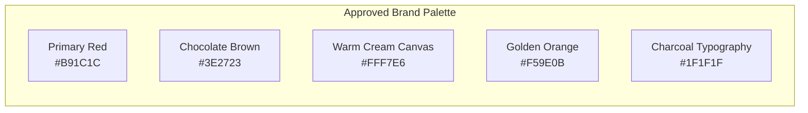
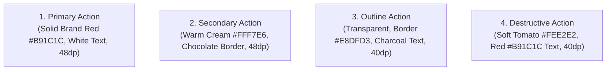
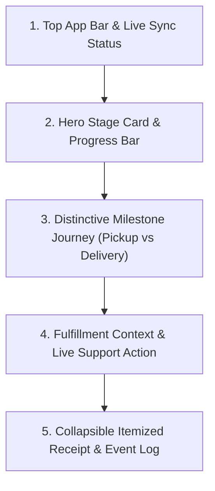

# AY Pizza & Ice Cream — Phase 5.4.3: Design System & Premium Tracking Proposal

**Document:** `docs/phase-5-4-3-design-system-proposal.md`  
**Brand Identity Authority:** Approved Concept 3 Visual Identity Board (ChatGPT Master Reference)  
**Target Hardware:** Universal Mobile (Optimized for Xiaomi Redmi 13C, 360dp baseline width)  
**Objective:** Formalize a cohesive, production-grade design system and propose an elevated, distinctive order tracking experience based strictly on the approved AY Pizza brand identity.

---

## 1. Brand Identity Foundations (Preserved Assets)

The AY Pizza & Ice Cream visual identity is anchored by six approved, non-negotiable brand assets:

1. **Approved Concept 3 Monogram Logo:**
   - Pizza-slice `A` with visible savory toppings (pepperoni, green pepper, golden melted cheese).
   - Soft-serve ice cream `Y` with waffle cone fluting descending into the stem.
   - Dual-layer warm cream (`#FFF7E6`) and golden orange (`#F59E0B`) contour outlines.
   - Authoritative vector asset: [`src/components/BrandMonogram.tsx`](file:///c:/Users/Ososanwo%20Idris/Documents/AY%20PIZZA%20MOBILE/src/components/BrandMonogram.tsx).
2. **Core Brand Color Palette:**
   - **Primary Pizza Red:** `#B91C1C` (Pantone 186 C / Deep Tomato Red)
   - **Chocolate Brown:** `#3E2723` (Rich cocoa waffle & typography grounding)
   - **Warm Cream Canvas:** `#FFF7E6` (Warm, appetizing bakery atmosphere)
   - **Golden Orange:** `#F59E0B` (Stone-baked crust & waffle cone highlight)
   - **Charcoal:** `#1F1F1F` (High-contrast, razor-sharp typography)
3. **Food Photography Assets:** 23 studio food photography assets across Pizzas, Shawarmas, Burgers, Chicken, and Ice Cream.



---

## 2. Design Tokens Specification

### 2.1 Color Tokens & Contrast Matrix

All color combinations below are guaranteed to meet or exceed **WCAG 2.1 Level AA** contrast standards ($4.5:1$ for normal text, $3.0:1$ for large text/icons):

| Token Name | Hex Code | Semantic Role | Background Pairing | Contrast Ratio | WCAG Compliance |
| :--- | :--- | :--- | :--- | :---: | :---: |
| `canvas.base` | `#FFF7E6` | App-wide root screen background | N/A | Canvas | — |
| `canvas.surface` | `#FFFFFF` | Elevated cards, modals, sheets | On `canvas.base` | Distinct surface | — |
| `canvas.subtle` | `#F7F2E7` | Secondary card fills, input backgrounds | On `canvas.surface` | $1.15 : 1$ (Fill) | — |
| `brand.primary` | `#B91C1C` | Primary buttons, active highlights, price | On `#FFFFFF` | **$5.85 : 1$** | **PASS (AA / AAA)** |
| `brand.chocolate` | `#3E2723` | Emphasized headings, badges, accents | On `#FFF7E6` | **$10.42 : 1$** | **PASS (AAA)** |
| `brand.gold` | `#F59E0B` | Highlights, rating stars, active badges | On `#1F1F1F` | **$7.24 : 1$** | **PASS (AAA)** |
| `text.primary` | `#1F1F1F` | Titles, item names, primary body | On `#FFFFFF` | **$16.08 : 1$** | **PASS (AAA)** |
| `text.primary` | `#1F1F1F` | Titles, item names, primary body | On `#FFF7E6` | **$13.48 : 1$** | **PASS (AAA)** |
| `text.secondary` | `#6B5E59` | Descriptions, subtitles, metadata | On `#FFFFFF` | **$5.24 : 1$** | **PASS (AA)** |
| `text.secondary` | `#6B5E59` | Descriptions, subtitles, metadata | On `#FFF7E6` | **$4.38 : 1$** | **PASS (AA Large)** |
| `text.muted` | `#85746E` | Timestamps, inactive hints, placeholders | On `#FFFFFF` | **$3.72 : 1$** | **PASS (AA Large)** |
| `text.inverse` | `#FFFFFF` | Button labels, badge text | On `#B91C1C` | **$5.85 : 1$** | **PASS (AA / AAA)** |
| `status.success` | `#15803D` | Delivered, paid, in stock | On `#DCFCE7` | **$5.12 : 1$** | **PASS (AA)** |
| `status.warning` | `#B45309` | In-progress, oven baking, sync mode | On `#FEF3C7` | **$4.95 : 1$** | **PASS (AA)** |
| `status.danger` | `#B91C1C` | Cancelled, out of stock, errors | On `#FEE2E2` | **$5.35 : 1$** | **PASS (AA)** |
| `border.default` | `#E8DFD3` | Card borders, dividers | On `#FFF7E6` | $1.2 : 1$ (Border) | — |
| `border.focus` | `#B91C1C` | Focused input border, selected card | On `#FFFFFF` | $5.85 : 1$ (Stroke) | — |

---

### 2.2 Typography Scale

The typography scale uses a strict 4px modular baseline with proportional line heights to eliminate text truncation:

| Token | Size (dp) | Weight | Line Height (dp) | Tracking | Primary Usage |
| :--- | :---: | :---: | :---: | :---: | :--- |
| `type.display` | 26 | 900 (Black) | 32 | -0.5 | Launch screen, major milestone banners |
| `type.h1` | 22 | 800 (Extrabold) | 28 | -0.3 | Page titles, order numbers (`#AYP-...`) |
| `type.h2` | 18 | 800 (Extrabold) | 24 | 0 | Section headers, modal titles |
| `type.h3` | 15 | 800 (Extrabold) | 20 | 0.2 | Product names, milestone titles |
| `type.body` | 13 | 500 (Medium) | 18 | 0 | Standard description, item options |
| `type.bodySmall` | 12 | 500 (Medium) | 16 | 0 | Subtitles, delivery address details |
| `type.caption` | 11 | 600 (Semibold) | 14 | 0.3 | Timestamps, event logs, rate notes |
| `type.badge` | 10 | 800 (Extrabold) | 12 | 0.5 | In Stock, Campus, LIVE pills (Uppercase) |
| `type.priceLarge`| 20 | 900 (Black) | 24 | 0 | Grand totals, summary cost |
| `type.priceCard` | 15 | 900 (Black) | 18 | 0 | Line-item prices (`₦12,500`) |

---

### 2.3 Spacing & Layout Grid (4px Base)

- `space.2xs`: 2dp (micro gap)
- `space.xs`: 4dp (badge padding, icon gap)
- `space.sm`: 8dp (row gap, small margin)
- `space.md`: 12dp (card inner padding on small screens)
- `space.lg`: 16dp (standard screen padding, card margin)
- `space.xl`: 20dp (section separation)
- `space.2xl`: 24dp (modal header spacing)
- `space.3xl`: 32dp (footer clear spacing)
- **Minimum Touch Target:** `44dp × 44dp` for all interactive buttons, touchables, and toggles (`hitSlop: 8` applied if visual element is smaller).

---

### 2.4 Border Radii & Elevation Shadows

```typescript
export const Radii = {
  xs: 4,     // Size pills, tags
  sm: 8,     // Stepper buttons, small badges
  md: 12,    // Action buttons, text inputs
  lg: 16,    // Product cards, section cards
  xl: 20,    // Modals, bottom sheets
  pill: 9999,// Status indicators, floating pills
};

export const Elevations = {
  card: Platform.select({
    ios: { shadowColor: '#3E2723', shadowOffset: { width: 0, height: 2 }, shadowOpacity: 0.05, shadowRadius: 6 },
    android: { elevation: 2 },
  }),
  modal: Platform.select({
    ios: { shadowColor: '#1F1F1F', shadowOffset: { width: 0, height: 6 }, shadowOpacity: 0.15, shadowRadius: 18 },
    android: { elevation: 8 },
  }),
};
```

---

## 3. Core Reusable Component Primitives

### 3.1 Button Hierarchy



1. **`PrimaryButton`:**
   - Background: `Colors.brandRed` (`#B91C1C`)
   - Text: `#FFFFFF`, `type.h3` (14dp bold)
   - Height: `48dp`, border radius `12dp`
   - Disabled: opacity 0.5
2. **`SecondaryButton`:**
   - Background: `Colors.warmCream` (`#FFF7E6`)
   - Border: `1.5dp` solid `Colors.chocolateBrown` (`#3E2723`)
   - Text: `Colors.chocolateBrown` (`#3E2723`), `type.h3`
   - Height: `48dp`, border radius `12dp`
3. **`OutlineButton`:**
   - Background: `transparent`
   - Border: `1dp` solid `Colors.borderDefault` (`#E8DFD3`)
   - Text: `Colors.brandCharcoal` (`#1F1F1F`), `type.bodySmall` (bold)
   - Height: `38-44dp`, border radius `10dp`
4. **`DestructiveButton`:**
   - Background: `#FEE2E2` (Soft red)
   - Text: `Colors.brandRed` (`#B91C1C`), `type.bodySmall` (bold)
   - Height: `38-44dp`, border radius `10dp`

### 3.2 Form Controls & Inputs

- **Default State:** Background `#FFFFFF`, border `1dp` solid `#D4C9BF`, text `#1F1F1F`, placeholder `#85746E`, border radius `10dp`, height `48dp`.
- **Focused State:** Border `1.5dp` solid `Colors.brandRed` (`#B91C1C`), cursor `selectionColor={Colors.brandRed}`.
- **Error State:** Border `1.5dp` solid `#DC2626`, background `#FEF2F2`. Error label rendered below input in `#DC2626` (11dp).
- **Required Indicator:** Red asterisk (`<Text style={{ color: Colors.brandRed }}>*</Text>`).

---

## 4. Proposed Premium Order Tracking Experience

### 4.1 Visual Hierarchy & Architecture

The elevated tracking interface is organized into five distinct vertical modules:



---

### 4.2 Module 1: Top App Bar & Connection Status
- **Left:** Modal Title (`Order Tracking`) + Bold Order Number (`#AYP-20261104-0042`) in high-contrast charcoal (`#1F1F1F`).
- **Right:**
  - **Connection Badge:**
    - `LIVE` (Green `#15803D` fill, pulsing dot): WebSocket Realtime connected.
    - `SYNC` (Amber `#B45309` fill, steady dot): 10s secure background polling active.
    - `FINAL` (Neutral `#6B5E59` fill): Completed or cancelled order.
    - `OFFLINE` (Red `#B91C1C` fill): Connection interrupted, displaying cached receipt.
  - **Manual Refresh Action (`🔄`):** 36×36dp touch target with subtle spin animation on press.
  - **Dismiss Action (`✕`):** 36×36dp rounded charcoal button.

---

### 4.3 Module 2: Hero Stage Card & Progress Bar
A prominent, warm hero card with high-contrast text and a modern animated progress bar:
- **Card Background:** Deep warm cream (`#FFF3DD`) with chocolate accent border (`#3E2723`, 1dp).
- **Top Row:** Large stage emoji (e.g. `🔥` for baking, `🛵` for courier transit) + Large stage title in chocolate (`type.h2`: 18dp bold).
- **Subtext:** Reassuring, clear explanation (e.g. *"Baking in stone oven opposite King Jaja Hall"* or *"Courier is in transit to Faculty of Education"*).
- **Progress Fill Bar:** A 6dp rounded progress bar displaying completed percentage (e.g. 60% at Baking, 80% at Packed, 100% at Delivered) filled with `Colors.brandRed` and capped with a golden dot.
- **Estimated Window Notice:** If order is in progress, display realistic duration range based on fulfillment:
  - *Pickup:* *"Typically ready for pickup in ~15–20 mins"*
  - *Delivery:* *"Typical delivery window: ~25–35 mins"*
  - Clearly marked: *"Official AY Pizza Store Estimate"* (No fake seconds countdown).

---

### 4.4 Module 3: Distinctive Milestone Journey (Pickup vs Delivery)

The vertical timeline cleanly separates into two dedicated tracks based on `order.fulfillment_type`:

#### Track A: Pickup Order Journey (5 Stages)
1. **Order Received (`CONFIRMED`):** Payment verified; order received at King Jaja store.
   - Timestamp: `order.created_at` (formatted: e.g. `2:14 PM`).
2. **Order Confirmed (`ACCEPTED`):** Kitchen reviewed and accepted ticket.
   - Timestamp: `order.accepted_at` (formatted: e.g. `2:16 PM`).
3. **Preparing (`PREPARING`):** Pizzas assembled and baking in stone oven.
   - Timestamp: `order.prepared_at` (formatted: e.g. `2:20 PM`).
4. **Ready for Collection (`READY_FOR_PICKUP`):** Boxed hot and waiting at pickup counter.
   - Timestamp: `order.ready_at` (formatted: e.g. `2:32 PM`).
   - Customer guidance: *"Show Order #... at the counter opposite King Jaja Hall."*
5. **Picked Up (`DELIVERED`):** Customer collected order.
   - Timestamp: `order.completed_at` (formatted: e.g. `2:38 PM`).

#### Track B: Delivery Order Journey (6 Stages)
1. **Order Received (`CONFIRMED`):** Payment verified; order enqueued for store.
   - Timestamp: `order.created_at`.
2. **Order Confirmed (`ACCEPTED`):** Kitchen reviewed and accepted order.
   - Timestamp: `order.accepted_at`.
3. **Preparing (`PREPARING`):** Food freshly prepared and baking.
   - Timestamp: `order.prepared_at`.
4. **Ready for Dispatch (`READY_FOR_PICKUP`):** Boxed and waiting for courier pickup.
   - Timestamp: `order.ready_at`.
5. **Picked Up & On the Way (`IN_TRANSIT`):** Courier departed store with order.
   - Timestamp: `order.in_transit_at` / `events` timestamp.
   - Landmark highlight: *"Heading to [Landmark Name]"*.
6. **Delivered (`DELIVERED`):** Courier completed handover at destination.
   - Timestamp: `order.completed_at`.

#### Step Visual States:
- **Completed Step:** Circle filled with `Colors.freshGreen` (`#15803D`), white checkmark `✓`, connecting line solid green, label in dark charcoal (`#1F1F1F`), timestamp in caption text (`#85746E`).
- **Active Step:** Circle outlined with golden orange (`#F59E0B`, 2dp), pulsing warm halo, stage emoji inside, label in bold red (`#B91C1C`), subtext in rich chocolate (`#3E2723`), indicator *"In Progress..."*.
- **Upcoming Step:** Circle outlined in muted beige (`#E8DFD3`), filled with `#FAF7F2`, upcoming emoji in 40% opacity, label in muted gray (`#85746E`).

---

### 4.5 Module 4: Fulfillment Context & Live Support Action
A dedicated card displaying verified order details and real-world store support:
- **Fulfillment Tag:** `🛵 Campus Delivery` or `🏬 Store Pickup`.
- **Recipient:** Customer Name & Phone Number.
- **Destination:** Delivery Landmark + Room/Hostel Details + Specific Delivery Instructions.
- **Direct Store Support Button (`📞 Call AY Pizza Kitchen`):**
  - Tapping prompts phone dialer with verified store phone (`0812 345 6789`).
  - Ensures a customer never feels abandoned during high-volume rush periods.

---

### 4.6 Module 5: Collapsible Itemized Receipt & Verified Event Log
- **Item Breakdown:** Item thumbnail (40×40dp), Item name, size pill, quantity, customizations list (Half & Half, extra toppings), and line-item total.
- **Financial Summary:** Subtotal, Delivery Fee (with landmark name), and Total in high-contrast red (`type.priceLarge`: 20dp).
- **Append-Only Event Log (Collapsible):** Displays exact audit events from `public.order_status_events` with verified database timestamps (`created_at`) and descriptive explanations.

---

### 4.7 Alternative States: Cancelled & Connection Failure Handling

#### Cancelled State (`order.status === 'CANCELLED'`)
- Replaces progress timeline with a high-contrast **Cancellation Notice Card**:
  - Banner: Red border, background `#FEE2E2`.
  - Headline: `🚫 Order Cancelled` in `#B91C1C` (18dp bold).
  - Store Reason: Exact `order.rejection_reason` rendered in high contrast (`#1F1F1F`).
  - Refund Status Notice: If `refund_status === 'REFUND_REQUIRED'`, displays amber box:
    *"💰 Paystack Refund Notice: Your payment of ₦... has been flagged for merchant refund review. Our team reconciles refunds via Paystack within 24 hours."*
  - Support Button: *"Contact Support WhatsApp / Call"*.

#### Offline / Network Interrupted State
- Modal retains all last-known cached order data from `GuestReceiptStore`.
- Header badge displays `OFFLINE` (red/amber).
- Banner at top of screen:
  *"⚠️ Connection interrupted. Showing verified status from [Last Update Time]. [Retry Button 🔄]"*.
- Customer can inspect receipt, order number, and items without being blocked.

