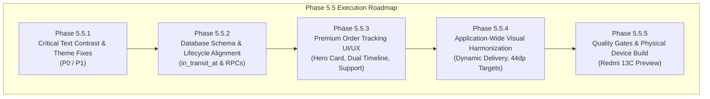

# AY Pizza & Ice Cream — Phase 5.4.3: Engineering Implementation Roadmap

**Document:** `docs/phase-5-4-3-implementation-roadmap.md`  
**Application Target:** `ng.aypizza.app`  
**Target Hardware:** Xiaomi Redmi 13C (Android 13 / HyperOS, ~360dp width)  
**Preceding Milestones:** Phase 5.4.2 Complete (Cart layout fix, SecureStore token recovery, guest polling)  
**Objective:** Deliver an actionable, risk-managed, step-by-step implementation sequence for executing the findings from the Tracking Audit, Visual Audit, and Design System Proposal.

---

## 1. Executive Summary & Strategy

The comprehensive audits conducted in Phase 5.4.3 revealed two critical paths requiring engineering attention before the AY Pizza & Ice Cream mobile application can pass physical device acceptance on Android:

1. **Urgent Visual & Contrast Remediation (P0 / P1):** Inverted text contrast, unreadable yellow-on-yellow buttons, and dark-theme inheritance collisions stemming from `app.json` (`userInterfaceStyle: "dark"`) and legacy `rgba(255, 232, 214, ...)` styling.
2. **Premium Order Tracking Lifecycle & UI (P1):** Customer-facing order progress tracking currently lacks a dispatched/in-transit timestamp column in the database, does not visually distinguish between pickup and delivery lifecycles, and suffers from severe unreadability in the tracking modal.

To ensure zero downtime, maintain all 444 automated regression tests, and minimize operational risk, implementation is structured into **four sequential phases** (Phase 5.5.1 through Phase 5.5.4) culminating in a physical-device build and checkpoint (Phase 5.5.5).

---

## 2. Phase-by-Phase Implementation Plan

### Phase 5.5.1: Critical Text Contrast & Theming Remediation (P0 / P1)

*Goal: Completely eliminate invisible text, unreadable buttons, and Android system dark mode input clashes across all customer-facing modals.*

#### Scope of Work & Affected Files:
1. **Application Configuration (`app.json`):**
   - Change `"userInterfaceStyle": "dark"` $\rightarrow$ `"userInterfaceStyle": "light"`.
   - **Rationale:** The application canvas was migrated to light warm cream (`#FFF7E6`) in Phase 5.2.3. The `"dark"` setting caused Xiaomi HyperOS and native Android `TextInput` controls to force white foreground text on white/cream backgrounds.
2. **Order Tracking Modal (`src/components/OrderTrackingModal.tsx`):**
   - Replace 20+ legacy translucent cream text styles (`rgba(255, 232, 214, ...)`) with semantic dark tokens:
     - Primary titles and headings: `Colors.brandCharcoal` (`#1F1F1F`)
     - Subtitles, descriptions, and details: `Colors.textSecondary` (`#6B5E59`)
     - Timestamps and inactive steps: `Colors.textMuted` (`#85746E`)
     - Active stage text: `Colors.brandRed` (`#B91C1C`)
   - Replace dark border lines with warm cream borders (`Colors.warmCreamBorder` / `#E8DFD1`).
3. **Paystack Payment Modal (`src/components/PaystackPaymentModal.tsx`):**
   - Fix yellow-on-yellow button bug: Update `successBtn` to use `backgroundColor: Colors.brandRed` (`#B91C1C`) with `color: '#FFFFFF'` (Contrast: **`5.85 : 1`**).
   - Fix unreadable total amount text: Replace `color: Colors.neon` with `Colors.brandCharcoal` (`#1F1F1F`) or `Colors.brandRed` (`#B91C1C`) on the cream container.
   - Update `cancelBtn`: Use neutral chocolate/charcoal text with clear boundary.
4. **Saved Addresses & Landmark Search Modals (`SavedAddressesModal.tsx`, `LandmarkPickerModal.tsx`):**
   - Explicitly specify `color: Colors.brandCharcoal` (`#1F1F1F`), `backgroundColor: '#FFFFFF'`, and `placeholderTextColor: Colors.textMuted` (`#85746E`) on all `TextInput` components.
   - Ensure clear contrast for address card titles, radio buttons, and action buttons.

#### Verification & Quality Gates:
- Automated test run (`npm test`) ensuring 0 regressions.
- WCAG AA contrast verification across all modified text nodes ($\ge 4.5:1$).
- Typecheck (`npx tsc --noEmit`) and lint (`npx expo lint`).

---

### Phase 5.5.2: Database Migration & Order Lifecycle Alignment (P1)

*Goal: Align the backend PostgreSQL database schema and RPCs with the authoritative 6-stage customer order journey.*

#### Scope of Work & Affected Files:
1. **Supabase Database Migration (`supabase/migrations/20261105000001_phase5_5_order_transit_tracking.sql`):**
   - Add missing column: `ALTER TABLE public.orders ADD COLUMN IF NOT EXISTS in_transit_at TIMESTAMPTZ;`
   - Create index for performance: `CREATE INDEX IF NOT EXISTS idx_orders_in_transit_at ON public.orders(in_transit_at) WHERE in_transit_at IS NOT NULL;`
   - Update `transition_order_status` stored procedure:
     - When transitioning to `'IN_TRANSIT'`, automatically record `UPDATE public.orders SET in_transit_at = NOW() WHERE id = p_order_id AND in_transit_at IS NULL;`
     - Retain existing `order_status_events` audit insert.
2. **TypeScript Database & Domain Types (`src/types/database.types.ts`, `src/types/Order.ts`):**
   - Add `inTransitAt?: string | null;` to the `Order` interface and `in_transit_at` to the Supabase Database definitions.
3. **Order Service (`src/services/order-service.ts`):**
   - Map `in_transit_at` $\rightarrow$ `inTransitAt` in `mapDbOrderToDomain`.
   - Ensure `getOrderReceipt` and `getOrderById` retrieve and return `inTransitAt`.
4. **Kitchen & Staff Operations Compatibility:**
   - Verify that staff transitions (`READY_FOR_PICKUP` $\rightarrow$ `IN_TRANSIT` and `IN_TRANSIT` $\rightarrow$ `DELIVERED`) populate both the table column and event log.

#### Verification & Quality Gates:
- Dedicated migration rollback and apply scripts.
- Unit tests verifying mapping of `inTransitAt` in `order-service.test.ts`.
- RPC regression tests ensuring state transitions succeed and terminal states remain protected.

---

### Phase 5.5.3: Premium Order Tracking UI/UX Implementation (P1)

*Goal: Implement the elevated, distinctive customer tracking interface designed in the Phase 5.4.3 Design System Proposal.*

#### Scope of Work & Affected Files:
1. **Component Architecture Refactor (`src/components/OrderTrackingModal.tsx`):**
   - Decompose into modular, clean sub-components:
     - `TrackingHeroCard.tsx`: Prominent order number, live badge, current status headline, friendly contextual message, and pulse animation.
     - `TrackingTimeline.tsx`: Dual-track vertical stepper with completed checks, active pulsing ring, upcoming dotted nodes, and verified timestamps.
     - `TrackingOrderSummary.tsx`: Item count, item names, variant badges, prices, and total amount.
     - `TrackingFulfillmentDetails.tsx`: Pickup counter badge & collection PIN OR delivery address & landmark notes.
     - `TrackingSupportBar.tsx`: Direct call button (`tel:+2348123456789`), WhatsApp chat link, and order reference copy button.
     - `TrackingTerminalView.tsx`: Purpose-built failure and cancellation views with reason display, recovery guidance, and "Start New Order" action.
2. **Dual-Track Journey Logic:**
   - **Pickup Flow (5 Stages):**
     1. Order Received (`CONFIRMED`)
     2. Kitchen Accepted (`ACCEPTED`)
     3. Preparing (`PREPARING`)
     4. Ready for Collection at Counter (`READY_FOR_PICKUP`)
     5. Collected (`DELIVERED`)
   - **Delivery Flow (6 Stages):**
     1. Order Received (`CONFIRMED`)
     2. Kitchen Accepted (`ACCEPTED`)
     3. Preparing (`PREPARING`)
     4. Ready for Dispatch (`READY_FOR_PICKUP`)
     5. Out for Delivery / In Transit (`IN_TRANSIT`)
     6. Delivered (`DELIVERED`)
3. **Connection State Indicator:**
   - Visual chip in header:
     - Green pill: "Live Updates" (WebSocket connected)
     - Amber pill: "Checking Updates..." (HTTP polling fallback)
     - Gray pill: "Offline" (Network unavailable)
4. **Strict Temporal Integrity:**
   - Display verified timestamps strictly from `order.createdAt`, `order.acceptedAt`, `order.preparedAt`, `order.readyAt`, `order.inTransitAt`, and `order.completedAt`.
   - Never fabricate estimated times of arrival or artificial progress ticks.

#### Verification & Quality Gates:
- Snapshot and component unit tests for both Pickup and Delivery flows.
- Guest customer order tracking verification using SecureStore token.
- Error state and cancellation layout validation.

---

### Phase 5.5.4: Application-Wide Visual Harmonization & Accessibility Polish (P2)

*Goal: Harmonize typography, touch targets, and visual hierarchy across all screens to match the approved Concept 3 brand system.*

#### Scope of Work & Affected Files:
1. **Home Screen (`src/screens/HomeScreen.tsx`):**
   - Replace hardcoded `₦500 Flat Campus Delivery` subtitle:
     - Dynamically display the active delivery fee based on selected landmark (e.g. `₦500 Campus Delivery` or `₦2,500 Off-Campus Delivery (Landmark Name)`).
     - If pickup is selected, display `Store Pickup · Counter Collection`.
2. **Touch Target Enlargement (WCAG 2.1 AA — Minimum 44×44 dp):**
   - Audit and expand touch targets:
     - Quantity decrement/increment buttons in `CartView.tsx` (add `hitSlop={8}`).
     - Category pills in `CategoryBar.tsx` (ensure min height 44dp).
     - Modal close buttons across `ProductDetailsModal.tsx`, `CartView.tsx`, `SavedAddressesModal.tsx`.
3. **Consistent Card Radius & Shadows:**
   - Standardize card corner radius to `16dp` across product cards, cart rows, and tracking cards.
   - Standardize input and button corner radius to `12dp`.
   - Ensure soft chocolate shadows (`rgba(62, 39, 35, 0.08)`) replace harsh black shadows.
4. **Catalog Photography Alignment:**
   - Verify that all 23 approved studio product photography assets render with consistent aspect ratio (`16:9` banner, `4:3` cards, `1:1` thumbnails) without clipping.

#### Verification & Quality Gates:
- Automated accessibility checks.
- Touch target measurement audit.
- Full test suite passing without regression.

---

### Phase 5.5.5: Comprehensive Quality Gates, Physical Device Build & Checkpoint

*Goal: Verify all fixes on physical hardware, produce a production-ready preview APK, and establish an approved Git checkpoint.*

#### Execution Steps:
1. **Automated Quality Gates:**
   - Unit & integration tests: `npm test` ($\ge 444$ tests passing).
   - Typechecking: `npx tsc --noEmit` (0 errors).
   - Code style & linting: `npx expo lint` (0 errors).
   - Dependency diagnostics: `npx expo-doctor` (0 errors).
2. **EAS Android Preview Build:**
   - Execute cloud preview build: `npx eas-cli@latest build --platform android --profile preview --freeze-credentials`.
   - Retain existing keystore: `Build Credentials 1OjbQzUxQX (default)`.
3. **Physical Device Validation (Xiaomi Redmi 13C):**
   - Install generated APK on test device.
   - Test checklist:
     - [ ] Landmark search input text contrast (black text on white).
     - [ ] Saved addresses list readability.
     - [ ] Order Tracking Modal readability (all stages visible, zero invisible text).
     - [ ] Paystack Payment modal buttons and amount display.
     - [ ] Dynamic home delivery subtext.
     - [ ] Cart price alignment on 360dp width screen.
     - [ ] Pickup vs Delivery order journey verification.
4. **Git Checkpoint Creation:**
   - Await explicit user authorization.
   - Stage approved changes cleanly (no secrets, no temporary files).
   - Create local commit and push to remote repository.

---

## 3. Dependencies & Risk Management Matrix

| Risk / Dependency | Impact | Mitigation Strategy |
| :--- | :---: | :--- |
| **`app.json` `userInterfaceStyle` switch** | Medium | Changing to `"light"` affects native dialogs and status bar. Must verify `expo-status-bar` style is set to `'dark'` so battery/clock icons remain legible on light cream. |
| **Database `in_transit_at` column addition** | Low | Column is nullable (`TIMESTAMPTZ NULL`). Existing orders and past migrations will remain completely unaffected. |
| **Paystack WebView sandbox boundaries** | High | Hosted Paystack pages cannot be styled via CSS injection on Android WebView due to CSP. All improvements must be restricted to our native modal container, header, cancel bar, and fallback screens. |
| **Realtime WebSocket connection drops** | Medium | Retain the robust HTTP polling fallback implemented in Phase 5.4.2 (`order-tracking-service.ts`) with exponential backoff and jitter. |
| **Guest customer token expiration** | Low | Token is securely persisted in hardware-backed `expo-secure-store`. Automatic recovery logic is already proven and tested. |

---

## 4. Rollback Protocols

If any phase fails acceptance or introduces an unresolvable regression:
1. **Phase 5.5.1 Rollback:** Revert `app.json` and color token assignments in `src/components/`. All existing functionality remains intact.
2. **Phase 5.5.2 Rollback:** Execute `ALTER TABLE public.orders DROP COLUMN IF EXISTS in_transit_at;` via Supabase SQL editor.
3. **Phase 5.5.3 Rollback:** The new tracking sub-components can be toggled off by reverting `OrderTrackingModal.tsx` to its Phase 5.4.2 state (`git checkout HEAD -- src/components/OrderTrackingModal.tsx`).
4. **Build Protection:** EAS builds are pinned to `--freeze-credentials`. No signing keys or project configuration will be mutated under any circumstance.

