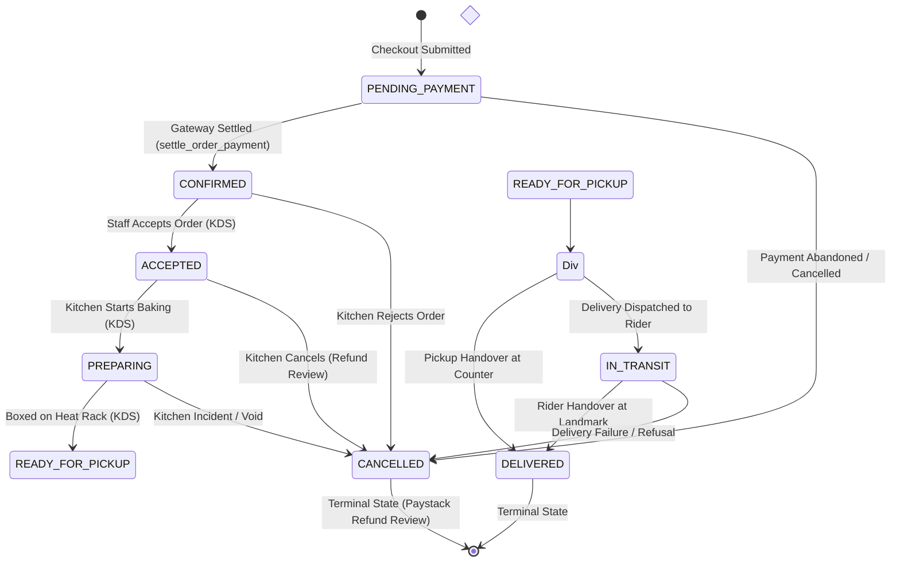

# AY Pizza & Ice Cream — Phase 5.4.3: Order Tracking Architecture & Lifecycle Audit

**Document:** `docs/phase-5-4-3-tracking-audit.md`  
**Application Target:** `ng.aypizza.app`  
**Database:** PostgreSQL 15 / Supabase Staging (`https://gmtlwewpblnnkzuwfcib.supabase.co`)  
**Objective:** Comprehensive technical audit of the order status state machine, lifecycle stages, database schema, event triggers, tracking services, real-time synchronization, and client-facing tracking components.

---

## 1. Executive Summary

This audit evaluates the end-to-end order lifecycle and tracking architecture for the AY Pizza & Ice Cream mobile application. It covers database constraints, PostgreSQL stored procedures (RPCs), row-level security (RLS), Supabase Realtime WebSocket mechanics, polling fallbacks, hardware-backed credential retention, and client rendering components.

### Core Findings:
1. **Database Enum & State Machine:** The PostgreSQL enum `order_status` currently defines 11 distinct values (`DRAFT`, `PENDING_PAYMENT`, `PAID`, `CONFIRMED`, `ACCEPTED`, `PREPARING`, `READY_FOR_PICKUP`, `IN_TRANSIT`, `DELIVERED`, `CANCELLED`, `REFUNDED`).
2. **Current Lifecycle Representation:** Active paid orders currently transition through: `CONFIRMED` $\rightarrow$ `ACCEPTED` $\rightarrow$ `PREPARING` $\rightarrow$ `READY_FOR_PICKUP` $\rightarrow$ `IN_TRANSIT` (Delivery only) $\rightarrow$ `DELIVERED`.
3. **Target 6-Stage Customer Journey Alignment:**
   - *Stage 1: Order Received* $\rightarrow$ Mapped to database `CONFIRMED` (payment verified, order committed to store queue).
   - *Stage 2: Order Confirmed / Kitchen Accepted* $\rightarrow$ Mapped to database `ACCEPTED` (kitchen staff accepted ticket on KDS).
   - *Stage 3: Preparing* $\rightarrow$ Mapped to database `PREPARING` (staff initiated pizza dough stretching, topping, and stone-oven baking).
   - *Stage 4: Ready for Collection / Dispatch* $\rightarrow$ Mapped to database `READY_FOR_PICKUP` (food boxed and hot on heat rack).
   - *Stage 5: Picked Up* $\rightarrow$ Divergent: For **Delivery**, mapped to `IN_TRANSIT` (handed to dispatch rider). For **Pickup**, mapped to initial counter presentation/verification.
   - *Stage 6: Delivered* $\rightarrow$ Mapped to database `DELIVERED` (completed handover to customer).
4. **Data & Schema Gaps:** 
   - `public.orders` contains `accepted_at`, `prepared_at`, `ready_at`, and `completed_at`, but **lacks an `in_transit_at` (or `dispatched_at`) timestamp column**. Dispatched events are recorded in `order_status_events`, but not directly on the order row.
   - Initial checkout creation inserts `status = 'PENDING_PAYMENT'`. If payment drops before gateway settlement, the order remains `PENDING_PAYMENT` until swept.
   - Time estimation is currently static or absent; no dynamic ETA calculation exists. Real timestamps must be strictly sourced from verified database events without fabrication.

---

## 2. Database Schema & State Machine Inspection

### 2.1 Order Status Enum (`order_status`)
Defined in [`supabase/migrations/20261021000001_initial_schema.sql`](file:///c:/Users/Ososanwo%20Idris/Documents/AY%20PIZZA%20MOBILE/supabase/migrations/20261021000001_initial_schema.sql) and extended in [`20261022000005_phase4_1_kds_and_staff_operations.sql`](file:///c:/Users/Ososanwo%20Idris/Documents/AY%20PIZZA%20MOBILE/supabase/migrations/20261022000005_phase4_1_kds_and_staff_operations.sql):

```sql
CREATE TYPE public.order_status AS ENUM (
    'DRAFT',              -- Local client cart / initial state
    'PENDING_PAYMENT',    -- Created authoritatively, awaiting Paystack transaction
    'PAID',               -- Payment authorized (transitional)
    'CONFIRMED',          -- Settled by gateway; enqueued for kitchen
    'ACCEPTED',           -- Acknowledged by staff on Kitchen Display System (KDS)
    'PREPARING',          -- Active stone-oven baking / assembly
    'READY_FOR_PICKUP',   -- Boxed; awaiting counter customer or dispatch rider
    'IN_TRANSIT',         -- Courier dispatched (delivery orders only)
    'DELIVERED',          -- Final successful handover (terminal state)
    'CANCELLED',          -- Rejected by store or customer cancellation (terminal)
    'REFUNDED'            -- Financial refund finalized (terminal)
);
```

### 2.2 Table Structure & Timestamp Tracking (`public.orders`)
Key columns relevant to tracking:

| Column | Type | Description | Current Population Trigger |
| :--- | :--- | :--- | :--- |
| `id` | `UUID` (PK) | Unique order identifier | `create_order_authoritative` |
| `order_number` | `TEXT` | Human-readable (e.g. `AYP-20261104-0042`) | Computed deterministically in DB |
| `status` | `order_status` | Current state | Updated by RPCs |
| `fulfillment_type` | `fulfillment_type` | `'pickup'` or `'delivery'` | Set at checkout |
| `version` | `INT` | Optimistic locking & event sequencing | Incremented on every status update |
| `receipt_token_hash` | `TEXT` | SHA-256 hash of unguessable receipt token | Verified in `get_order_by_receipt` |
| `created_at` | `TIMESTAMPTZ` | Timestamp when order was created | Default `now()` |
| `accepted_at` | `TIMESTAMPTZ` | Timestamp when kitchen accepted order | Set in `transition_order_status` |
| `prepared_at` | `TIMESTAMPTZ` | Timestamp when baking started | Set in `transition_order_status` |
| `ready_at` | `TIMESTAMPTZ` | Timestamp when food was boxed/ready | Set in `transition_order_status` |
| `completed_at` | `TIMESTAMPTZ` | Timestamp when customer received order | Set in `transition_order_status` |
| *`dispatched_at`* | *Missing* | *Timestamp when rider took custody* | *MISSING on `orders` (in `events` only)* |
| `rejection_reason` | `TEXT` | Reason recorded if order is cancelled | Required when target is `CANCELLED` |
| `refund_status` | `TEXT` | `'NONE'`, `'REFUND_REQUIRED'`, `'REFUNDED'` | Set to `REFUND_REQUIRED` if paid order is cancelled |

### 2.3 Immutable Event Log (`public.order_status_events`)
Defined in [`supabase/migrations/20261022000008_phase4_2_tracking_and_notifications.sql`](file:///c:/Users/Ososanwo%20Idris/Documents/AY%20PIZZA%20MOBILE/supabase/migrations/20261022000008_phase4_2_tracking_and_notifications.sql):

```sql
CREATE TABLE public.order_status_events (
    id UUID PRIMARY KEY DEFAULT gen_random_uuid(),
    order_id UUID NOT NULL REFERENCES public.orders(id) ON DELETE CASCADE,
    previous_status public.order_status,
    new_status public.order_status NOT NULL,
    version INT NOT NULL,
    actor_type TEXT NOT NULL,           -- 'staff', 'system', 'customer'
    actor_id TEXT,                      -- Staff UUID or 'database_trigger'
    title TEXT NOT NULL,                -- Human-readable notification/event title
    description TEXT,                   -- Descriptive message
    metadata JSONB DEFAULT '{}'::jsonb,
    created_at TIMESTAMPTZ NOT NULL DEFAULT timezone('utc'::text, now())
);
```

- **Trigger:** `trg_order_status_transition` fires `AFTER UPDATE OF status ON public.orders`.
- **Immutability:** Triggers deny `UPDATE` or `DELETE` on `order_status_events`.
- **Integrity:** Every state transition automatically creates an append-only event record with a server-generated timestamp.

### 2.4 State Machine Rules & Constraints (`transition_order_status`)
Implemented in [`supabase/migrations/20261022000006_phase4_1_1_adversarial_hardening.sql`](file:///c:/Users/Ososanwo%20Idris/Documents/AY%20PIZZA%20MOBILE/supabase/migrations/20261022000006_phase4_1_1_adversarial_hardening.sql):



#### Valid Transition Matrix
| Current Status | Target Status | Allowed Fulfillment Types | Required Staff Role | Automated Action |
| :--- | :--- | :--- | :--- | :--- |
| `PENDING_PAYMENT` | `CONFIRMED` | Both | `system:settle_order_payment` | Sets `payment_reference`, logs event |
| `CONFIRMED` | `ACCEPTED` | Both | `staff`, `kitchen`, `counter`, `manager` | Sets `accepted_at`, enqueues push |
| `CONFIRMED` | `CANCELLED` | Both | `counter`, `manager`, `admin` | Requires `reason`, sets `REFUND_REQUIRED` |
| `ACCEPTED` | `PREPARING` | Both | `staff`, `kitchen`, `manager` | Sets `prepared_at`, enqueues push |
| `PREPARING` | `READY_FOR_PICKUP` | Both | `staff`, `kitchen`, `manager` | Sets `ready_at`, enqueues push |
| `READY_FOR_PICKUP` | `DELIVERED` | **Pickup Only** | `counter`, `staff`, `manager` | Sets `completed_at`, terminal state |
| `READY_FOR_PICKUP` | `IN_TRANSIT` | **Delivery Only** | `staff`, `rider`, `manager` | Rider custody transfer, enqueues push |
| `IN_TRANSIT` | `DELIVERED` | **Delivery Only** | `staff`, `rider`, `manager` | Sets `completed_at`, terminal state |
| Any active | `CANCELLED` | Both | `counter`, `manager`, `admin` | Requires `reason`, sets `REFUND_REQUIRED` |

---

## 3. Tracking Services & Synchronization Audit

### 3.1 Order Service (`src/domains/order/order-service.ts`)
- **Authoritative Retrieval:** `getOrderReceipt(orderId, receiptToken?)` invokes Supabase RPC `get_order_by_receipt`.
- **Security Check:** The RPC hashes `p_receipt_token` via SHA-256 and compares it with `orders.receipt_token_hash`. Alternatively, it verifies `auth.uid() = customer_id` for authenticated sessions, or staff role.
- **SecureStore Fallback:** If `receiptToken` is omitted in React props, the client recovers it from `GuestReceiptStore.getReceipt(orderId)`.
- **Payload Normalization:** Returns fully normalized items and the `events` array sorted chronologically (`ORDER BY created_at ASC`).

### 3.2 Realtime Tracking Service (`src/domains/order/order-tracking-service.ts`)
- **Dual-Mode Engine:** Combines Supabase Realtime WebSocket subscriptions with automated 10-second periodic polling.
- **WebSocket Scoping:** Subscribes strictly to `postgres_changes` filtered by `table=orders, filter=id=eq.${orderId}`.
- **RLS & Guest Isolation (DEF-42-05):** In Supabase, anonymous/guest connections do not have `auth.uid()`. PostgreSQL RLS prevents anonymous sockets from receiving table updates directly. Therefore:
  - If caller is an unauthenticated guest, the Realtime channel is cleanly torn down, and tracking operates exclusively in `polling` mode via the `SECURITY DEFINER` RPC.
  - If caller is an authenticated owner, Realtime remains active (`isRealtimeConnected: true`, `trackingMode: 'realtime'`).
- **Monotonic Version Check:** Incoming payload versions are compared (`incomingVersion >= existingVersion`). Stale, out-of-order, or duplicate updates are discarded.
- **Terminal Lifecycle Teardown:** When the order reaches `DELIVERED` or `CANCELLED`, timers and channels are stopped immediately (`trackingMode: 'terminal'`).

### 3.3 Hardware Credential Store (`src/domains/order/guest-receipt-store.ts`)
- Implements hardware-backed encrypted storage via Expo `SecureStore` (iOS Keychain / Android Keystore).
- Retains up to 20 recent orders in a FIFO index (`ay_pizza_guest_receipts_idx_v1`).
- Preserves credentials even after cancellation or completion so customers can review refund status, notes, and order history.

---

## 4. Current UI Component Inspection: `OrderTrackingModal.tsx`

### 4.1 Existing Capabilities
1. **Header:** Displays order number (`#AYP-...`), connection status badge (`LIVE`, `SYNC`, `FINAL`), manual reload button (`🔄`), and close button (`✕`).
2. **Cancelled Banner:** Surfaces cancellation reason and refund status (`REFUND_REQUIRED` with Paystack notice).
3. **Status Highlight Card:** Shows status emoji, milestone title, description, and "Last updated" time.
4. **Milestone Stepper:** Vertical step indicator displaying label, emoji, description, and status lines (completed green, active orange, upcoming outline).
5. **Notification Opt-In:** Displays prompt to register for push notifications if permission is undetermined.
6. **Fulfillment Details Card:** Shows customer name, phone, delivery landmark, address, and notes.
7. **Order Items & Summary:** Itemized breakdown with size, quantity, customizations, and subtotal/delivery fee/total.
8. **Timeline Event History:** Chronological log of status transitions with timestamps.

### 4.2 Structural Deficiencies & Deficits Identified
1. **Contrast & Theme Collapse:** Text styles in `OrderTrackingModal.tsx` utilize hardcoded values like `'rgba(255, 232, 214, 0.7)'`, which was designed for a dark theme. When rendered on the light cream background (`Colors.night = '#FFF8EC'`), descriptions, event times, and labels are nearly invisible.
2. **Milestone Mismatch:**
   - Current pickup milestones: `CONFIRMED` $\rightarrow$ `ACCEPTED` $\rightarrow$ `PREPARING` $\rightarrow$ `READY_FOR_PICKUP` $\rightarrow$ `DELIVERED` (Collected).
   - Target requirement expects a clear progression: *Order Received* $\rightarrow$ *Order Confirmed* $\rightarrow$ *Preparing* $\rightarrow$ *Ready for Collection/Dispatch* $\rightarrow$ *Picked Up* $\rightarrow$ *Delivered*.
   - In current pickup flow, `DELIVERED` is labeled "Collected" in step 5, omitting a distinct intermediate "Picked Up" state.
3. **Missing `in_transit_at` Timestamp:** When a courier dispatches an order, `orders.in_transit_at` does not exist on the database table, leaving the UI to rely solely on the event history table or `updated_at`.
4. **No Estimated Delivery Countdown:** While hardcoded delivery ranges (e.g. `25-35 mins`) exist on the home screen, the tracking screen shows no estimated completion window or time elapsed.
5. **Static Customer Help / Support:** If an order is delayed, there is no direct "Contact Kitchen / Call Courier" action button in the tracking modal.

---

## 5. Journey Mapping: Target 6-Stage Progression vs Backend Reality

The table below maps the 6 requested customer-facing stages against current database and staff capabilities:

| Target Stage | Customer-Facing Meaning | DB Status Today | Timestamp Source Today | Staff Action Needed to Trigger | Gaps / Work Needed |
| :--- | :--- | :--- | :--- | :--- | :--- |
| **1. Order Received** | Payment settled; order recorded in database; waiting for kitchen pickup. | `CONFIRMED` | `orders.created_at` | Automated via `settle_order_payment` (Paystack webhook or verify RPC). | Rename UI presentation from "Confirmed" to "Order Received / Queued" to distinguish from kitchen confirmation. |
| **2. Order Confirmed** | Kitchen staff reviewed ticket and accepted order into production queue. | `ACCEPTED` | `orders.accepted_at` | Kitchen staff taps "Accept Order" on KDS. | Supported in DB & KDS. Ensure client timeline highlights kitchen acceptance timestamp. |
| **3. Preparing** | Pizza dough stretched, toppings applied, baking in the King Jaja stone oven. | `PREPARING` | `orders.prepared_at` | Kitchen staff taps "Start Baking" on KDS. | Supported in DB & KDS. |
| **4. Ready for Collection / Dispatch** | Baking complete, sliced, boxed, hot on heat rack. | `READY_FOR_PICKUP` | `orders.ready_at` | Kitchen staff taps "Mark Ready / Boxed" on KDS. | Supported in DB & KDS. |
| **5. Picked Up** | **Pickup:** Customer arrived at King Jaja counter.<br>**Delivery:** Courier collected order and departed store. | **Delivery:** `IN_TRANSIT`<br>**Pickup:** *No intermediate status between Ready & Delivered* | `order_status_events.created_at` (*`orders.in_transit_at` is missing*) | **Delivery:** Staff taps "Dispatch Courier".<br>**Pickup:** Handover initiated at counter. | **Database Change:** Add `in_transit_at` (or `dispatched_at`) to `public.orders`. For Pickup, `READY_FOR_PICKUP` represents ready at counter; "Collected" is `DELIVERED`. |
| **6. Delivered** | Customer has received their meal. Order complete. | `DELIVERED` | `orders.completed_at` | **Pickup:** Counter staff taps "Handed Over".<br>**Delivery:** Rider or staff taps "Delivered". | Supported in DB & KDS. Final terminal stage. |

### Handling Alternative & Terminal Failure States:
1. **Order Cancelled / Rejected by Store:** Status `CANCELLED`.
   - Requires non-empty `rejection_reason`.
   - Automatically sets `refund_status = 'REFUND_REQUIRED'` if order was paid.
   - UI must display: Red banner, exact store reason, refund review notice, and support hotline button.
2. **Payment Failed / Abandoned:** Status `PENDING_PAYMENT` or payment gateway decline.
   - Order does not reach `CONFIRMED`.
   - Client shows Paystack decline alert and allows immediate re-attempt without recreating cart.

---

## 6. Required Database & Backend Changes for Implementation

> [!IMPORTANT]
> In accordance with Phase 5.4.3 constraints, **no database migrations will be executed during this audit**. The following changes are formally cataloged for execution in Phase 5.5.

1. **Schema Migration:**
   ```sql
   -- Add missing dispatch timestamp to orders table
   ALTER TABLE public.orders 
   ADD COLUMN IF NOT EXISTS in_transit_at TIMESTAMPTZ DEFAULT NULL;
   ```
2. **RPC Update (`transition_order_status`):**
   Update transition logic to populate `in_transit_at = v_now` when `p_target_status = 'IN_TRANSIT'`.
3. **RPC Update (`get_order_by_receipt`):**
   Expose `in_transit_at` in the returned JSONB object.
4. **TypeScript Domain Types:**
   Update `Order` interface in `src/types/order.ts` to include `in_transit_at?: string | null`.
5. **Staff KDS Enhancements:**
   Ensure dispatch riders or counter staff can update `IN_TRANSIT` $\rightarrow$ `DELIVERED` cleanly with minimal taps.

