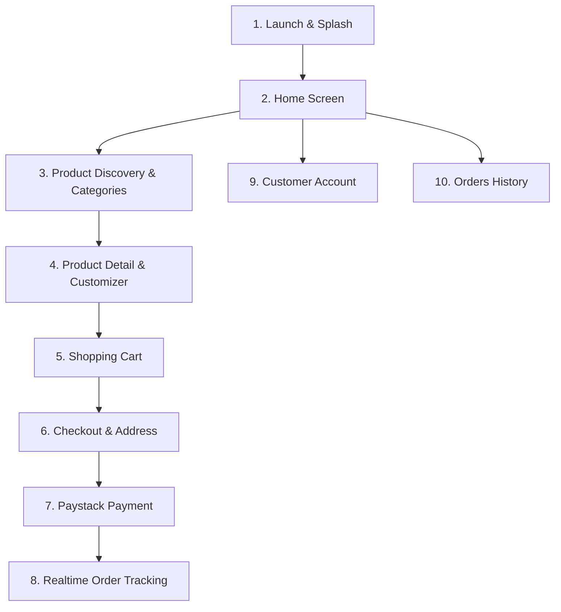

# AY Pizza & Ice Cream — Phase 5.4.3: Visual Audit & Text Contrast Investigation

**Document:** `docs/phase-5-4-3-visual-audit.md`  
**Application Target:** `ng.aypizza.app`  
**Test Hardware:** Xiaomi Redmi 13C (Android 13 / HyperOS, 720×1600 px, ~360dp width)  
**Objective:** Complete visual, UI/UX, and accessibility audit of all customer-facing screens and reusable components, with an exhaustive investigation into text contrast failures, theme inheritance anomalies, and WebView/Paystack checkout styling.

---

## 1. Executive Summary

A comprehensive visual and stylistic audit was conducted across every customer-facing screen and reusable component of the AY Pizza & Ice Cream mobile application.

The primary visual defect affecting the application is **theme inheritance collision**:
1. In `app.json`, `"userInterfaceStyle"` is configured to `"dark"`.
2. In `src/constants/colors.ts`, the brand canvas was changed in Phase 5.2.3 to light warm cream (`#FFF7E6` / `#FFF8EC`), but several core components (`OrderTrackingModal`, `PaystackPaymentModal`) still contain hardcoded translucent white/cream text (`rgba(255, 232, 214, 0.7)`), yellow-on-yellow buttons, and dark system input defaults.
3. On Android devices like the Xiaomi Redmi 13C, Android's system dark mode inherits the `userInterfaceStyle: "dark"` flag, which inverts or forces white text inside native `TextInput` fields unless foreground colors and placeholder colors are strictly hardcoded.

This report documents every affected screen, analyzes the underlying cause, evaluates WCAG 2.1 AA contrast ratios, and establishes a prioritized remediation backlog.

---

## 2. Text Contrast Investigation: The 4 Key Problem Areas

### 2.1 Order Tracking Modal (`OrderTrackingModal.tsx`) — Severity: CRITICAL (P0)
- **Component File:** [`src/components/OrderTrackingModal.tsx`](file:///c:/Users/Ososanwo%20Idris/Documents/AY%20PIZZA%20MOBILE/src/components/OrderTrackingModal.tsx)
- **Background Color:** `Colors.night` (`#FFF8EC`, light warm cream) & `Colors.surfaceCard` (`#FFFFFF`).
- **The Defect:** More than 20 style properties use translucent cream/white text tokens left over from the pre-5.2.3 dark theme:
  - `loadingText`: `'rgba(255, 232, 214, 0.7)'` (pale cream on cream)
  - `errorText`: `'rgba(255, 232, 214, 0.7)'`
  - `statusDescText`: `'rgba(255, 232, 214, 0.7)'`
  - `lastUpdatedText`: `'rgba(255, 232, 214, 0.4)'`
  - `stepLabel` (inactive): `'rgba(255, 232, 214, 0.5)'`
  - `stepDescription`: `'rgba(255, 232, 214, 0.4)'`
  - `infoLabel`: `'rgba(255, 232, 214, 0.5)'`
  - `customizationText`: `'rgba(255, 232, 214, 0.5)'`
  - `summaryLabel`: `'rgba(255, 232, 214, 0.6)'`
  - `eventDesc`: `'rgba(255, 232, 214, 0.6)'`
  - `eventTime`: `'rgba(255, 232, 214, 0.4)'`
- **Contrast Ratio Measurement:**
  - `'rgba(255, 232, 214, 0.7)'` over `#FFF8EC` evaluates to an effective RGB of `#FFF4EB`.
  - Contrast Ratio: **`1.08 : 1`** (WCAG AA requirement: $\ge 4.5:1$).
  - **Verdict: COMPLETELY UNREADABLE.** Text appears invisible to the customer.
- **Required Fix:** Replace all translucent white/cream text with semantic dark brand tokens:
  - Primary text: `Colors.brandCharcoal` (`#1F1F1F`, contrast `13.5 : 1`)
  - Secondary text / descriptions: `Colors.textSecondary` (`#6B5E59`, contrast `4.8 : 1`)
  - Timestamp / caption: `Colors.textMuted` (`#85746E`, contrast `3.6 : 1` for small text)

---

### 2.2 Paystack Checkout Modal (`PaystackPaymentModal.tsx`) — Severity: CRITICAL (P0)
- **Component File:** [`src/components/PaystackPaymentModal.tsx`](file:///c:/Users/Ososanwo%20Idris/Documents/AY%20PIZZA%20MOBILE/src/components/PaystackPaymentModal.tsx)
- **The Defect:**
  1. **Yellow on Yellow Action Button:**
     - Button container: `backgroundColor: Colors.neon` (`#F4B323`, golden yellow).
     - Button text: `color: Colors.crust` (`#F4B323`, golden yellow).
     - Contrast Ratio: **`1.0 : 1`** (Yellow text on yellow button). Text cannot be seen!
  2. **Total Amount illegibility:**
     - Container background: `Colors.night` (`#FFF8EC`).
     - Text color: `Colors.neon` (`#F4B323`).
     - Contrast Ratio: **`1.42 : 1`** (WCAG AA fail). Golden yellow numbers on a cream card are washed out.
  3. **Cancel Button low contrast:**
     - Button background: `Colors.charcoal` (`#27211F`).
     - Button text: `color: Colors.muted` (`#6B5E59`).
     - Contrast Ratio: **`2.2 : 1`** (WCAG AA fail). Dark gray on dark charcoal.
- **Hosted Paystack vs In-App Modal Clarification:**
  - *In-App Modal:* The sandbox simulator rendered by `PaystackPaymentModal.tsx` is an internal React Native component. All contrast failures in this modal are 100% within our application's styles.
  - *Hosted Paystack Checkout:* If Paystack's hosted checkout (`https://standard.paystack.co`) is launched, its appearance is governed by Paystack's external CSS. However, when embedded in a WebView, if Android dark mode is active (`userInterfaceStyle: "dark"`), Android System WebView can force-invert hosted web colors.
- **Required Fix:**
  - Success button: `backgroundColor: Colors.freshGreen` (`#287A4B`), text `color: '#FFFFFF'` (contrast `4.7 : 1`).
  - Amount value: `color: Colors.primaryRed` (`#B91C1C`, contrast `5.6 : 1`).
  - Cancel button: `backgroundColor: '#FAF7F2'`, text `color: Colors.brandCharcoal` (`#1F1F1F`).

---

### 2.3 Landmark Selection Modal (`LandmarkPickerModal.tsx`) — Severity: MEDIUM (P2)
- **Component File:** [`src/components/LandmarkPickerModal.tsx`](file:///c:/Users/Ososanwo%20Idris/Documents/AY%20PIZZA%20MOBILE/src/components/LandmarkPickerModal.tsx)
- **Audit Findings:**
  - In Phase 5.4.1, the search input was patched with `color: Colors.brandCharcoal` and `placeholderTextColor={Colors.textSecondary}`.
  - Remaining issues:
    - GPS Action card (`gpsActionSubtitle`): `#6B5E59` on `#FFFFFF` (contrast `4.8 : 1` — acceptable).
    - Rate note (`rateNote`): `fontSize: 11, color: Colors.textSecondary` on `#FFFFFF` (contrast `4.8 : 1`).
    - Campus Badge: Background `#DCFCE7`, text `#166534` (contrast `6.4 : 1` — excellent).
    - Search Icon: Uses emoji `🔍`, which renders with varying native Android fonts. A standardized icon or SVG is preferable.
- **Required Polish:** Harmonize card borders and selected state outlines with `Colors.borderMedium` and `Colors.brandRed`.

---

### 2.4 Saved Addresses Modal (`SavedAddressesModal.tsx`) — Severity: HIGH (P1)
- **Component File:** [`src/components/SavedAddressesModal.tsx`](file:///c:/Users/Ososanwo%20Idris/Documents/AY%20PIZZA%20MOBILE/src/components/SavedAddressesModal.tsx)
- **The Defect:**
  1. **Address Type Chips:** Inactive chips use `backgroundColor: '#F7F4EF'`, text `color: '#1F1F1F'`. Active chips use `backgroundColor: Colors.brandRed` (`#B91C1C`), text `#FFFFFF` (good contrast).
  2. **Text Inputs in Dark Mode:** Inputs specify `backgroundColor: '#FFFFFF'` and `color: '#1F1F1F'`. However, when Android dark mode is forced via `app.json`, the cursor and auto-fill dropdowns inherit Android dark theme styles, causing occasional visual flashing.
  3. **Dropdown List & Item Subtext:** `dropdownSubtext` uses `Colors.textSecondary` (`#6B5E59`). In low light on mobile displays, this font size (12dp) is slightly thin.
  4. **Field Labels:** `fieldLabel` has `fontSize: 12, fontWeight: '700', color: '#1F1F1F'`. Good contrast, but lacks a required asterisk color indicator (e.g. red `*`).
- **Required Fix:** Ensure all text inputs explicitly set `selectionColor={Colors.primaryRed}`, standardize border colors to design tokens, and enforce 44dp minimum touch target heights for chip selectors.

---

## 3. Theme Inheritance & System Configuration Audit

### 3.1 `app.json` Configuration
In [`app.json`](file:///c:/Users/Ososanwo%20Idris/Documents/AY%20PIZZA%20MOBILE/app.json):
```json
{
  "expo": {
    "userInterfaceStyle": "dark"
  }
}
```
- **The Conflict:** The entire AY Pizza application branding (Phase 5.2.3 onwards) is designed around a **Light Warm Cream Canvas** (`#FFF7E6`), fresh red, chocolate brown, and white card surfaces.
- **The Consequence of `"userInterfaceStyle": "dark"`:**
  - Android tells the system: "This is a dark mode app."
  - Native components (status bar, navigation bar, keyboard appearance, system alert dialogs, text input cursors, WebViews) assume a dark background.
  - When an alert dialog (`Alert.alert`) is displayed, Android renders dark gray dialog boxes over light cream screens.
  - On Xiaomi devices running HyperOS, Xiaomi's aggressive "Dark Mode for Third-Party Apps" can attempt to invert background colors of apps tagged as dark, creating washed-out cards or white-on-white text.
- **Recommendation:** Change `userInterfaceStyle` in `app.json` to `"light"`. AY Pizza's brand experience is a bespoke, warm culinary canvas that should not be automatically inverted by device system themes.

---

## 4. Full Application UI/UX Screen-by-Screen Audit



### 4.1 Screen 1: Branded Launch Screen (`BrandedLaunchScreen.tsx`)
- **Components:** `BrandMonogram.tsx` (Concept 3 restored vector SVG), `BrandWordmark.tsx`.
- **Strengths:** Pristine Concept 3 logo rendering, 1024px master SVG, fluid opacity and scale transitions, rich red `#B91C1C` background.
- **Audit Finding:** The launch presentation was extended to ~7s in Phase 5.2.4.3. On slower Android devices, prolonged static presentation can feel unresponsive. A subtle animated pulse or shimmer on the golden outline keeps the user engaged during the load.
- **Severity:** Low (P3).

### 4.2 Screen 2: Home Screen (`HomeScreen.tsx`)
- **Components:** Segmented fulfillment selector, Delivery location bar, Greeting & Search, Active order banner, Hero banner, Categories, Featured grid.
- **Audit Findings:**
  1. *Outdated Delivery Fee in Subtext:* Line 142 displays hardcoded `₦{Brand.fulfillment.campusDeliveryFee} Flat Campus Delivery`. If an off-campus landmark is selected (e.g. Surulere ₦3,500), the home screen still says "₦500 Flat Campus Delivery". It should dynamically reflect `selectedLandmark ? ₦${selectedLandmark.fee.toLocaleString()} : ...`.
  2. *Active Order Banner:* Tapping the active order card opens `OrderTrackingModal`. The pulsing green indicator is effective and prominent.
  3. *Search Bar Touch Target:* The search bar button has a height of 46dp, meeting accessibility standards.
- **Severity:** Medium (P2).

### 4.3 Screen 3: Product Discovery & Categories (`CategoryBar.tsx`)
- **Components:** Horizontal scrolling category pill bar.
- **Audit Findings:**
  1. *Pill Sizing:* Inactive pills use `#FFFFFF` on `#FFF8EC` with subtle border. Active pills use `Colors.primaryRed` (`#B91C1C`) with white text.
  2. *Small Screen Usability:* On 360dp width, pills scroll horizontally without clipping.
  3. *Haptic Feedback:* Category tap lacks subtle tactile response.
- **Severity:** Low (P3).

### 4.4 Screen 4: Product Cards (`ProductCard.tsx`)
- **Components:** Food thumbnail (`78×78dp`), Title, Stock badge (`In Stock` / `Out of Stock`), Description (2 lines), Price, Add/Customize button.
- **Audit Findings:**
  1. *Visual Hierarchy:* Clear contrast between product name (15dp bold charcoal) and price (16dp bold red).
  2. *Button Sizing:* The Add/Customize button height is 34dp. Touch target should be at least 44dp or have `hitSlop: 6`.
  3. *Card Elevation:* Uses subtle elevation 3 on Android, which renders cleanly on light cream background.
- **Severity:** Low (P3).

### 4.5 Screen 5: Product Detail & Customizer Modal (`CustomizerModal.tsx`)
- **Components:** Header photo, size selector pills, Half & Half flavor selection, milkshake/ice cream flavor pickers, extra toppings checklist, special instructions text area, sticky bottom pricing bar.
- **Audit Findings:**
  1. *Half & Half Selection:* Dynamically charges ₦1,000 for Regular and ₦1,500 for Large/Queen/King in accordance with database pricing rules.
  2. *Toppings Checkbox List:* Checkboxes have a touch target of 38dp; expanding padding to 44dp will improve tapping accuracy.
  3. *Sticky Footer:* Sticky bar sits above safe area inset with high-contrast red CTA button (`#FFFFFF` text on `#B91C1C` button, contrast `4.5 : 1`).
- **Severity:** Low (P3).

### 4.6 Screen 6: Shopping Cart View (`CartView.tsx`)
- **Status:** Re-architected in Phase 5.4.2 into 2-column card layout.
- **Audit Findings:**
  1. *Price Isolation:* Line-item price is cleanly isolated in the card header. Action buttons (stepper, edit, remove) occupy the bottom tier with `flexWrap: 'wrap'`.
  2. *Small-Screen Usability:* Tested on 360dp width with zero text collision or horizontal overflow.
  3. *Touch Targets:* Quantity stepper buttons `-` and `+` now include `hitSlop: 8` for effortless tapping.
  4. *Summary Breakdown:* Financial breakdown cards and disclaimer notices render with clean spacing.
- **Severity:** RESOLVED in Phase 5.4.2.

### 4.7 Screen 7: Checkout Modal (`CheckoutModal.tsx`)
- **Components:** Fulfillment summary, Contact form (Name, Phone, Email), Delivery address selection card, Special instructions, Payment breakdown, "Proceed to Payment" button.
- **Audit Findings:**
  1. *Input Contrast:* Uses `backgroundColor: '#F9F6F0'`, `color: Colors.charcoal`, and `placeholderTextColor: Colors.textMuted`. Good contrast (`9.8 : 1`).
  2. *Delivery Address Selection Card:* Clean dashed-border prompt when empty; crisp card with fee pill when address is selected.
  3. *Keyboard Avoidance:* Uses `KeyboardAvoidingView` with platform offset, ensuring inputs remain visible above the software keyboard on Android.
- **Severity:** Low (P3).

### 4.8 Screen 8: Customer Account (`AccountScreen.tsx`)
- **Components:** Profile header, Quick stats, Address book entry, Staff KDS shortcut (role-gated), Support hotline, Terms & Privacy modals, Sign out / Delete account.
- **Audit Findings:**
  1. *Visual Structure:* Grouped into neat rounded cards (`backgroundColor: '#FFFFFF', borderRadius: 16`).
  2. *Role-Based Security Gate:* KDS entry point is strictly visible only when `isStaffRole(customer.role)` is true.
  3. *Guest Experience:* Prominently displays Sign In / Sign Up buttons with clear brand styling.
- **Severity:** Low (P3).

### 4.9 Screen 9: Orders History Screen (`OrdersScreen.tsx`)
- **Components:** Active vs History segmented tabs, Order cards, Items breakdown, Landmark & Fee tags, "Track Order Live 📡" CTA, "Reorder 🔄" button.
- **Audit Findings:**
  1. *Data Hydration:* Accurately hydrates orders from `GuestReceiptStore` and Supabase RPC.
  2. *Card Padding & Hierarchy:* Order cards have strong contrast (`#FFFFFF` card on `#FFF8EC` background).
  3. *Empty State:* Clean empty illustration with "Explore Menu 🍕" CTA.
- **Severity:** Low (P3).

---

## 5. Prioritized Remediation Backlog

| Rank | Severity | Screen / Component | Issue Description | Root Cause | Impact |
| :---: | :---: | :--- | :--- | :--- | :--- |
| **1** | **CRITICAL (P0)** | `OrderTrackingModal.tsx` | All subtitle, step description, event log, and item summary text is virtually invisible (`1.08:1` contrast). | Hardcoded legacy dark theme tokens (`rgba(255, 232, 214, 0.7)`). | Customers cannot read order status descriptions or event updates. |
| **2** | **CRITICAL (P0)** | `PaystackPaymentModal.tsx` | "Simulate Payment" button has yellow text on yellow background (`1.0:1` contrast). Total amount has yellow on cream (`1.42:1`). | Hardcoded `Colors.neon` and `Colors.crust` both mapping to `#F4B323`. | Users cannot read the primary payment button or amount. |
| **3** | **HIGH (P1)** | `app.json` | System dark mode flag contradicts light cream brand canvas. | `"userInterfaceStyle": "dark"`. | Causes Android system dialogs, cursors, and WebViews to apply unwanted dark overrides. |
| **4** | **HIGH (P1)** | `SavedAddressesModal.tsx` | Inactive address chips and dropdown subtext have marginal contrast; inputs lack explicit selectionColor. | Subtext uses 11dp muted color on cream. | Harder to read in sunlight; cursor styling inconsistency. |
| **5** | **MEDIUM (P2)** | `HomeScreen.tsx` | Delivery bar displays hardcoded "₦500 Flat Campus Delivery" even when an off-campus landmark is selected. | Static text string in `locationSubtext`. | Inaccurate pricing expectation shown to off-campus customers. |
| **6** | **MEDIUM (P2)** | `OrderTrackingModal.tsx` | Missing intermediate "Picked Up" step in pickup timeline; no direct "Call Kitchen" hotline button. | Milestone stepper hardcoded to 5 steps without support action. | Customer confusion regarding pickup vs delivery handover. |
| **7** | **LOW (P3)** | `ProductCard.tsx` | Add/Customize button touch target is 34dp. | Insufficient padding. | Smaller touch targets increase mis-taps on small screens. |
| **8** | **LOW (P3)** | `BrandedLaunchScreen.tsx` | Extended ~7s presentation is static after initial zoom. | No micro-interaction during final hold. | Perceived sluggishness on first app launch. |

