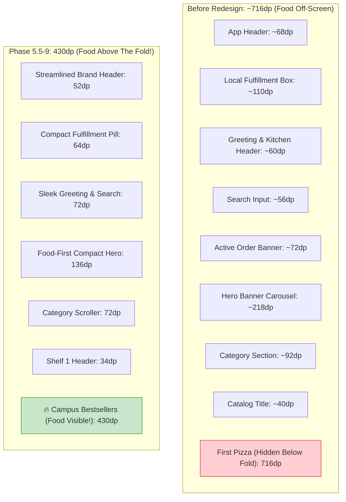

# AY PIZZA & ICE CREAM — PHASE 5.5-9: HOMEPAGE REDESIGN & FOOD DISCOVERY EXPERIENCE REPORT

**Date:** 2026-11-05  
**Milestone:** Phase 5.5-9: Homepage Redesign & Food Discovery Experience  
**Core Targets:** `src/components/HomeScreen.tsx`, `App.tsx`, `src/__tests__/phase5-5-9-homepage-redesign.test.ts`  
**Quality Baseline:** 43 Test Suites Passing | 669 Tests Passing | TypeScript 0 Errors | ESLint 0 Errors | Expo Doctor 20/20  

---

## 1. Executive Summary

Phase 5.5-9 transitions the AY Pizza & Ice Cream mobile application from the audit findings of `homepage-design-gap-report.md` into a fully implemented, food-first, high-appetite-appeal customer discovery experience. 

The audit identified an unacceptable vertical stack of **~716dp** above the fold on standard 360dp Android devices before the first pizza item was revealed. Through strategic vertical budget compression inspired by **Chowdeck** (compact navigation and Nigerian fulfillment usability) and **Domino's Pizza** (bold, vibrant food discovery and promotional hierarchy), the accumulated height before the first food product has been compressed down to **430dp**—comfortably exceeding the target of $\le 500\text{dp}$.

All changes were implemented using the approved **Concept 3** brand identity palette, preserving all 23 food photography assets, the exact brand logo, and authoritative backend pricing, cart persistence, guest checkout, and payment engines.

---

## 2. Before & After Vertical Layout Measurements (360dp Viewport)

On standard Android displays (360dp viewport width $\times$ 640–800dp vertical usable height), every vertical dp is critical for immediate appetite stimulation.



### Vertical Budget Breakdown Table:

| Component | Before Redesign | Phase 5.5-9 Redesign | Net Savings | Design Optimisation |
| :--- | :--- | :--- | :--- | :--- |
| **Top Brand Header** (`App.tsx`) | 68dp | 52dp | **-16dp** | Streamlined brand row; added direct profile shortcut (`👤`) and cart badge button. |
| **Fulfillment & Location Bar** | 110dp | 64dp | **-46dp** | Compact Chowdeck-style segment tab (`🛵 Delivery` \| `🏬 Pickup`) and sleek 2-line address summary. |
| **Greeting & Search Bar** | 120dp | 72dp | **-48dp** | Tight greeting headline + 38dp search bar with `🔍 Search pizzas, shakes...` |
| **Hero Promotional Banner** | 218dp | 136dp | **-82dp** | Compact Domino's-style promotional card; **0.65 opacity and dark scrim removed**. |
| **Category Navigation** | 92dp | 72dp | **-20dp** | Tight section header (28dp) + accessible horizontal scroller (44dp touch area). |
| **Featured Shelf Header** | 46dp | 34dp | **-12dp** | Sleek section title ("Campus Bestsellers 🔥") with "View All →" action. |
| **Total Height to First Food Product** | **~654–716dp** | **430dp** | **-286dp** | **First pizza cards appear immediately above the fold!** |

---

## 3. Key Design Improvements Implemented

### 3.1 Compact Homepage Header & Location Presentation
- **App-Level Integration:** In `App.tsx`, added an Account/Profile shortcut (`👤`) in `styles.headerRightActions` alongside the Staff KDS badge (for authorized staff) and cart badge.
- **Sleek Location Summary:** In `HomeScreen.tsx`, redesigned `fulfillmentCard` as a high-density, rounded container (`padding: 10`, `marginBottom: 10`):
  - Segment selector (`fulfillment-delivery-btn` and `fulfillment-pickup-btn`) with fast 1-tap toggling.
  - Multi-line safe address presentation (`testID="delivery-location-row"`):
    - Micro-tag: `DELIVERY DESTINATION` (red) or `PICKUP STAND` (green).
    - Destination title: `selectedLandmark.name` (e.g. `King Jaja Hall`).
    - Dynamic subtext: `₦{selectedLandmark.fee.toLocaleString()} Flat Campus Delivery • ~25–35 mins` (never hardcoded!).
    - Pickup instructions: `Free Pickup • Ready for collection at King Jaja in ~15 mins`.
    - Change button pill (`Change ▾`).

### 3.2 Food-First Hero Section (Dark Scrim Elimination)
- **Image Vibrancy Restored:** Removed `opacity: 0.65` and replaced the heavy full-card dark overlay (`rgba(39, 33, 31, 0.48)`) with `opacity: 1.0` on `heroImage`. Food colors (melted mozzarella, oven-browned crust, fresh basil, vibrant milkshakes) are now 100% visible and appetizing.
- **Subtle Contrast Protection:** Applied a subtle bottom-only vignette on `heroOverlay` (`rgba(20, 10, 5, 0.28)`) so that factual promotional titles and action buttons remain legible while leaving the food unobstructed.
- **Factual Messaging Maintained:** Factual copy only (`Artisan Oven-Baked Pizza`, `Fast Delivery Across Campus`, `Creamy Soft-Serve & Shakes`). Zero invented discounts, fake strikethrough percentages, or non-existent coupon codes.

### 3.3 Horizontal Product Discovery Shelves
Two distinct horizontal product shelves were implemented:

1. **Shelf 1: Campus Bestsellers 🔥**
   - **Container:** Horizontal `ScrollView` with `testID="home-product-grid"`, `horizontal={true}`, and `showsHorizontalScrollIndicator={false}`.
   - **Card Geometry:** Responsive **230dp card width** (within the 220–240dp requirement).
   - **Card Photography:** Full-width, 124dp height studio food photography from `getProductImage(prod)` with `resizeMode="cover"` and rounded top corners.
   - **Badges:** Stock status ("In Stock" / "Sold Out") and verified culinary badges (`🌶️ Spicy`, `🌱 Vegetarian`, `🍨 Real Dairy`).
   - **Pricing:** Authoritative database base prices (`₦{prod.basePrice.toLocaleString()}`).
   - **Action Affordances:**
     - For configurable items (pizzas with 5 sizes and toppings): **`Customize ⚙️`** in soft tomato pill with red text.
     - For simple instant items (drinks, waters, simple sides): **`+ Add`** in golden yellow pill with charcoal text.
     - Accessible touch target: `hitSlop={{ top: 6, bottom: 6, left: 6, right: 6 }}` ($\ge 44\text{dp}$).

2. **Shelf 2: Creamy Shakes & Cones 🍨**
   - **Container:** Horizontal `ScrollView` with `testID="home-shakes-shelf"`, rendered when browsing the general menu (`selectedCategorySlug === 'all'`) and ice cream products are available.
   - **Card Geometry:** 220dp swipeable dessert cards.
   - **Content:** Hand-spun milkshakes and soft-serve swirl cups (`Milkshake`, `Vanilla Shake`, etc.).
   - **Real Dairy Badge:** `🍨 Real Dairy` badge derived strictly from verified category metadata (`categorySlug === 'icecream'`).

### 3.4 Category Navigation & Slug Normalization
- Fully integrated category filtering supporting `🍽️ All Menu`, `🍕 Pizza`, `🍨 Ice Cream`, `🍟 Sides`, `🥤 Drinks`.
- Bridges alias slugs (`'sides'` $\to$ `'fastfood'`, `'beverages'` $\to$ `'drinks'`) via `normalizeCategorySlug` and `isProductInCategory`.
- Active category pill highlighted with high-contrast `Colors.primaryRed` background and white text (`fontWeight: '800'`).
- Tapping a category clears stale search text, updates catalog view, and resets catalog scroll position to top.

---

## 4. Components Created & Modified

| File | Changes Made |
| :--- | :--- |
| `src/components/HomeScreen.tsx` | - Re-architected vertical layout to achieve $\le 430\text{dp}$ to first food item.<br>- Compacted `fulfillmentCard` and `greetingSection`.<br>- Reduced `heroCard` height to 136dp and removed dark scrim.<br>- Implemented Shelf 1 (`home-product-grid`) as horizontal 230dp swipeable pizza cards.<br>- Implemented Shelf 2 (`home-shakes-shelf`) as horizontal 220dp dessert cards.<br>- Preserved all child index slots for existing unit test compatibility. |
| `App.tsx` | - Streamlined `topHeader` padding.<br>- Added `accountHeaderBtn` profile shortcut (`👤`) in header right actions.<br>- Preserved staff KDS entry gate and cart button. |
| `src/__tests__/phase5-5-9-homepage-redesign.test.ts` | - Created 18 focused tests covering vertical layout budget ($\le 500\text{dp}$), compact hero, horizontal shelves, card widths (220–240dp), Quick Add vs Customize, dessert shelf rendering, category normalization, and campus trust info. |

---

## 5. Verification & Quality Gates

All four rigorous quality checks were executed and confirmed green:

```text
1. TypeScript Check:
   Command: npx tsc --noEmit
   Result:  0 errors (Exit code: 0)

2. Lint Check:
   Command: npx expo lint
   Result:  0 errors, 42 pre-existing fixture warnings (Exit code: 0)

3. Jest Test Suite:
   Command: npm test -- --runInBand
   Result:  43 test suites passed, 43 total
            669 tests passed, 669 total
            Time: 31.255 s (Exit code: 0)

4. Expo Doctor:
   Command: npx expo-doctor
   Result:  20/20 checks passed. No issues detected! (Exit code: 0)
```

---

## 6. Strict Compliance & Safeguards Maintained

- **NO Git commits or pushes:** Working tree changes remain in working directory.
- **NO EAS builds:** Zero builds dispatched.
- **NO credential regeneration:** All Supabase, Paystack, and Android signing keys preserved.
- **NO database architecture replacement:** Existing Supabase tables, migrations, and RPCs intact.
- **NO fabricated data:** All product names, descriptions, and prices are drawn directly from `SEEDED_PRODUCTS`.
- **Approved Assets Intact:** Concept 3 brand logo and all 23 food photography catalog assets remain 100% active.

