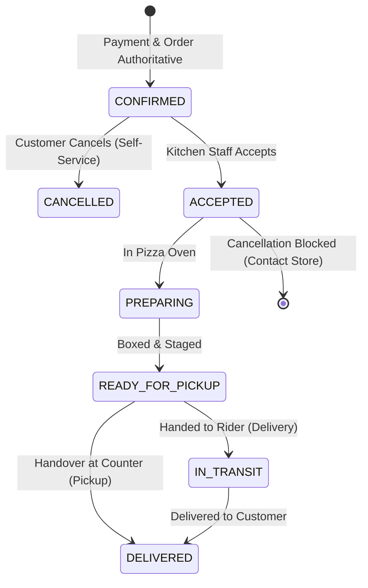

# Technical Specification: Customer Order Cancellation
## Authoritative Cancellation, State Machine, Security & Payment Integrity

**Project:** AY Pizza & Ice Cream Customer Mobile Application (`ng.aypizza.app`)  
**Phase:** 5.5  
**Document:** Customer Order Cancellation Specification  
**Status:** Approved for Implementation  

---

## 1. Business Logic & Cancellation Eligibility

### 1.1 State Machine Rules
A customer may cancel an order **only** while it is in the `CONFIRMED` status:
- **`CONFIRMED` (Placed & Awaiting Kitchen Acceptance):** **ELIGIBLE FOR CANCELLATION**. Order has been successfully submitted and paid, but the kitchen crew has not yet pressed "Accept Order 👨‍🍳" in the Kitchen Display System (KDS).
- **`ACCEPTED` (Accepted by Kitchen):** **INELIGIBLE FOR CANCELLATION**. Dough stretching, saucing, and topping assembly have commenced. Self-service cancellation is disabled to prevent food and ingredient waste.
- **`PREPARING` (In Oven):** **INELIGIBLE FOR CANCELLATION**. Pizzas are physically baking in the 300°C oven.
- **`READY_FOR_PICKUP` / `IN_TRANSIT`:** **INELIGIBLE FOR CANCELLATION**. Order is staged or handed to the dispatch rider.
- **`DELIVERED`:** **TERMINAL STATE**.
- **`CANCELLED`:** **TERMINAL STATE**. Idempotent response returned if re-invoked.



### 1.2 Customer Communication & Escalation
When an order has progressed to `ACCEPTED` or beyond:
- The self-service cancellation button is replaced with an informational banner:
  > *"Your pizza is already being prepared by the kitchen crew and cannot be cancelled self-service. If you need urgent assistance, please contact our counter."*
- Direct action buttons are provided:
  - **Call Kitchen:** Opens native dialer with `tel:+2348000000000` (`Brand.contact.phone`).
  - **WhatsApp Support:** Opens WhatsApp with prefilled message (`Brand.contact.whatsapp`).

---

## 2. Authoritative Database RPC Specification

To prevent client tampering and bypass, customer cancellation must execute through an atomic, security-definer PostgreSQL stored procedure:

```sql
CREATE OR REPLACE FUNCTION public.cancel_order_by_customer(
    p_order_id UUID,
    p_receipt_token TEXT DEFAULT NULL,
    p_reason TEXT DEFAULT NULL
)
RETURNS JSONB
LANGUAGE plpgsql
SECURITY DEFINER
SET search_path = public, pg_temp
AS $$
DECLARE
    v_order RECORD;
    v_caller_id UUID;
    v_now TIMESTAMPTZ := clock_timestamp();
    v_token_hash TEXT;
    v_is_authorized BOOLEAN := FALSE;
    v_cancellation_reason TEXT;
BEGIN
    v_caller_id := auth.uid();

    -- 1. Validate Order ID
    IF p_order_id IS NULL THEN
        RETURN jsonb_build_object('success', false, 'code', 'INVALID_ORDER_ID', 'message', 'Order ID is required.');
    END IF;

    -- 2. Concurrently lock the order row to serialize race conditions
    SELECT * INTO v_order
    FROM public.orders
    WHERE id = p_order_id
    FOR UPDATE;

    IF v_order.id IS NULL THEN
        RETURN jsonb_build_object('success', false, 'code', 'ORDER_NOT_FOUND', 'message', 'The requested order does not exist.');
    END IF;

    -- 3. Verify Customer Ownership or Valid Cryptographic Receipt Token
    IF p_receipt_token IS NOT NULL AND TRIM(p_receipt_token) != '' THEN
        v_token_hash := encode(digest(TRIM(p_receipt_token), 'sha256'), 'hex');
        IF v_order.receipt_token_hash = v_token_hash THEN
            v_is_authorized := TRUE;
        END IF;
    END IF;

    IF NOT v_is_authorized AND v_caller_id IS NOT NULL THEN
        IF v_order.customer_id = v_caller_id THEN
            v_is_authorized := TRUE;
        END IF;
    END IF;

    IF NOT v_is_authorized THEN
        RETURN jsonb_build_object('success', false, 'code', 'UNAUTHORIZED', 'message', 'You do not have permission to cancel this order.');
    END IF;

    -- 4. Idempotency Check: Already Cancelled
    IF v_order.status = 'CANCELLED' THEN
        RETURN jsonb_build_object(
            'success', true,
            'code', 'ALREADY_CANCELLED',
            'message', 'Order is already cancelled.',
            'order_id', v_order.id,
            'order_number', v_order.order_number,
            'status', v_order.status,
            'refund_status', v_order.refund_status
        );
    END IF;

    -- 5. Eligibility Check: Must be CONFIRMED
    IF v_order.status != 'CONFIRMED' THEN
        RETURN jsonb_build_object(
            'success', false,
            'code', 'ORDER_ALREADY_ACCEPTED',
            'message', 'This order has already been accepted by the kitchen and cannot be cancelled self-service. Please contact the store directly.',
            'current_status', v_order.status
        );
    END IF;

    -- 6. Execute Cancellation
    v_cancellation_reason := COALESCE(NULLIF(TRIM(p_reason), ''), 'Cancelled by customer before kitchen acceptance');

    UPDATE public.orders
    SET status = 'CANCELLED',
        rejection_reason = v_cancellation_reason,
        refund_status = 'REFUND_REQUIRED',
        version = v_order.version + 1,
        updated_at = v_now
    WHERE id = p_order_id;

    RETURN jsonb_build_object(
        'success', true,
        'code', 'CANCELLED_SUCCESSFULLY',
        'message', 'Your order has been cancelled successfully. A manager will review your refund.',
        'order_id', v_order.id,
        'order_number', v_order.order_number,
        'status', 'CANCELLED',
        'refund_status', 'REFUND_REQUIRED',
        'cancelled_at', v_now
    );
END;
$$;

-- Security Grants
REVOKE ALL ON FUNCTION public.cancel_order_by_customer(UUID, TEXT, TEXT) FROM PUBLIC;
GRANT EXECUTE ON FUNCTION public.cancel_order_by_customer(UUID, TEXT, TEXT) TO authenticated, anon, service_role;
```

---

## 3. Payment & Refund Integrity

1. **No False Refund Confirmations:**
   The client application must **never** state "Your money has been refunded to your card." Paystack refunds require merchant authorization or automated API initiation with merchant balance.
2. **Refund Status Tracking:**
   - Setting `refund_status = 'REFUND_REQUIRED'` ensures the order appears immediately in the store manager's pending refund queue.
   - The customer UI displays:
     > *"Refund Status: Manager Review Required. Our store manager will process your Paystack reversal within 24–48 hours."*
3. **Audit Event Logging:**
   The database trigger `trg_order_status_transition` automatically records an event in `public.order_status_events` with `previous_status = 'CONFIRMED'`, `new_status = 'CANCELLED'`, `actor_type = 'customer'`, ensuring a tamper-proof financial audit trail.

---

## 4. UI/UX Interaction Flow

### 4.1 Order Tracking Modal (`OrderTrackingModal.tsx`)
- When `order.status === 'CONFIRMED'`:
  - A prominent outline button `"Cancel Order ✕"` is displayed beneath the estimated preparation indicator.
  - Tapping opens the `CancelOrderConfirmationModal`.
- When `order.status !== 'CONFIRMED'`:
  - If active (`ACCEPTED`, `PREPARING`, `READY_FOR_PICKUP`, `IN_TRANSIT`): Displays a helpful "Need to make changes?" callout with Call Store and WhatsApp buttons.

### 4.2 Cancellation Confirmation Modal
- **Warning Card:** Highlights that cancellation is permanent and cannot be undone.
- **Reason Picker:** Quick-select pills:
  - *"Ordered by mistake"*
  - *"Delivery time too long"*
  - *"Changed my mind"*
  - *"Other"* (with optional comment text field)
- **Action Buttons:**
  - `"Keep Order"` (Dismiss modal, primary focus)
  - `"Confirm Cancellation"` (Destructive red button, loading state while processing)
- **Post-Cancellation View:**
  - Realtime state updates automatically.
  - Order card switches to Cancelled Hero state with refund information.
  - Tracking status pill updates to `CANCELLED`.

### 4.3 Order History (`OrdersScreen.tsx`)
- **Three-Segment Filter:**
  - `Active` (In progress orders: `CONFIRMED`, `ACCEPTED`, `PREPARING`, `READY_FOR_PICKUP`, `IN_TRANSIT`)
  - `Completed` (`DELIVERED`)
  - `Cancelled` (`CANCELLED`)
- **Hide Cancelled Orders Toggle:** An optional switch in History to clean up customer view without deleting database records.

