# AY Pizza Customer Experience Redesign — Screen-by-Screen Implementation Plan
## Phased Architecture, Technical Sequence & Quality Gates

**Project:** AY Pizza & Ice Cream Customer Mobile Application (`ng.aypizza.app`)  
**Phase:** 5.5  
**Document:** Implementation Sequence & Roadmap  
**Target Device:** Xiaomi Redmi 13C (360dp width benchmark)  

---

## 1. Implementation Sub-Phases & Dependency Graph

```mermaid
flowchart TD
    subgraph Phase1 ["Sub-Phase 1: JSX Diagnostic"]
        P1[Investigate TS17008 & Configure Workspace TSDK]
    end

    subgraph Phase2 ["Sub-Phase 2: Order Cancellation & History"]
        P2A[Migration: cancel_order_by_customer RPC]
        P2B[Order Service & Tracking Service Integration]
        P2C[OrderTrackingModal Cancellation UI & Modal]
        P2D[OrdersScreen 3-Tab Filter & Hide Cancelled Toggle]
    end

    subgraph Phase3 ["Sub-Phase 3: Design System & Navigation"]
        P3A[CategoryBar with Emoji/Icon Badges]
        P3B[Bottom Tab Bar Micro-Interactions]
    end

    subgraph Phase4 ["Sub-Phase 4: Home & Product Discovery"]
        P4A[Search & Filter Bar on HomeScreen]
        P4B[Product Card Flavor Badges & 2-Tier Layout]
    end

    subgraph Phase5 ["Sub-Phase 5: Customisation & Cart"]
        P5A[Clear Half-and-Half Split Selector]
        P5B[Cart In-View Fulfilment Switcher & Favorites]
    end

    subgraph Phase6 ["Sub-Phase 6: Checkout & Payment"]
        P6A[Structured 3-Step Checkout Card Layout]
        P6B[Paystack Trust Badging & Loading State]
    end

    subgraph Phase7 ["Sub-Phase 7: Receipts, Account & Support"]
        P7A[Order Receipt WhatsApp Share & Countdown]
        P7B[Branded Account Card & Expanded Support FAQs]
    end

    subgraph Phase8 ["Sub-Phase 8: Quality Gates & Verification"]
        P8[Test Suite, TypeScript, Lint, Expo Doctor]
    end

    P1 --> P2A
    P2A --> P2B --> P2C --> P2D
    P2D --> P3A --> P3B
    P3B --> P4A --> P4B
    P4B --> P5A --> P5B
    P5B --> P6A --> P6B
    P6B --> P7A --> P7B
    P7B --> P8
```

---

## 2. Detailed Technical Scope per Sub-Phase

### Sub-Phase 1: Persistent JSX Diagnostic Resolution (Completed)
- Documented in `docs/phase-5-5-customer-experience-redesign/jsx-diagnostic-investigation.md`.
- Workspace configuration created: `.vscode/settings.json` specifying `"typescript.tsdk": "node_modules/typescript/lib"`.
- Validated with AST parser, `npx tsc --noEmit` (0 errors), and `npx eslint` (0 errors).

### Sub-Phase 2: Customer Order Cancellation & History
1. **Database Migration:**
   - Create migration: `supabase/migrations/20261105000002_phase5_5_customer_order_cancellation.sql`.
   - Implement `public.cancel_order_by_customer(p_order_id UUID, p_receipt_token TEXT, p_reason TEXT)`.
   - Enforce row-level lock (`FOR UPDATE`), status verification (`CONFIRMED` only), ownership validation (receipt token or authenticated customer), and automated `refund_status = 'REFUND_REQUIRED'`.
2. **Order Service Layer:**
   - Add `orderService.cancelOrderByCustomer(orderId, receiptToken, reason)` with error categorization (`ORDER_ALREADY_ACCEPTED`, `UNAUTHORIZED`, etc.).
   - Update `order-tracking-service.ts` to handle local optimistic transition to `CANCELLED` and sync with realtime.
3. **Tracking UI (`OrderTrackingModal.tsx`):**
   - Visible `"Cancel Order ✕"` button rendered exclusively while `order.status === 'CONFIRMED'`.
   - Dedicated `CancelOrderConfirmationModal` with confirmation prompt, quick reasons, and loading spinner.
   - For `ACCEPTED` orders, show callout: *"In oven — call counter for urgent updates"* with 1-tap phone and WhatsApp buttons.
4. **Order History (`OrdersScreen.tsx`):**
   - 3-segment filter: `Active`, `Completed`, and `Cancelled`.
   - Toggle switch: *"Hide cancelled orders"*.
   - Unit test coverage for all cancellation pathways.

### Sub-Phase 3: Design System & Navigation Improvements
1. **Category Bar (`CategoryBar.tsx`):**
   - Add iconography/emojis to pills (🍕 Pizza, 🍦 Ice Cream, 🍟 Sides, 🥤 Drinks).
   - Elevated active pill styling with warm cream borders.
2. **Bottom Tab Bar (`BottomTabBar.tsx`):**
   - High-contrast active indicators and minimum 48dp touch targets.

### Sub-Phase 4: Homepage & Product Discovery
1. **Home Screen (`HomeScreen.tsx`):**
   - Add instant search and dietary/flavor quick filter above the product catalog.
   - Add store status badge: *"Kitchen Baking Live 🔥 • King Jaja Hall"*.
2. **Product Cards (`ProductCard.tsx`):**
   - Flavor tags: `"Bestseller 🔥"`, `"Sweet & Savory"`, `"Classic"`.
   - Re-architected 2-tier footer to guarantee title, price, and "Add +" button never overlap on 360dp displays.

### Sub-Phase 5: Customisation & Shopping Cart
1. **Customizer Modal (`CustomizerModal.tsx`):**
   - Redesign Half & Half selector into visual two-slot pizza layout (Left Half / Right Half).
   - Sticky bottom action bar with itemized price breakdown.
2. **Shopping Cart (`CartView.tsx`):**
   - In-cart delivery vs pickup toggle previewing delivery fees and total.
   - Empty cart shelf recommending customer favorites (e.g. Suya Feast + Vanilla Ice Cream).

### Sub-Phase 6: Checkout, Addresses & Payment
1. **Checkout Modal (`CheckoutModal.tsx`):**
   - Structured 3-step card layout: Where & Who $\to$ Order Summary $\to$ Payment.
   - Reassurance badge: *"Authoritative Kitchen Pricing • Zero Hidden Fees"*.
2. **Paystack Modal (`PaystackPaymentModal.tsx`):**
   - Security trust badge and skeleton loading state during payment URL initialization.

### Sub-Phase 7: Receipts, Account & Support
1. **Order Receipt Modal (`OrderReceiptModal.tsx`):**
   - WhatsApp receipt sharing and 1-tap order number copying.
2. **Account Screen (`AccountScreen.tsx`):**
   - Branded profile card and member tenure.
3. **Customer Support Modal (`SupportModal.tsx`):**
   - Expanded FAQs covering hostel delivery, cancellation rules, and refund timelines.

### Sub-Phase 8: Automated Quality Gates
- `npm test`: All test suites passing.
- `npx tsc --noEmit`: 0 TypeScript errors.
- `npx expo lint`: 0 ESLint errors.
- `npx expo-doctor`: 20/20 checks passed.

