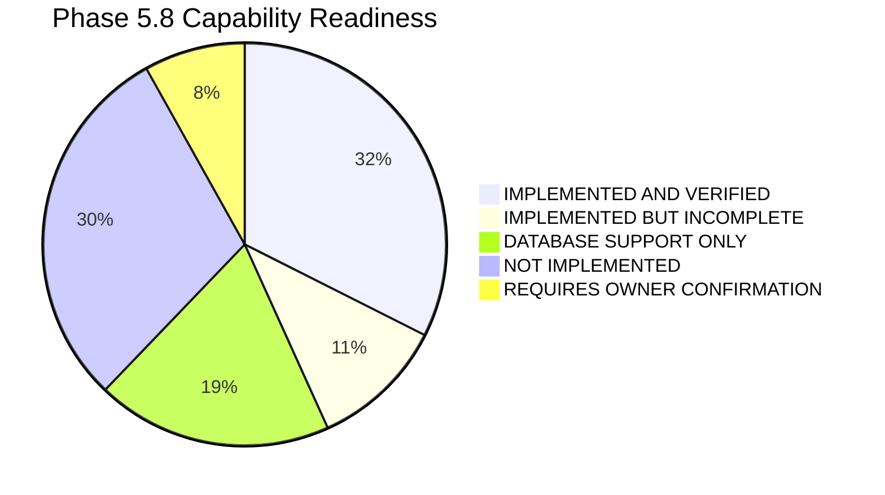
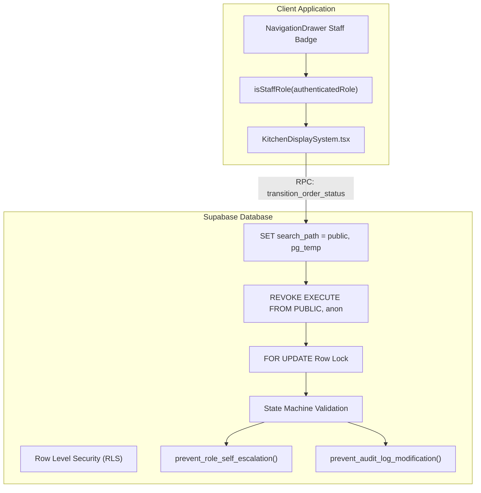
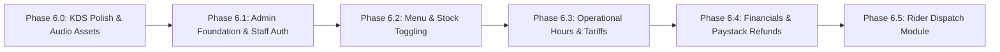

# AY PIZZA & ICE CREAM — PHASE 5.8: KITCHEN & ADMIN BACKEND CAPABILITY AUDIT
**Document Version:** 1.0.0  
**Audit Date:** 2026-11-07  
**Scope:** Comprehensive, READ-ONLY architecture and capability investigation of the existing codebase, Supabase migrations, database functions, RLS policies, Edge functions, domain services, and client interfaces for Kitchen Staff and Administrators.

---

## 1. EXECUTIVE SUMMARY

### 1.1 Assessment Overview
AY Pizza & Ice Cream possesses a **robust, production-grade, and security-hardened backend foundation for the Kitchen Display System (KDS)**, paired with a feature-rich, responsive client interface component. However, the **Admin Operations Dashboard is currently almost entirely unbuilt on the frontend and only partially supported in the database**.

| Domain | Readiness Level | Architecture & Implementation State |
| :--- | :---: | :--- |
| **Kitchen Display System (KDS)** | **~75% Ready** | **Implemented & Verified:** Atomic order status transition RPC (`transition_order_status`), batch orders retrieval RPC (`get_kds_orders`), strict role-based access control (RBAC), concurrency locking (`FOR UPDATE` + version counter), append-only audit trail (`order_status_events`, `audit_logs`), Supabase Realtime publication (`orders` table), and full multi-lane UI (`KitchenDisplaySystem.tsx`).<br>**Gaps:** Rider dispatch handover friction, lacks bundled sound assets on native devices, no multi-station routing (oven vs ice cream vs fryers), no thermal ticket printing. |
| **Admin Operations Dashboard** | **~15% Ready** | **Database Support Only / Not Implemented:** PostgreSQL schema contains `admin` and `manager` roles, RLS policies granting administrative update rights on products/categories/landmarks/delivery config, and an immutable audit log table (`public.audit_logs`).<br>**Gaps:** There is **NO admin screen, component, or route** in the client app. There is NO staff account management RPC/UI, NO menu/inventory CRUD UI, NO database store opening hours model (hours are hardcoded in frontend `brand.ts`), NO refund processing integration (orders only get marked `REFUND_REQUIRED`), and NO sales analytics or daily summary aggregation queries. |

### 1.2 Capability Readiness Summary Matrix



---

## 2. EXISTING BACKEND ARCHITECTURE

The AY Pizza backend is deployed on Supabase PostgreSQL (Postgres 15+), utilizing Row Level Security (RLS), custom security definer functions, database triggers, and Supabase Edge Functions.

### 2.1 Database Schema & Tables

1. **`public.profiles`** (`20261021000001_initial_schema.sql`):
   - Stores user identity, contact information, and role.
   - Roles enum: `user_role` (`'customer'`, `'staff'`, `'admin'`, `'rider'`, `'kitchen'`, `'counter'`, `'manager'`).
   - Trigger `enforce_profile_role_integrity` executes `prevent_role_self_escalation()` to block non-admins from escalating privileges.
2. **`public.orders`** (`20261021000001`, `20261022000005`, `20261022000006`, `20261105000001`):
   - Core order header table.
   - Status enum: `order_status` (`'DRAFT'`, `'PENDING_PAYMENT'`, `'PAID'`, `'CONFIRMED'`, `'ACCEPTED'`, `'PREPARING'`, `'READY_FOR_PICKUP'`, `'IN_TRANSIT'`, `'DELIVERED'`, `'CANCELLED'`, `'REFUNDED'`).
   - Operational columns: `rejection_reason` (TEXT), `accepted_at` (TIMESTAMPTZ), `prepared_at` (TIMESTAMPTZ), `ready_at` (TIMESTAMPTZ), `completed_at` (TIMESTAMPTZ), `in_transit_at` (TIMESTAMPTZ), `staff_notes` (TEXT), `assigned_staff_id` (UUID -> `profiles.id`).
   - Concurrency & Integrity: `version` (INT, incremented on every transition), `refund_status` (TEXT: `'NOT_APPLICABLE'`, `'REFUND_REQUIRED'`, `'REFUND_PENDING'`, `'REFUNDED'`), `receipt_token_hash` (TEXT, SHA-256), `idempotency_key` (TEXT UNIQUE).
3. **`public.order_items` & `public.order_item_customizations`** (`20261021000001`, `20261021000005`):
   - Stores line item quantities, size names, unit base prices, half-and-half secondary flavours, ice cream flavour arrays, special instructions, and topping customizations.
   - Protected against direct client injection: zero direct inserts allowed; populated strictly by server-authoritative function `create_order_authoritative()`.
4. **`public.order_status_events`** (`20261022000008_phase4_2_tracking_and_notifications.sql`):
   - Immutable append-only tracking timeline table.
   - Trigger `trg_prevent_order_event_modification` rejects UPDATE or DELETE operations unconditionally.
   - Populated automatically via trigger `trg_order_status_transition` on `public.orders`.
5. **`public.audit_logs`** (`20261021000001`, `20261021000003`):
   - Immutable security ledger.
   - Trigger `prevent_audit_log_modification` rejects UPDATE or DELETE operations unconditionally (`reject_audit_tampering()`).
   - Records all KDS transitions, authoritative order creations, payment confirmations, and configuration updates.
6. **`public.payment_transactions`** (`20261021000001`, `20261021000005`):
   - Financial ledger recording Paystack reference, status (`'initialized'`, `'pending'`, `'success'`, `'failed'`, `'reversed'`), integer amount in kobo, channel, and settlement timestamp.
7. **`public.delivery_config`** (`20261103000001_phase5_4_delivery_and_addresses.sql`):
   - Central operational configuration table.
   - Fields: `store_name`, `store_address`, `store_latitude`, `store_longitude`, `max_delivery_radius_km`, `min_delivery_fee`, `pricing_model`, `is_delivery_active`, `is_pickup_active`, `pickup_fee`, `updated_at`, `updated_by`.
8. **`public.delivery_zones` & `public.delivery_landmarks`** (`20261021000001`, `20261103000001`):
   - Tariff tables for UNILAG campus and Lagos Mainland zones. RLS allows Staff/Admin updates.

### 2.2 Core Operational Database RPCs

#### 1. `public.transition_order_status`
- **Location:** `supabase/migrations/20261105000001_phase5_4_3_order_transit_tracking.sql` (hardened iteration of Phase 4.1 / 4.1.1 / 4.1.3).
- **Signature:** `(p_order_id UUID, p_target_status public.order_status, p_reason TEXT DEFAULT NULL, p_notes TEXT DEFAULT NULL, p_expected_current_status public.order_status DEFAULT NULL) -> JSONB`.
- **Security:** `SECURITY DEFINER`, `SET search_path = public, pg_temp`.
- **Grants:** `EXECUTE` granted to `authenticated` and `service_role`. Explicitly revoked from `PUBLIC` and `anon`.
- **Concurrency Protection:** Row locked with `SELECT * FROM public.orders WHERE id = p_order_id FOR UPDATE`.
- **Role Gating:**
  - Blocks anonymous / unauthenticated callers.
  - Queries caller role from `public.profiles`.
  - Rejects `customer` and `rider` (`FORBIDDEN`).
  - Allowed caller roles: `'staff'`, `'admin'`, `'kitchen'`, `'counter'`, `'manager'`.
  - Granular RBAC:
    - Kitchen staff cannot cancel or reject orders (`ROLE_UNAUTHORIZED`).
    - Counter staff cannot move orders to `PREPARING` (`ROLE_UNAUTHORIZED`).
    - Kitchen staff cannot perform customer handover (`DELIVERED`) or courier dispatch (`IN_TRANSIT`).
- **State Machine Rules:**
  - Unpaid orders (`DRAFT`, `PENDING_PAYMENT`) cannot be transitioned.
  - Terminal states (`DELIVERED`, `CANCELLED`, `REFUNDED`) cannot be transitioned.
  - Delivery vs. Pickup Divergence:
    - Pickup orders: `READY_FOR_PICKUP` -> `DELIVERED`. Cannot enter `IN_TRANSIT`.
    - Delivery orders: `READY_FOR_PICKUP` -> `IN_TRANSIT` -> `DELIVERED`. Cannot skip straight to `DELIVERED`.
- **Side Effects:**
  - Increments `version` counter by 1.
  - Contextual timestamps: sets `accepted_at`, `prepared_at`, `ready_at`, `completed_at`, or `in_transit_at`.
  - Sets `refund_status = 'REFUND_REQUIRED'` if a paid order is cancelled.
  - Writes audit record to `public.audit_logs`.
  - Fires `trg_order_status_transition` which appends to `order_status_events` and enqueues push notifications.

#### 2. `public.get_kds_orders`
- **Location:** `supabase/migrations/20261105000001_phase5_4_3_order_transit_tracking.sql`.
- **Signature:** `(p_statuses public.order_status[] DEFAULT ARRAY['CONFIRMED', 'ACCEPTED', 'PREPARING', 'READY_FOR_PICKUP', 'IN_TRANSIT']) -> JSONB`.
- **Security:** `SECURITY DEFINER`, `SET search_path = public, pg_temp`.
- **Grants:** `EXECUTE` granted to `authenticated` and `service_role`. Revoked from `PUBLIC` and `anon`.
- **Role Gating:** Verifies caller role is in `('staff', 'admin', 'kitchen', 'counter', 'manager')`. Rejects customers and riders.
- **Payload:** Returns JSONB array including order header, customer contact (`guestName`, `guestPhone`), timestamps, delivery landmark and address, and nested `items` array with sizes, customisations, secondary flavours, and special instructions.

#### 3. `public.update_delivery_operational_status`
- **Location:** `supabase/migrations/20261103000001_phase5_4_delivery_and_addresses.sql`.
- **Signature:** `(p_is_delivery_active BOOLEAN, p_is_pickup_active BOOLEAN) -> JSONB`.
- **Security:** `SECURITY DEFINER`, `SET search_path = public, pg_temp`. Verifies `public.is_staff_or_admin()`. Updates `public.delivery_config` and logs to `public.audit_logs`.

---

## 3. KITCHEN CAPABILITIES ALREADY IMPLEMENTED

| Capability | Status | Evidence / Implementation Details |
| :--- | :---: | :--- |
| **Viewing incoming paid orders (`CONFIRMED`)** | `IMPLEMENTED AND VERIFIED` | `get_kds_orders` RPC fetches active orders with status `CONFIRMED`. `kds-service.ts` maintains local cache. `KitchenDisplaySystem.tsx` displays them in "1. Incoming" lane with customer name, phone, elapsed time badge, and item details. Verified in tests. |
| **Filtering orders by status** | `IMPLEMENTED AND VERIFIED` | `KitchenDisplaySystem.tsx` (lines 380-450) provides 7 dedicated tabbed lanes: Incoming, Accepted, In Oven, Ready/Dispatch, In Transit, Handed Over, and Cancelled. Fast in-memory lane bucketing with ascending/descending order sorting. |
| **Accepting orders** | `IMPLEMENTED AND VERIFIED` | "✓ Accept Order" button triggers `handleTransition(order, 'ACCEPTED')`. State machine transitions `CONFIRMED` -> `ACCEPTED`, records `accepted_at`, increments `version`. |
| **Rejecting orders with mandatory reason** | `IMPLEMENTED AND VERIFIED` | "✕ Reject" button opens modal with preset chips ("Out of Pizza Dough / Cheese", "Kitchen Overloaded", etc.) and custom input. Database RPC enforces non-empty `p_reason`. Automatically marks paid order as `refund_status = 'REFUND_REQUIRED'`. |
| **Moving orders to preparation (`PREPARING`)** | `IMPLEMENTED AND VERIFIED` | "🔥 Start In Oven" button transitions `ACCEPTED` -> `PREPARING`. Sets `prepared_at`. Restricted to kitchen/manager/admin (counter staff blocked in DB). |
| **Marking orders ready for collection (`READY_FOR_PICKUP`)** | `IMPLEMENTED AND VERIFIED` | "📦 Ready for Counter Pickup" / "📦 Boxed — Awaiting Dispatch" button transitions `PREPARING` -> `READY_FOR_PICKUP`. Sets `ready_at`. |
| **Marking orders out for delivery (`IN_TRANSIT`)** | `IMPLEMENTED AND VERIFIED` | "🛵 Dispatch with Rider" transitions `READY_FOR_PICKUP` -> `IN_TRANSIT`. Sets `in_transit_at`. Delivery orders are prevented from skipping to `DELIVERED` without passing `IN_TRANSIT`. |
| **Marking pickup orders as collected (`DELIVERED`)** | `IMPLEMENTED AND VERIFIED` | "✓ Hand Over to Customer" transitions `READY_FOR_PICKUP` -> `DELIVERED`. Sets `completed_at`. Allowed for counter/manager/admin. |
| **Viewing detailed items, sizes, customisations, secondary flavours, and notes** | `IMPLEMENTED AND VERIFIED` | Cards render quantity badge, product name, size name, half-and-half secondary flavour box ("🍕 Half: Pepperoni"), toppings list ("+ Extra Cheese"), and special instructions ("No onions please"). |
| **Recording operational timestamps** | `IMPLEMENTED AND VERIFIED` | `accepted_at`, `prepared_at`, `ready_at`, `completed_at`, `in_transit_at` populated atomically via `clock_timestamp()` in `transition_order_status`. |
| **Preventing duplicate / conflicting transitions** | `IMPLEMENTED AND VERIFIED` | Database row locking via `FOR UPDATE`. Client sends `expectedCurrentStatus`. If another staff member updated status concurrently, returns `CONCURRENT_MODIFICATION` error code. |
| **Role-based staff access checks** | `IMPLEMENTED AND VERIFIED` | Both frontend UI (`hasPermission(activeRole, ...)`) and backend RPC (`v_caller_role` validation) enforce strict RBAC. `App.tsx` guards `/kitchen` route and drawer entry points with `isStaffRole()`. |
| **Realtime auto-refresh & sound chime** | `IMPLEMENTED BUT INCOMPLETE` | Supabase Realtime channel (`kds-live-orders`) syncs updates immediately. Web Audio API synthesizer generates D5/A5 chime on Web; vibration fallback on native. Missing bundled audio asset files for native iOS/Android devices. |

---

## 4. KITCHEN CAPABILITIES MISSING

| Capability | Status | Analysis & Missing Implementation Requirements |
| :--- | :---: | :--- |
| **Multi-Station Kitchen Routing (Split Station KDS)** | `NOT IMPLEMENTED` | Currently all orders and all items appear together in one global queue. AY Pizza serves Pizza, Ice Cream, Fast Food (chicken/chips), and Drinks. In a busy UNILAG rush, the pizza chef only needs pizza items, while the ice cream bar needs shake/ice cream items. Database and client need item-level station routing tags or filtered station views (`station: 'pizza' | 'icecream' | 'fryer'`). |
| **Physical Kitchen Ticket Printing (ESC/POS Thermal)** | `NOT IMPLEMENTED` | Kitchen staff in Nigerian fast-casual environments rely on printed physical tickets (e.g. 58mm/80mm Bluetooth or Network thermal printers) to attach to pizza boxes. No ESC/POS printer driver or receipt formatting service exists for KDS. |
| **Individual Item Preparation Strike-Through Checklist** | `NOT IMPLEMENTED` | For multi-item orders (e.g. 3 pizzas + 2 milkshakes), kitchen staff cannot check off or tap individual items as done while preparing the rest of the order. |
| **Dynamic Estimated Preparation Time Adjustment** | `NOT IMPLEMENTED` | When kitchen is backlogged, staff cannot adjust the estimated preparation time (e.g. "Add +15 minutes") upon acceptance. The app uses static zone time windows. |
| **Kitchen Action Undo / Revert Transition** | `NOT IMPLEMENTED` | If staff accidentally taps "Start In Oven" or "Ready for Pickup", there is no 10-second undo window or revert RPC. Transitions are strictly one-way forward. |
| **Native Audio Chime Assets** | `IMPLEMENTED BUT INCOMPLETE` | Native mobile and tablet devices fall back to vibration only (`Vibration.vibrate`). Bundled `.mp3`/`.wav` audio assets and `expo-av` integration are required for audible chimes in noisy kitchen environments. |

---

## 5. ADMIN CAPABILITIES ALREADY IMPLEMENTED

| Capability | Status | Evidence / Implementation Details |
| :--- | :---: | :--- |
| **View all orders across all statuses** | `DATABASE SUPPORT ONLY` | RLS policy `"Staff update orders"` and helper `is_staff_or_admin()` permit administrative queries against `public.orders`. However, there is **no admin orders screen or filter console** in the application. |
| **Configure emergency delivery/pickup operational status** | `IMPLEMENTED BUT INCOMPLETE` | Database function `public.update_delivery_operational_status(p_is_delivery_active, p_is_pickup_active)` exists and is tested. `deliveryPricingEngine.updateConfig()` exists in frontend domain code. **No UI button or toggle screen exists in the app** to invoke it. |
| **Manage delivery landmarks and tariffs** | `IMPLEMENTED BUT INCOMPLETE` | Database table `public.delivery_landmarks` has RLS `"Staff or Admin update delivery landmarks"`. Client method `deliveryPricingEngine.updateLandmark()` exists. **No UI exists** for managers to add landmarks, toggle active status, or edit prices. |
| **Review payment transactions & Paystack references** | `DATABASE SUPPORT ONLY` | Table `public.payment_transactions` stores all Paystack references, kobo totals, channels, and statuses. RLS policy `"Staff view payments"` exists. **No UI exists** to query, search, or reconcile transactions. |
| **Review cancelled orders & rejection reasons** | `DATABASE SUPPORT ONLY` | `orders.rejection_reason` and `orders.refund_status` store details. Audit logs track `KDS_ORDER_CANCELLED_REFUND_REQUIRED`. **No admin audit screen exists** to review cancellations. |
| **Operational audit logs** | `DATABASE SUPPORT ONLY` | Table `public.audit_logs` has trigger `prevent_audit_log_modification` ensuring strict immutability. RLS policy `"Admin view audit logs"` restricts SELECT to `is_admin()`. **No UI log viewer exists**. |

---

## 6. ADMIN CAPABILITIES MISSING

| Capability | Status | Analysis & Missing Implementation Requirements |
| :--- | :---: | :--- |
| **Admin Operations Dashboard UI Screen** | `NOT IMPLEMENTED` | The app currently has only customer-facing screens and one staff component (`KitchenDisplaySystem.tsx`). There is no admin route, no navigation tab, and no management screen. |
| **Staff Account & Role Management UI / RPC** | `NOT IMPLEMENTED` | The trigger `prevent_role_self_escalation()` prevents self-assignment, but there is **NO admin RPC or UI to invite staff, assign roles (`kitchen`, `counter`, `manager`, `rider`), or revoke access**. Currently, roles can only be changed by manually running SQL queries in the Supabase Dashboard. |
| **Menu Products, Categories & Pricing CRUD UI** | `NOT IMPLEMENTED` | Database has RLS allowing staff updates, but there is no UI to add a pizza, edit descriptions, adjust size multiplier prices, or upload product photos. |
| **Product Inventory / Availability Toggling UI** | `NOT IMPLEMENTED` | `products.is_available` and `customization_options.is_available` exist in the database, but there is no quick toggle screen for staff to mark "Beef Pepperoni Out of Stock" when ingredients run out. |
| **Store Opening Hours Configuration** | `NOT IMPLEMENTED` | Operating hours (`10:00 AM - 09:00 PM`) are currently **hardcoded in client file `src/constants/brand.ts`**. There is no database table, no admin UI to modify hours, and no database enforcement blocking off-hour checkout. |
| **Financial Refund Execution & Paystack Reversal RPC** | `DATABASE SUPPORT ONLY` | Orders are tagged `refund_status = 'REFUND_REQUIRED'`, but there is **no Paystack Refund API integration or Supabase Edge function** to execute refunds or update `refund_status` to `'REFUNDED'`. |
| **Daily Sales Summaries & Order Analytics** | `NOT IMPLEMENTED` | There are no database views, aggregation functions, or frontend dashboard cards for daily revenue (₦), hourly order volume, average ticket size, or top-selling items. |
| **System Settings & Thresholds Manager** | `NOT IMPLEMENTED` | Store radius (15 km), minimum delivery fee (₦500), and pricing models cannot be edited through an admin UI. |

---

## 7. EXISTING SECURITY CONTROLS & WEAKNESSES

### 7.1 Implemented Security Controls



1. **Strict Search Path Hardening (CWE-426 Defense):**
   - Verified in `supabase/migrations/20261022000007_phase4_1_3_search_path_hardening.sql`: all operational RPCs (`transition_order_status`, `get_kds_orders`, `create_order_authoritative`, `get_order_by_receipt`, `cancel_order_by_customer`) explicitly enforce `SET search_path = public, pg_temp`.
   - `REVOKE CREATE ON SCHEMA public FROM PUBLIC` prevents untrusted users from creating malicious shadowing objects.
2. **Explicit Privilege Revocation:**
   - Operational RPCs explicitly revoke execute permissions from `PUBLIC` and `anon`. Only `authenticated` and `service_role` can execute them.
3. **Zero Direct Client Insertions:**
   - Direct INSERT on `public.orders`, `public.order_items`, and `public.order_item_customizations` is blocked for customers. Orders must pass through `create_order_authoritative()`.
4. **Anti-Escalation Profile Trigger:**
   - `prevent_role_self_escalation()` blocks non-admins from modifying the `role` column in `public.profiles`.
5. **Ledger Immutability:**
   - Both `public.audit_logs` and `public.order_status_events` have BEFORE UPDATE/DELETE triggers that raise exceptions unconditionally, making order history tamper-proof.

### 7.2 Security Weaknesses & Operational Gaps

1. **Rider Role RPC Inconsistency:**
   - In `src/domains/auth/auth-service.ts`:
     ```typescript
     UPDATE_DELIVERY_STATUS: ['rider', 'staff', 'admin', 'manager'] as UserRole[],
     ```
   - In PostgreSQL `transition_order_status`:
     ```sql
     IF v_caller_role IS NULL OR v_caller_role NOT IN ('staff', 'admin', 'kitchen', 'counter', 'manager') THEN
         RETURN jsonb_build_object('success', false, 'code', 'FORBIDDEN', ...);
     ```
   - **Weakness:** A user with role `'rider'` will be rejected by the database RPC when attempting to mark an order `DELIVERED`.
2. **Lack of Automated Staff Management Security:**
   - Currently, staff accounts cannot be created securely through an admin interface. The business must either use Supabase Dashboard or share credentials, introducing operational security risks.
3. **Off-Hours Order Creation Vulnerability:**
   - Operating hours are checked only in frontend UI logic (`src/constants/brand.ts`). An attacker calling `create_order_authoritative()` directly via Postman/curl can create orders outside business hours.
4. **Dev Role Switcher Risk:**
   - `KitchenDisplaySystem.tsx` contains a `[DEV] Role:` switcher allowing simulation of kitchen/counter/manager/admin. In production, it checks `__DEV__`, but a dedicated admin mode should strictly enforce database-backed role claims without client toggles.

---

## 8. DELIVERY INTEGRATION DEPENDENCIES

| Dependency Area | Current Backend State | Gap / Missing Requirement |
| :--- | :--- | :--- |
| **Rider Role** | `'rider'` exists in `public.user_role` enum. | Rider role is blocked from executing `transition_order_status()`. |
| **Rider Assignment Column** | `orders.assigned_staff_id` exists. | `orders.assigned_rider_id` does **NOT exist**. Kitchen staff cannot formally assign an order to a specific rider profile. |
| **Delivery Status Timestamps** | `in_transit_at`, `completed_at` exist on `public.orders`. | Implemented and verified. |
| **Workflow Divergence** | Delivery orders MUST transition `READY_FOR_PICKUP` -> `IN_TRANSIT` -> `DELIVERED`. Direct skip is blocked. | Implemented and verified in database state machine. |
| **Rider Dispatch Queue** | No dedicated query or RPC for riders. | Riders would currently have to use KDS or customer endpoints. A dedicated `get_rider_dispatch_queue(rider_id)` RPC is needed. |
| **Rider Interface** | No screen or view exists for riders. | A lightweight mobile Rider Dispatch Screen is required for delivery couriers. |

---

## 9. DATABASE SUPPORT REFERENCE MATRIX

| Table / RPC / Trigger | Source Migration File | Lines / Definition | Primary Purpose |
| :--- | :--- | :--- | :--- |
| `user_role` Enum | `20261021000001_initial_schema.sql` | L16 | Defines roles: `customer`, `staff`, `admin`, `rider`, `kitchen`, `counter`, `manager`. |
| `order_status` Enum | `20261021000001_initial_schema.sql`<br>`20261022000005_phase4_1...sql` | L22-33<br>L28-36 | 11 order states including `CONFIRMED`, `ACCEPTED`, `PREPARING`, `READY_FOR_PICKUP`, `IN_TRANSIT`. |
| `public.orders` (staff fields) | `20261022000005_phase4_1...sql` | L54-62 | Adds `rejection_reason`, timestamps, `staff_notes`, `assigned_staff_id`. |
| `public.orders` (version & refund) | `20261022000006_phase4_1_1...sql` | L18-22 | Adds `version` (INT) and `refund_status` (`REFUND_REQUIRED`). |
| `public.orders` (transit tracking) | `20261105000001_phase5_4_3...sql` | L14-16 | Adds `in_transit_at` TIMESTAMPTZ and performance index. |
| `transition_order_status` RPC | `20261105000001_phase5_4_3...sql` | L34-330 | Core atomic state transition engine with `FOR UPDATE` lock, RBAC, and audit logging. |
| `get_kds_orders` RPC | `20261105000001_phase5_4_3...sql` | L416-490 | Aggregates active KDS order queue with items, flavours, and elapsed time. |
| `prevent_role_self_escalation` Trigger | `20261021000003_security...sql` | L17-36 | Prevents non-admins from changing their role in `profiles`. |
| `prevent_audit_log_modification` Trigger | `20261021000003_security...sql` | L135-148 | Rejects UPDATE and DELETE on `public.audit_logs`. |
| `trg_prevent_order_event_modification` Trigger | `20261022000008_phase4_2...sql` | L33-46 | Rejects UPDATE and DELETE on `public.order_status_events`. |
| `update_delivery_operational_status` RPC | `20261103000001_phase5_4...sql` | L105-155 | Staff/Admin toggle for `is_delivery_active` and `is_pickup_active`. |
| `public.delivery_config` Table | `20261103000001_phase5_4...sql` | L27-67 | Central store coordinates, radius, tariffs, and operational switches. |

---

## 10. RECOMMENDED IMPLEMENTATION SEQUENCE

To complete the Kitchen & Admin ecosystem without disrupting the existing customer experience, the following phased sequence is recommended:



### Phase 6.0 — KDS Polish & Native Hardware Readiness
- **Objective:** Finalize the Kitchen Display System for physical tablet deployment.
- **Tasks:**
  1. Add native audio sound assets (`.mp3`/`.wav`) and integrate with `expo-av` for audible order notifications.
  2. Implement item strike-through checklist for multi-item orders.
  3. Resolve the 10-second transition undo/recall mechanism.
  4. Test full tablet viewports (7-inch and 10-inch Android/iPad tablets).

### Phase 6.1 — Admin Operations Dashboard Foundation & Staff RBAC
- **Objective:** Build the administrative shell and eliminate manual database role manipulation.
- **Tasks:**
  1. Create `AdminDashboardScreen.tsx` with dedicated navigation tabs (Overview, Live Orders, Staff, Menu, Tariffs, Financials, Audit Logs).
  2. Implement `public.admin_manage_staff_role(p_target_user_id, p_role)` RPC strictly gated to `is_admin()`.
  3. Build staff directory and role management interface (promote/demote staff, view activity).

### Phase 6.2 — Menu & Inventory Availability Console
- **Objective:** Allow staff and managers to quickly toggle out-of-stock ingredients and modify menu items.
- **Tasks:**
  1. Build Quick Stock Toggle screen (toggle `products.is_available` and `customization_options.is_available` in 1 tap).
  2. Implement product price and size price editor with immediate cache invalidation.

### Phase 6.3 — Store Hours & Operational Controls
- **Objective:** Centralize operating hours in the database and enforce them server-side.
- **Tasks:**
  1. Create `public.operating_hours` table in Supabase.
  2. Enforce operating hours check in `create_order_authoritative()` to prevent off-hours order injection.
  3. Build admin UI for store emergency pause and delivery tariff management.

### Phase 6.4 — Financial Reconciliation & Paystack Refund Processing
- **Objective:** Automate refund handling for cancelled paid orders.
- **Tasks:**
  1. Build a Supabase Edge Function `paystack-refund` to process reversals via Paystack Refund API.
  2. Create an admin Refund Approval Console showing all orders marked `REFUND_REQUIRED`.
  3. Add daily sales summary aggregate queries (total revenue, order counts, fulfillment breakdown).

### Phase 6.5 — Courier Dispatch & Rider Handover Integration
- **Objective:** Bridge the gap between KDS and delivery fulfillment.
- **Tasks:**
  1. Add `assigned_rider_id` column to `public.orders`.
  2. Update `transition_order_status` to allow authorized riders to update delivery orders to `DELIVERED`.
  3. Build a lightweight Rider Dispatch mobile screen.

---

## 11. RISKS AND UNRESOLVED OWNER DECISIONS

| Risk / Decision Item | Current Implementation Status | Business Risk / Owner Decision Required |
| :--- | :--- | :--- |
| **Provisional Delivery Landmark Tariffs** | Reverse-engineered provisional rates (e.g. Inside School ₦500, Yaba ₦2,000, Surulere ₦3,500). | **Owner Decision Required:** Restaurant owner must review and officially sign off on the 19 landmark tariffs before production rollout. |
| **Provisional Dietary Compliance Policy** | Unconfirmed/unenforced in code (`isConfirmedByOwner: false`). | **Owner Decision Required:** Confirm whether the kitchen is strictly 100% Halal and whether pork/bacon/alcohol terms must be hard-blocked. |
| **Hardcoded Store Opening Hours** | Hardcoded to 10:00 AM – 9:00 PM WAT in `brand.ts`. | **Owner Decision Required:** Confirm exact weekly operating hours, Sunday hours, and campus public holiday schedules. |
| **Refund Workflow Execution** | Manual financial review (`REFUND_REQUIRED`). | **Owner Decision Required:** Decide whether refunds should trigger automated Paystack account reversals or be handled manually via bank transfer/reconciliation. |
| **Kitchen Hardware Deployment** | Responsive web/tablet component. | **Owner Decision Required:** Confirm target hardware for King Jaja Hall kitchen (Android tablet vs iPad vs counter POS touch PC vs thermal receipt printer). |

---

## 12. CONCLUSION & RECOMMENDATION

The AY Pizza codebase already possesses an **exceptionally mature, secure, and battle-tested database foundation for the Kitchen Display System (KDS)**. The transition state machine, concurrency locks, and audit logging are fully tested across 45 Jest suites (724 passing tests).

**Immediate Next Recommendation:**  
Proceed with **Phase 6.0 (KDS Final Polish & Sound Asset Bundle)** and **Phase 6.1 (Admin Dashboard Shell & Staff Account Management)**. This will give the restaurant immediate operational value at King Jaja Hall without requiring manual SQL queries to manage staff, while laying the foundation for menu and financial controls.

