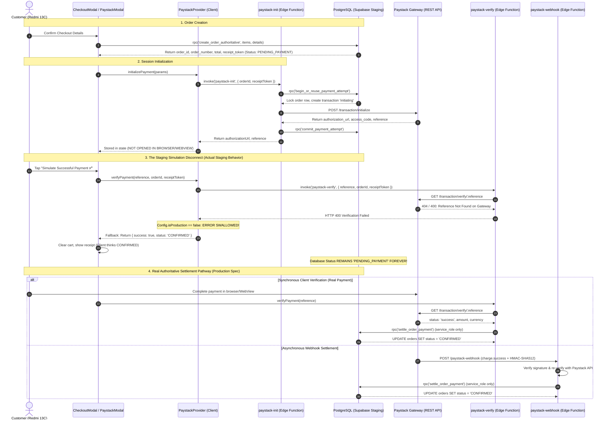

# AY Pizza — Phase 6.0.5.5: Paystack Payment Settlement Audit & Order Lifecycle Investigation

**Date**: 2026-11-09  
**Audit Type**: READ-ONLY Architectural & Security Audit  
**Target Environment**: Supabase Staging (`gmtlwewpblnnkzuwfcib`)  
**EAS Project ID**: `a0aaa783-3f92-4b05-b32f-e44ccc7bfd38`  
**EAS Channel**: `staging`  
**Runtime Version**: `1.0.0`

---

## 1. Executive Summary & Exact Root Cause

### The Problem
During testing of Android preview builds on the Xiaomi Redmi 13C, customer orders created through checkout frequently remained in PostgreSQL with:
```sql
status = 'PENDING_PAYMENT'
```
instead of advancing to `CONFIRMED`.

Because PostgreSQL order status was never updated:
1. The authoritative customer cancellation RPC `public.cancel_order_by_customer` rejected cancellation requests with:
   `Order is not eligible for cancellation. Current status: PENDING_PAYMENT`.
2. Kitchen Display Systems (KDS) and counter staff never received the order because KDS views filter strictly for `CONFIRMED`, `ACCEPTED`, `PREPARING`, and `READY_FOR_PICKUP`.
3. Upon reopening the receipt in the mobile application, the **Cancel Order** button disappeared because the reopened receipt queried the authoritative database status rather than the optimistic local state.

### The Exact Root Cause
The root cause was established by tracing the entire payment lifecycle across client, edge functions, and PostgreSQL:

1. **No Gateway UI in Mobile Application**:
   - The application does not embed a `WebView`, browser redirect, or native Paystack checkout module in [`CheckoutModal.tsx`](file:///c:/Users/Ososanwo%20Idris/Documents/AY%20PIZZA%20MOBILE/src/components/CheckoutModal.tsx) or [`PaystackPaymentModal.tsx`](file:///c:/Users/Ososanwo%20Idris/Documents/AY%20PIZZA%20MOBILE/src/components/PaystackPaymentModal.tsx).
   - In [`PaystackPaymentModal.tsx`](file:///c:/Users/Ososanwo%20Idris/Documents/AY%20PIZZA%20MOBILE/src/components/PaystackPaymentModal.tsx#L46), the Paystack authorization URL is assigned to a discarded setter (`const [, setAuthorizationUrl] = useState('')`).
   - Instead, both modals display a mock card with two buttons: `Simulate Successful Payment ✅` and `Simulate Cancel / Failure ❌`.

2. **Server Verification Fails on Mock / Unpaid References**:
   - Tapping `Simulate Successful Payment ✅` calls `paymentService.verifyPayment(reference, orderId, receiptToken)`.
   - The client invokes the Supabase Edge Function `paystack-verify`.
   - In [`supabase/functions/paystack-verify/index.ts`](file:///c:/Users/Ososanwo%20Idris/Documents/AY%20PIZZA%20MOBILE/supabase/functions/paystack-verify/index.ts#L118-L135), the Edge Function calls Paystack REST API `GET https://api.paystack.co/transaction/verify/${reference}`.
   - Because no actual charge occurred on Paystack's servers, Paystack's API responds with an error (`404 Not Found` or `400 Transaction reference not found`).
   - `paystack-verify` returns HTTP 400 to the caller.
   - **PostgreSQL RPC `settle_order_payment` is NEVER called.** The order remains in `PENDING_PAYMENT` in PostgreSQL.

3. **Client-Side Silent Error Swallow in Staging Mode**:
   - In [`src/domains/payment/paystack-provider.ts`](file:///c:/Users/Ososanwo%20Idris/Documents/AY%20PIZZA%20MOBILE/src/domains/payment/paystack-provider.ts#L132-L156):
     ```typescript
     if (error && Config.isProduction) {
       return { success: false, ... };
     }
     // Sandbox simulation fallback for development testing
     return {
       success: true,
       status: 'CONFIRMED',
       paymentReference: reference,
       channel: 'test_card',
     };
     ```
   - In staging, `Config.isProduction` evaluates to `false` (`Config.appEnv === 'staging'`).
   - The client code catches the error from `paystack-verify`, **silently swallows it**, and returns `{ success: true, status: 'CONFIRMED' }` directly to the React Native UI.
   - The UI displays the confirmed receipt and celebrates payment success, but the database order remains indefinitely stuck in `PENDING_PAYMENT`.

---

## 2. Complete Payment Lifecycle Sequence



---

## 3. Relevant Files, Functions & Database Routines

| Component | File / Location | Responsibility & Behavior |
|---|---|---|
| **`CheckoutModal.tsx`** | [`src/components/CheckoutModal.tsx`](file:///c:/Users/Ososanwo%20Idris/Documents/AY%20PIZZA%20MOBILE/src/components/CheckoutModal.tsx) | Stage 3 payment screen; presents simulation buttons; does not render browser/WebView. |
| **`PaystackPaymentModal.tsx`** | [`src/components/PaystackPaymentModal.tsx`](file:///c:/Users/Ososanwo%20Idris/Documents/AY%20PIZZA%20MOBILE/src/components/PaystackPaymentModal.tsx) | Discards `authorizationUrl`; renders simulation buttons. |
| **`paystack-provider.ts`** | [`src/domains/payment/paystack-provider.ts`](file:///c:/Users/Ososanwo%20Idris/Documents/AY%20PIZZA%20MOBILE/src/domains/payment/paystack-provider.ts) | Bridges client to Edge Functions; contains lines 132–156 that swallow verification errors in non-production. |
| **`paystack-init`** | [`supabase/functions/paystack-init/index.ts`](file:///c:/Users/Ososanwo%20Idris/Documents/AY%20PIZZA%20MOBILE/supabase/functions/paystack-init/index.ts) | Edge Function; invokes `begin_or_reuse_payment_attempt`, calls Paystack REST API, commits attempt. |
| **`paystack-verify`** | [`supabase/functions/paystack-verify/index.ts`](file:///c:/Users/Ososanwo%20Idris/Documents/AY%20PIZZA%20MOBILE/supabase/functions/paystack-verify/index.ts) | Edge Function; verifies caller authorization; verifies transaction with Paystack; calls `settle_order_payment`. |
| **`paystack-webhook`** | [`supabase/functions/paystack-webhook/index.ts`](file:///c:/Users/Ososanwo%20Idris/Documents/AY%20PIZZA%20MOBILE/supabase/functions/paystack-webhook/index.ts) | Edge Function; HMAC-SHA512 verification; independent API verification; calls `settle_order_payment`. |
| **`create_order_authoritative()`** | PostgreSQL RPC | Generates order header, items, fees, receipt token hash; initializes status to `'PENDING_PAYMENT'`. |
| **`settle_order_payment()`** | PostgreSQL RPC | `SECURITY DEFINER`, granted **exclusively to `service_role`**; updates order status to `'CONFIRMED'`. |
| **`cancel_order_by_customer()`** | PostgreSQL RPC | `SECURITY DEFINER`; enforces that cancellation is only permitted when `status = 'CONFIRMED'`. |
| **`transition_order_status()`** | PostgreSQL RPC | Operational KDS RPC; strictly blocks any transition on `PENDING_PAYMENT` orders (`UNPAID_ORDER`). |

---

## 4. Nature of the Issue

The issue is a **combination of client-side simulation design and server-enforced security boundaries**:

1. **Client-Side Defect**: The mobile client has an incomplete payment UX (no WebView or browser link) and an unsafe sandbox simulation handler that returned fake success to the UI without contacting the database.
2. **Backend Architecture**: The backend correctly enforced that `settle_order_payment` requires `service_role` and verified external gateway confirmation. Because the client never completed a real gateway payment and couldn't settle directly, the backend correctly left the order in `PENDING_PAYMENT`.
3. **Webhook Component**: The webhook handler is implemented correctly, but cannot fire because no external transaction exists on Paystack's gateway to trigger a webhook.

---

## 5. Security & Payment-Integrity Findings

| Security Requirement | Status | Verification Evidence |
|---|---|---|
| **Secret Key Isolation** | **VERIFIED SECURE** | `PAYSTACK_SECRET_KEY` exists only in server-side Edge Functions (`Deno.env`). The client only receives `EXPO_PUBLIC_PAYSTACK_PUBLIC_KEY`. |
| **Direct Gateway Verification** | **VERIFIED SECURE** | Both `paystack-verify` and `paystack-webhook` perform direct HTTPS GET calls to Paystack REST API before calling database settlement. |
| **HMAC-SHA512 Webhook Verification** | **VERIFIED SECURE** | `paystack-webhook` computes HMAC-SHA512 over the raw request body and verifies using constant-time string comparison (`timingSafeEqual`). |
| **Transaction Reference Binding** | **VERIFIED SECURE** | Both Edge Functions verify that `transactionData.metadata?.order_id === orderId` before settling. |
| **Integer-Kobo Amount Verification** | **VERIFIED SECURE** | Both `paystack-verify` and `settle_order_payment` verify `p_amount_in_kobo === ROUND(order.total * 100)::BIGINT`. |
| **Settlement Idempotency & Concurrency** | **VERIFIED SECURE** | `settle_order_payment` handles duplicate references with `already_settled: true`, and flags duplicate payments with different references as `duplicate_success_needs_refund`. |
| **Client Settlement Prohibition** | **VERIFIED SECURE** | `REVOKE EXECUTE ON FUNCTION settle_order_payment ... FROM PUBLIC, anon, authenticated;` is enforced. Only `service_role` can settle. |
| **Client-Side Simulation Safety Gap** | **FINDING / RISK** | In `paystack-provider.ts`, non-production environments swallow verification errors and simulate success on the client without database settlement. |

---

## 6. Review of Existing Test Coverage & Gaps

### Existing Test Coverage Gaps
1. **Mocked Payment Verification**: Current test suites (e.g. `phase5-5-checkout-and-payment.test.ts` lines 369–404) mock `paymentService.verifyPayment` using `jest.spyOn(...).mockResolvedValueOnce(...)`. They never test `PaystackProvider`, Edge Function invocations, or database settlement.
2. **Untested Real Settlement Flow**: No test verifies what happens when `paystack-verify` fails in staging mode.
3. **No Integration Test for `settle_order_payment` Execution**: The transition from `PENDING_PAYMENT` to `CONFIRMED` via client interaction is not tested end-to-end against the database.

### 12 Recommended Regression & Integration Tests
1. **Successful Paystack Payment & Authoritative Settlement**: Verify that a valid Paystack success response triggers `settle_order_payment` and transitions `orders.status` to `CONFIRMED`.
2. **Failed Payment**: Verify that a declined transaction leaves `orders.status` in `PENDING_PAYMENT` and returns an error without opening the receipt.
3. **Abandoned Checkout**: Verify that closing checkout leaves `orders.status` in `PENDING_PAYMENT` and expires the transaction attempt after 15 minutes.
4. **Delayed Webhook Delivery**: Verify that an order in `PENDING_PAYMENT` transitions to `CONFIRMED` upon asynchronous webhook arrival, updating the customer tracking view.
5. **Duplicate Webhook Delivery**: Verify that replaying a `charge.success` webhook returns `already_settled: true` without altering timestamps or status.
6. **Invalid Webhook Signature**: Verify that webhooks with forged or missing signatures are rejected with HTTP 401 and do not settle the order.
7. **Incorrect Payment Amount**: Verify that settling with an amount differing by even 1 kobo is rejected by `settle_order_payment`.
8. **Payment Reference Mismatch**: Verify that a transaction whose metadata `order_id` does not match the target order is rejected by `paystack-verify`.
9. **Verification Timeout & Recovery**: Verify that network interruptions during verification display the ambiguous recovery banner without cancelling the order.
10. **Settlement Followed by Receipt Reopening**: Verify that an order settled to `CONFIRMED` displays the **Cancel Order** button both immediately and upon reopening.
11. **Settlement Followed by Cancellation Eligibility**: Verify that an order settled to `CONFIRMED` successfully cancels via `public.cancel_order_by_customer` and sets `refund_status = 'REFUND_REQUIRED'`.
12. **Payment Success Arriving After Client Timeout**: Verify that when a client times out but the webhook succeeds, reloading the order in `OrdersScreen` shows `CONFIRMED`.

---

## 7. Recommended Implementation Plan

When authorized, the solution should be implemented in two synchronized tracks:

### Track 1: Client-Side Browser Checkout (`Linking.openURL`)
1. In [`CheckoutModal.tsx`](file:///c:/Users/Ososanwo%20Idris/Documents/AY%20PIZZA%20MOBILE/src/components/CheckoutModal.tsx) and [`PaystackPaymentModal.tsx`](file:///c:/Users/Ososanwo%20Idris/Documents/AY%20PIZZA%20MOBILE/src/components/PaystackPaymentModal.tsx):
   - When payment initializes, retrieve `authorizationUrl` from `paystack-init`.
   - Provide a button **"Pay with Paystack (Card, Transfer, USSD)"** that calls `Linking.openURL(authorizationUrl)` to launch the Paystack checkout page in Chrome/browser.
   - Use deep linking (`aypizza://payment-callback`) or an active "I Have Completed Payment" / "Check Payment Status" button that invokes `verifyPayment()`.
   - While the modal is displayed, poll `orderService.getOrderReceipt()` every 3–4 seconds to detect automatic webhook settlement.

### Track 2: Dedicated Staging Sandbox Settlement RPC (Testing Safety)
1. For development and staging environments where automated testing or manual QA requires simulation:
   - Create a dedicated staging-only RPC (or Edge Function parameter) `simulate_sandbox_payment_settlement(p_order_id, p_receipt_token)` that is strictly disabled in production.
   - When a tester taps "Simulate Successful Payment ✅" in staging mode, this endpoint calls `settle_order_payment` on the server so that the order **actually becomes `CONFIRMED` in PostgreSQL**!
   - Remove the unsafe local mock return in `paystack-provider.ts` that faked confirmation on the client without database settlement.

---

## 8. Files and Database Components Requiring Modification

1. **Client Code**:
   - [`src/domains/payment/paystack-provider.ts`](file:///c:/Users/Ososanwo%20Idris/Documents/AY%20PIZZA%20MOBILE/src/domains/payment/paystack-provider.ts): Remove silent failure swallow; integrate staging settlement or strict error propagation.
   - [`src/components/CheckoutModal.tsx`](file:///c:/Users/Ososanwo%20Idris/Documents/AY%20PIZZA%20MOBILE/src/components/CheckoutModal.tsx): Add `Linking.openURL(authorizationUrl)` checkout action and polling.
   - [`src/components/PaystackPaymentModal.tsx`](file:///c:/Users/Ososanwo%20Idris/Documents/AY%20PIZZA%20MOBILE/src/components/PaystackPaymentModal.tsx): Utilize `authorizationUrl` via `Linking.openURL`.
2. **Backend / Staging**:
   - Verify that `PAYSTACK_SECRET_KEY` is configured in Supabase Edge Functions secrets on staging (`gmtlwewpblnnkzuwfcib`).
   - If maintaining a "Simulate Payment" button for staging testers, provide a secure server-side sandbox settlement RPC that transitions the database order to `CONFIRMED`.

---

## 9. OTA Compatibility vs Backend Deployment

- **Client Corrections**: Strictly JavaScript/TypeScript using built-in `react-native` `Linking` API. **100% OTA-compatible** via EAS Update (`staging` channel, `runtimeVersion: "1.0.0"`). No native rebuild or new npm packages required.
- **Backend Edge Functions / Secrets**: If `PAYSTACK_SECRET_KEY` needs to be set or updated on Supabase, this is done via `supabase secrets set` without touching mobile code or requiring native builds.

---

## 10. Unresolved Operator Decisions

1. **Real Paystack Sandbox vs Local Simulation**:
   - Does the owner want physical testing on the Redmi 13C to open Paystack's real test checkout page in Chrome (allowing testing with Paystack test cards like `4084 0840 8408 4084`), or do they want the in-app "Simulate Successful Payment" button to execute a real server-side staging settlement?
   - *Recommendation*: Support both: allow tapping "Pay with Paystack" to open the real Paystack sandbox checkout via `Linking.openURL`, while ensuring the "Simulate" button in staging actually calls the database to transition the order to `CONFIRMED`.
2. **Paystack Secret Key on Staging**:
   - Confirm whether `PAYSTACK_SECRET_KEY` has been populated in the Supabase staging project secrets (`gmtlwewpblnnkzuwfcib`).

